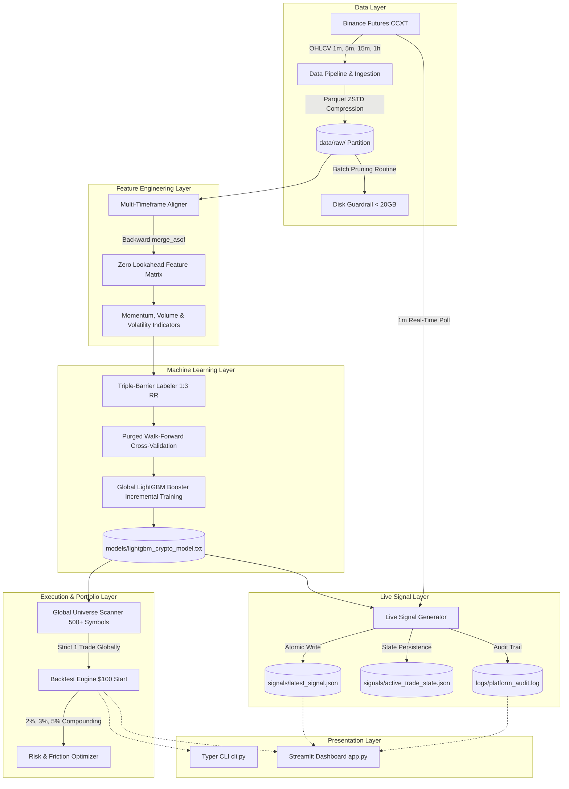
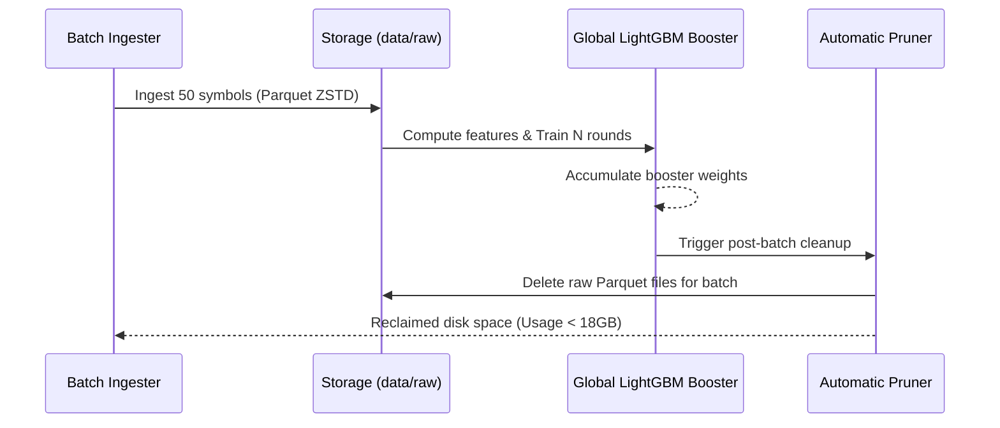

# Quantitative Architecture Manual: Binance Futures ML Research & Live Signal Platform

---

## 1. Executive Summary & Hardware Profile

This platform is a modular, high-throughput quantitative machine learning crypto research, backtesting, and live signal emission engine targeting Binance Futures USDT-Margined perpetual contracts.

### Target Hardware Environment
- **CPU:** AMD Ryzen 5 (multi-threaded parallel computation)
- **GPU:** NVIDIA GeForce RTX 3050 (inference acceleration & CUDA support)
- **RAM:** 16 GB DDR4/DDR5
- **Disk Ceiling:** **Strictly under 20 GB Total Storage** (Hard constraint enforced via Parquet ZSTD compression and rolling-batch raw data purging).

---

## 2. System Architecture & Data Flow



---

## 3. Strict Disk Constraint Enforcement (< 20GB Ceiling)

To process **500+ cryptocurrency pairs over 1 year of historical data across 4 timeframes** (`1m`, `5m`, `15m`, `1h`) without exceeding a 20GB disk budget:

1. **Compressed Apache Parquet Storage:**
   - Raw candles are written using `pyarrow` with **ZSTD level 3** compression. ZSTD achieves a 4x to 6x compression ratio over raw CSV/JSON on numerical financial time series.
   - Partitions are rigidly organized: `data/raw/{timeframe}/{symbol}.parquet`.

2. **Rolling-Batch Ingestion & Training Pipeline (`rolling_train_pipeline.py`):**
   - The 500+ symbol universe is partitioned into discrete batches (e.g., 50 symbols per batch).
   - Ingests batch data $\to$ Engineers features $\to$ Applies Triple-Barrier labels $\to$ Trains LightGBM incrementally using `keep_training_booster=True` $\to$ **Immediately purges all raw Parquet files for that batch**.
   - Storage usage is checked after every symbol and batch. If disk usage approaches 18.0 GB, lowest-volume symbols are pruned automatically.



---

## 4. Multi-Timeframe Feature Engineering & Zero Lookahead Bias

### Trend, Momentum, Volume, and Volatility Alignment
- **Momentum:**
  - Relative Strength Index (RSI 14)
  - MACD (12, 26, 9): Normalized MACD line, signal line, histogram
  - Rate of Change (ROC over 5, 10, 20 periods)
  - Multi-period returns (1, 3, 5, 10, 20 periods)
- **Volume:**
  - Volume Rate of Change (VROC 5, 14)
  - Volume Moving Average Ratio: $\frac{\text{Volume}}{\text{SMA}(\text{Volume}, 20)}$
  - Distance from 24-period Rolling VWAP: $\frac{\text{Close} - \text{VWAP}}{\text{VWAP}}$
- **Volatility & Trend:**
  - Average True Range (ATR 14) and Normalized ATR ($\text{NATR} = \frac{\text{ATR}}{\text{Close}} \times 100$)
  - Bollinger Bands (20, 2.0 std): Bandwidth $\frac{\text{Upper} - \text{Lower}}{\text{Middle}}$ and %B position $\frac{\text{Close} - \text{Lower}}{\text{Upper} - \text{Lower}}$
  - Exponential Moving Averages (EMA 20, 50, 200) and crossover differentials

### Zero Look-Ahead Bias Enforcement
A higher-timeframe bar (e.g., 15m or 1h) spanning $[T_{\text{open}}, T_{\text{close}}]$ is only finalized at $T_{\text{close}} = T_{\text{open}} + \Delta T_{\text{HTF}}$. 

When merging HTF features into execution base timeframes (1m or 5m):
- Every HTF row's available timestamp is explicitly shifted to its closure: $T_{\text{avail}} = T + \Delta T_{\text{HTF}}$.
- Aligned via pandas backward merge:
  ```python
  pd.merge_asof(
      base_df.sort_values("timestamp"),
      htf_df.sort_values("avail_timestamp"),
      left_on="timestamp",
      right_on="avail_timestamp",
      direction="backward"
  )
  ```
This ensures a 5-minute candle at 10:05 strictly sees the 1-hour candle that closed at 10:00, with **zero future data leakage**.

---

## 5. Machine Learning Pipeline & Triple-Barrier Labeling

### Dynamic ATR Triple-Barrier Method (Strict 1:3 Risk-Reward)
For each bar $i$:
- **Take-Profit Barrier:** $P_{\text{TP}} = P_{\text{close}} + (3.0 \times \text{ATR}_i)$
- **Stop-Loss Barrier:** $P_{\text{SL}} = P_{\text{close}} - (1.0 \times \text{ATR}_i)$
- **Time Horizon Barrier:** $H = 24$ bars

```
Price
  ▲
  │   [Upper Barrier: +3.0 * ATR] --------------------> Label = +1 (TP Hit)
  │                                    /──\
  │       Entry (Close) ───────>  ───/      \
  │                                           \───...-> Label = -1 (SL Hit)
  │   [Lower Barrier: -1.0 * ATR] -------------------->
  ┼───────────────────────────────────────────────────► Time (max H bars)
```

Labels are encoded as:
- **`1` (Take-Profit hit first):** Target long entry winner.
- **`-1` (Stop-Loss hit first):** Adverse movement.
- **`0` (Time expiry):** Neither barrier breached within $H$ bars.

### Purged Walk-Forward Cross-Validation
- Multi-fold temporal splits preserving chronological order.
- Embargo buffers (1% of sample size) inserted between training and test sets to eliminate trade-overlap leakage.
- Global LightGBM Classifier:
  - Multiclass objective (`num_class=3`)
  - Parameters: `num_leaves=31`, `max_depth=6`, `learning_rate=0.03`, `subsample=0.8`, `colsample_bytree=0.8`

---

## 6. Compounding Risk Sizing & Execution Engine

### $100 Starting Balance & Risk Sizing
The engine compounds equity starting from `$100.00`:
- Account Equity: $E_t$
- Risk per Trade: $R \in \{0.02, 0.03, 0.05\}$ (2%, 3%, or 5% of compounding balance)
- Dynamic Dollar Risk:
  $$\text{Dollar Risk} = E_t \times R$$
- Stop-Loss Distance:
  $$SL_{\text{dist}} = 1.0 \times \text{ATR}$$
- Position Size (Base Asset Units):
  $$\text{Position Size} = \frac{E_t \times R}{SL_{\text{dist}}}$$
- Position Notional Value:
  $$\text{Notional} = \text{Position Size} \times P_{\text{entry}}$$
- Leverage Cap: Maximum allowable notional is bounded by $\text{Notional} \le 10 \times E_t$.

### Realistic Friction Modeling
- **Binance Futures Fees:** Taker fee (0.05% = 0.0005) on entry; Maker fee (0.02% = 0.0002) on TP/SL limit exit.
- **Continuous 8-Hour Perpetual Funding Rate:**
  $$\text{Funding Cost} = \text{Notional} \times \text{FundingRate}_{8h} \times \left(\frac{\text{Duration Hours}}{8.0}\right)$$
- **Slippage:** Configurable basis points deduction (default: 1.0 bps).

---

## 7. Global Multi-Symbol Universe Scanner

### Strict Global Single-Trade Invariance
Unlike isolated single-pair backtests, the `GlobalUniverseScanner` simulates simultaneous universe monitoring across 500+ coins:
1. At each timestamp $t$, if an active position is open globally, incoming candle High and Low are evaluated against TP and SL.
2. While a position is active, **all signals across all other 500+ symbols are locked and ignored**.
3. If no position is open, the scanner evaluates model confidence scores ($P(\text{TP})$) across all symbols at timestamp $t$.
4. The symbol with the highest confidence score meeting the threshold ($P(\text{TP}) \ge \text{threshold}$) is selected for the next trade.

---

## 8. Decoupled Live Signal Generator & JSON Contract

### Real-Time Ingestion
- Polls 24h market snapshots and candle feeds via CCXT Binance Futures API.
- Evaluates active position state in [`signals/active_trade_state.json`](file:///home/sankar/Desktop/bot/signals/active_trade_state.json).
- If no trade is open, evaluates universe candidate symbols concurrently using a thread pool.

### Atomic JSON Signal Contract (`signals/latest_signal.json`)
Signals are written using an atomic write pattern (writing to `.tmp` then performing an atomic `os.replace`), guaranteeing that any consumer process or automated trading bot reads complete, uncorrupted JSON payloads:

```json
{
  "timestamp": "2026-10-18T02:15:55Z",
  "symbol": "XRP/USDT:USDT",
  "direction": "LONG",
  "confidence": 0.4303,
  "entry_price": 1.2947,
  "stop_loss": 1.2922,
  "take_profit": 1.3022,
  "risk_pct": 3.0,
  "suggested_position_size": 749.4786,
  "status": "SIGNAL_GENERATED"
}
```

### Audit Trail (`logs/platform_audit.log`)
Structured JSON Lines recording every system event:
```json
{"timestamp": "2026-10-18T02:15:50.968123+00:00", "event_type": "TRADE_CLOSED", "message": "Position closed on BTC/USDT:USDT: STOP_LOSS", "data": {"symbol": "BTC/USDT:USDT", "exit_reason": "STOP_LOSS", "exit_price": 191511.4309, "realized_pnl": -3.00, "new_equity": 97.00}}
{"timestamp": "2026-10-18T02:15:55.808451+00:00", "event_type": "SIGNAL_EMITTED", "message": "High-conviction signal emitted for XRP/USDT:USDT", "data": {"timestamp": "2026-10-18T02:15:55Z", "symbol": "XRP/USDT:USDT", "direction": "LONG", "confidence": 0.4303, "entry_price": 1.2947, "stop_loss": 1.2922, "take_profit": 1.3022, "risk_pct": 3.0, "suggested_position_size": 749.4786, "status": "SIGNAL_GENERATED"}}
```

---

## 9. CLI Command Reference & Streamlit Guide

### CLI Commands (`cli.py`)
```bash
# 1. Rolling-Batch Training (< 20GB Disk Enforcement)
python cli.py rolling-train --batch-size 50 --months 12

# 2. Risk Sizing & Compounding Optimizer ($100 Starting Balance)
python cli.py optimize-risk --symbol BTC/USDT:USDT --risks "0.02,0.03,0.05" --capital 100.0

# 3. Dynamic Backtest on Any Custom Symbol and Risk
python cli.py backtest --symbol SOL/USDT:USDT --risk 0.03 --threshold 0.35

# 4. Global Multi-Symbol Universe Scanner (Strict 1-Trade Globally)
python cli.py global-backtest --threshold 0.30 --risk 0.03 --capital 100.0

# 5. Live Real-Time Universe Signal Scanner (Single or Daemon)
python cli.py live-scan --threshold 0.35
python cli.py live-scan --daemon --poll-interval 10 --threshold 0.35

# 6. Disk Usage & Platform Status Meter
python cli.py status

# 7. Disk Pruning Utility
python cli.py prune-data --max-storage-gb 18.0
```

### Streamlit Quantitative Dashboard (`app.py`)
Launch with:
```bash
streamlit run app.py
```
- **Live Disk Guardrail Bar:** Visual real-time indicator tracking disk utilization against the 20GB limit.
- **Tab 1 (Risk Sizing Optimizer):** Side-by-side comparison of 2%, 3%, and 5% account risk compounding from $100.
- **Tab 2 (Global Universe Scanner):** Simultaneous 500+ symbol backtest with global equity curve and asset breakdown.
- **Tab 3 (Decoupled Live Signals & Audit):** Formatted live signal card, active trade status, one-click scan button, and streaming audit log.
- **Tab 4 (Single Symbol Drilldown):** Detailed feature analysis and LightGBM feature importance bar chart.
