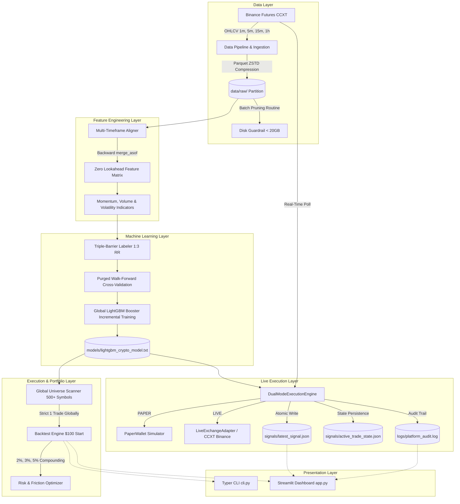
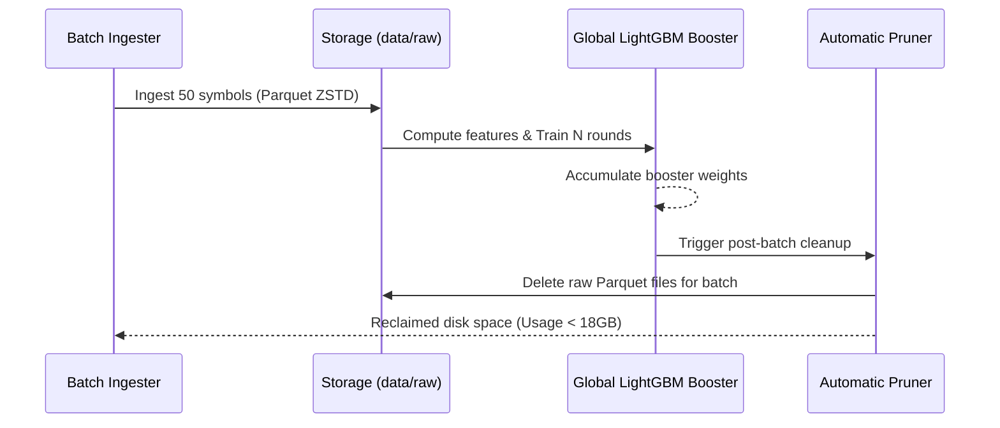
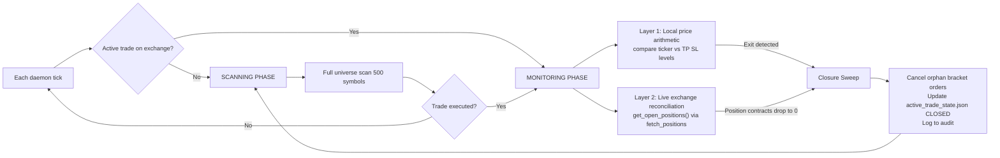
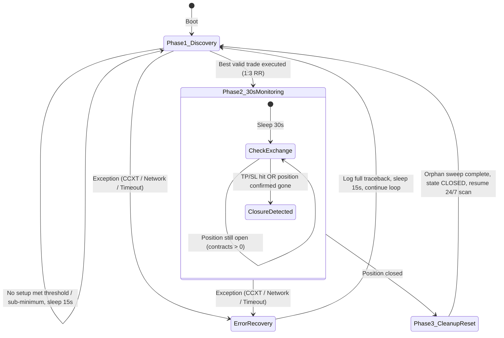

# Quantitative Architecture Manual: Binance Futures ML Research & Live Signal Platform

---

## 1. Executive Summary & Hardware Profile

This platform is a modular, high-throughput quantitative machine learning crypto research, backtesting, and live signal emission engine targeting Binance Futures USDT-Margined perpetual contracts.

### Target Hardware Environment
- **CPU:** AMD Ryzen 5 (multi-threaded parallel computation)
- **GPU:** NVIDIA GeForce RTX 3050 (inference acceleration & CUDA support)
- **RAM:** 16 GB DDR4/DDR5
- **Disk Ceiling:** **Strictly under 20 GB Total Storage** (Hard constraint enforced via Parquet ZSTD compression and rolling-batch raw data purging).

---

## 2. System Architecture & Data Flow



---

## 3. Strict Disk Constraint Enforcement (< 20GB Ceiling)

To process **500+ cryptocurrency pairs over 1 year of historical data across 4 timeframes** (`1m`, `5m`, `15m`, `1h`) without exceeding a 20GB disk budget:

1. **Compressed Apache Parquet Storage:**
   - Raw candles are written using `pyarrow` with **ZSTD level 3** compression. ZSTD achieves a 4x to 6x compression ratio over raw CSV/JSON on numerical financial time series.
   - Partitions are rigidly organized: `data/raw/{timeframe}/{symbol}.parquet`.

2. **Rolling-Batch Ingestion & Training Pipeline (`rolling_train_pipeline.py`):**
   - The 500+ symbol universe is partitioned into discrete batches (e.g., 50 symbols per batch).
   - Ingests batch data → Engineers features → Applies Triple-Barrier labels → Trains LightGBM incrementally using `keep_training_booster=True` → **Immediately purges all raw Parquet files for that batch**.
   - Storage usage is checked after every symbol and batch. If disk usage approaches 18.0 GB, lowest-volume symbols are pruned automatically.



---

## 4. Multi-Timeframe Feature Engineering & Zero Lookahead Bias

### Trend, Momentum, Volume, and Volatility Alignment
- **Momentum:**
  - Relative Strength Index (RSI 14)
  - MACD (12, 26, 9): Normalized MACD line, signal line, histogram
  - Rate of Change (ROC over 5, 10, 20 periods)
  - Multi-period returns (1, 3, 5, 10, 20 periods)
- **Volume:**
  - Volume Rate of Change (VROC 5, 14)
  - Volume Moving Average Ratio: $\frac{\text{Volume}}{\text{SMA}(\text{Volume}, 20)}$
  - Distance from 24-period Rolling VWAP: $\frac{\text{Close} - \text{VWAP}}{\text{VWAP}}$
- **Volatility & Trend:**
  - Average True Range (ATR 14) and Normalized ATR ($\text{NATR} = \frac{\text{ATR}}{\text{Close}} \times 100$)
  - Bollinger Bands (20, 2.0 std): Bandwidth $\frac{\text{Upper} - \text{Lower}}{\text{Middle}}$ and %B position $\frac{\text{Close} - \text{Lower}}{\text{Upper} - \text{Lower}}$
  - Exponential Moving Averages (EMA 20, 50, 200) and crossover differentials
- **Trend-Following Momentum & Alignment (v2 Features):**
  - **Average Directional Index (ADX 14):** Wilder's smoothed ADX, +DI, -DI, DI spread (+DI - -DI), and boolean `adx_trend_strong` ($\text{ADX} \ge 25$) to identify high-momentum trends.
  - **EMA Slope Dynamics:** Multi-bar percentage slopes over 3-bar and 5-bar windows for EMA 20, EMA 50, and EMA 200, capturing acceleration and velocity.
  - **EMA Structural Alignment:** Boolean flags `ema_alignment_bullish` ($\text{EMA}_{20} > \text{EMA}_{50} > \text{EMA}_{200}$) and `ema_alignment_bearish` ($\text{EMA}_{20} < \text{EMA}_{50} < \text{EMA}_{200}$) indicating verified directional regime.
  - **MACD Histogram Momentum Continuation:** Histogram slope ($\Delta \text{Hist} = \text{Hist}_t - \text{Hist}_{t-1}$) and continuation flags (`macd_bullish_continuation`, `macd_bearish_continuation`) preventing premature mean-reversion counter-trend entries.

### Zero Look-Ahead Bias Enforcement
A higher-timeframe bar (e.g., 15m or 1h) spanning $[T_{\text{open}}, T_{\text{close}}]$ is only finalized at $T_{\text{close}} = T_{\text{open}} + \Delta T_{\text{HTF}}$.

When merging HTF features into execution base timeframes (1m or 5m):
- Every HTF row's available timestamp is explicitly shifted to its closure: $T_{\text{avail}} = T + \Delta T_{\text{HTF}}$.
- Aligned via pandas backward merge:
  ```python
  pd.merge_asof(
      base_df.sort_values("timestamp"),
      htf_df.sort_values("avail_timestamp"),
      left_on="timestamp",
      right_on="avail_timestamp",
      direction="backward"
  )
  ```
This ensures a 5-minute candle at 10:05 strictly sees the 1-hour candle that closed at 10:00, with **zero future data leakage**.

---

## 5. Machine Learning Pipeline & Triple-Barrier Labeling

### Symmetric Directional Triple-Barrier Method (Strict 1:3 Risk-Reward)
To eliminate short-only mean-reversion distortion, the labeling engine supports **symmetric directional evaluation** (`symmetric_directional=True`):
For each bar $i$:
- **Long Breakout Evaluation:**
  - Take-Profit: $P_{\text{Long TP}} = P_{\text{close}} + (3.0 \times \text{ATR}_i)$
  - Stop-Loss: $P_{\text{Long SL}} = P_{\text{close}} - (1.0 \times \text{ATR}_i)$
  - Validated if price hits $+3.0 \times \text{ATR}$ before falling $-1.0 \times \text{ATR}$.
- **Short Breakdown Evaluation:**
  - Take-Profit: $P_{\text{Short TP}} = P_{\text{close}} - (3.0 \times \text{ATR}_i)$
  - Stop-Loss: $P_{\text{Short SL}} = P_{\text{close}} + (1.0 \times \text{ATR}_i)$
  - Validated if price drops $-3.0 \times \text{ATR}$ before rising $+1.0 \times \text{ATR}$.
- **Time Horizon Barrier:** $H = 24$ bars.

```
Long Breakout (+1):
Price ▲
      │   [Long TP: +3.0 * ATR] -------------------> Label = +1 (Long Winner)
      │                                    /──\
      │       Entry (Close) ─────────> ───/      \
      │   [Long SL: -1.0 * ATR] -------------------> Exit (Loss if breached first)

Short Breakdown (-1):
Price ▲
      │   [Short SL: +1.0 * ATR] ------------------> Exit (Loss if breached first)
      │       Entry (Close) ─────────> ───\      /
      │                                    \──/
      │   [Short TP: -3.0 * ATR] ------------------> Label = -1 (Short Winner)
```

Labels are encoded as:
- **`1` (Long Winner):** Clean $+3.0 \times \text{ATR}$ expansion without adverse $-1.0 \times \text{ATR}$ drawdown.
- **`-1` (Short Winner):** Clean $-3.0 \times \text{ATR}$ breakdown without adverse $+1.0 \times \text{ATR}$ runup.
- **`0` (Neutral / Chop):** Neither $3:1$ target reached within holding window $H$.

### Multi-Model Versioning Architecture (`v1` vs `v2`)
The platform supports side-by-side versioned model checkpoints:
- **`v1` (Baseline):** Trained on 75 original multi-timeframe momentum, volume, and volatility indicators.
  - Weights: `models/lightgbm_crypto_model_v1.txt` (and backward-compatible `models/lightgbm_crypto_model.txt`)
  - Schema: `models/lightgbm_crypto_model_v1_metadata.json`
- **`v2` (Trend-Following):** Trained on 111 features incorporating ADX, multi-period EMA slopes, and MACD continuation indicators, paired with symmetric directional triple-barrier labeling.
  - Weights: `models/lightgbm_crypto_model_v2.txt`
  - Schema: `models/lightgbm_crypto_model_v2_metadata.json`
- **Switching:** Controlled via CLI `--model v1` / `--model v2` and Streamlit sidebar radio toggle.

### Purged Walk-Forward Cross-Validation
- Multi-fold temporal splits preserving chronological order.
- Embargo buffers (1% of sample size) inserted between training and test sets to eliminate trade-overlap leakage.
- Global LightGBM Classifier:
  - Multiclass objective (`num_class=3`)
  - Parameters: `num_leaves=31`, `max_depth=6`, `learning_rate=0.03`, `subsample=0.8`, `colsample_bytree=0.8`

---

## 6. Compounding Risk Sizing & Execution Engine

### $100 Starting Balance & Risk Sizing
The engine compounds equity starting from `$100.00`:
- Account Equity: $E_t$
- Risk per Trade: $R \in \{0.02, 0.03, 0.05\}$ (2%, 3%, or 5% of compounding balance)
- Dynamic Dollar Risk:
  $$\text{Dollar Risk} = E_t \times R$$
- Stop-Loss Distance:
  $$SL_{\text{dist}} = 1.0 \times \text{ATR}$$
- Position Size (Base Asset Units):
  $$\text{Position Size} = \frac{E_t \times R}{SL_{\text{dist}}}$$
- Position Notional Value:
  $$\text{Notional} = \text{Position Size} \times P_{\text{entry}}$$
- Leverage Cap: Maximum allowable notional is bounded by $\text{Notional} \le \text{MaxLeverage} \times E_t$.

### Realistic Friction Modeling
- **Binance Futures Fees:** Taker fee (0.05% = 0.0005) on entry; Maker fee (0.02% = 0.0002) on TP/SL limit exit.
- **Continuous 8-Hour Perpetual Funding Rate:**
  $$\text{Funding Cost} = \text{Notional} \times \text{FundingRate}_{8h} \times \left(\frac{\text{Duration Hours}}{8.0}\right)$$
- **Slippage:** Configurable basis points deduction (default: 1.0 bps).

---

## 7. Global Multi-Symbol Universe Scanner

### Strict Global Single-Trade Invariance
Unlike isolated single-pair backtests, the `GlobalUniverseScanner` simulates simultaneous universe monitoring across 500+ coins:
1. At each timestamp $t$, if an active position is open globally, incoming candle High and Low are evaluated against TP and SL.
2. While a position is active, **all signals across all other 500+ symbols are locked and ignored**.
3. If no position is open, the scanner evaluates model confidence scores ($P(\text{TP})$) across all symbols at timestamp $t$.
4. The symbol with the highest confidence score meeting the threshold ($P(\text{TP}) \ge \text{threshold}$) is selected for the next trade.

---

## 8. Dual-Mode Execution Engine (`execution.py`)

The `DualModeExecutionEngine` supports both **PAPER** (local simulation) and **LIVE** (real Binance Futures via CCXT) execution in a unified interface.

### Credential Management & Graceful Fallback
- API keys are loaded from `.env` via `python-dotenv` (`BINANCE_API_KEY`, `BINANCE_API_SECRET`).
- On startup in LIVE mode, credentials are validated. If missing, empty, or dummy placeholders are detected:
  - Logs: `[WARN] Valid live credentials not found. Falling back to PAPER mode.`
  - Execution continues in PAPER mode; no crash.
- `.env` is in `.gitignore`. `.env.example` is tracked as a safe template.

### Dynamic Exchange Limit Validation & Sub-Minimum Trade Skipping
- For every candidate, `get_symbol_limits(symbol)` queries Binance market metadata for `minNotional`, `minQty`, `stepSize`, `tickSize`.
- If 5% equity risk sizing produces a notional below `minNotional` or a size below `minQty`:
  - **No crash** — the candidate is logged and skipped:
    ```
    [SKIPPED_MIN_NOTIONAL] Symbol XYZ position size $A below exchange minNotional $B. Evaluating next top setup.
    ```
  - The engine immediately evaluates the **next highest-ML-confidence candidate** in the ranked queue.

### Pure ML Probability Global Ranking
Candidates from the universe scan are ranked **strictly by raw LightGBM `confidence` score descending** with no hardcoded symbol bias. The leaderboard is exposed via `engine.latest_scan_leaderboard`.

### Binance `fetchOpenOrders` Warning Suppression
`LiveExchangeAdapter` sets:
```python
self.exchange.options["fetchOpenOrders"] = {"warnWithoutSymbol": False}
```
This suppresses the CCXT rate-limit advisory emitted when `fetch_open_orders()` is called without a symbol. We call it intentionally during the global orphan sweep to scan all open orders across the account.

### Exchange-First Ground Truth Architecture (`get_active_trade` & `startup_sweep`)

The Binance Futures API (`exchange.fetch_positions()`) is the **absolute, authoritative ground truth** for active trade verification:

1. **Elimination of Phantom Trades:**
   - In LIVE mode, the engine never relies blindly on `active_trade_state.json`.
   - On startup and at the beginning of every daemon loop iteration, `get_active_trade()` queries `self.live_adapter.get_open_positions()`.
   - **Case A: Zero Active Positions on Binance (`len(open_positions) == 0`):**
     - Even if `active_trade_state.json` contains a stale or mock entry (e.g., phantom symbols like `GOOGL/USDT:USDT` or `HOME/USDT:USDT`), the engine detects that the real Binance account is clean.
     - Immediately purges phantom state, overwrites `active_trade_state.json` with `{"status": "CLOSED"}`, and calls `sweep_all_orphan_orders()` to cancel lingering bracket orders on Binance.
     - Logs: `[EXCHANGE_SYNC] Zero open positions found on Binance. Purging phantom/stale local trade 'XYZ' and resetting state to CLOSED.`
     - Returns `None`, immediately unblocking Phase 1 Universal Scanning.
   - **Case B: Active Position Exists on Binance (`len(open_positions) > 0`):**
     - Extracts the real exchange position (symbol, direction, contracts/size, entry price, leverage).
     - Overwrites any mismatched local state, synchronizes `active_trade_state.json` with the real symbol (e.g., `JTO/USDT:USDT`), preserves valid bracket levels if symbol matches or sets standard brackets.
     - Locks scanning and routes straight to Phase 2 monitoring for that specific real symbol.
2. **Paper Mode Ground Truth:**
   - In PAPER mode, `self.paper_wallet.active_position` is the single source of truth. If `None`, `active_trade_state.json` is set to `CLOSED`.

### Two-Layer Trade Exit Detection (`check_and_process_exit`)



**Layer 1 — Local price arithmetic:** Compares current ticker price against stored `stop_loss` and `take_profit` levels.

**Layer 2 — Live exchange reconciliation (LIVE mode only):** Calls `LiveExchangeAdapter.verify_position_closed_on_exchange(symbol)` which queries `get_open_positions()` (`fetch_positions()`). If Binance reports zero contracts / zero notional for the symbol, the position is confirmed closed — even if the local ticker price hasn't crossed the arithmetic barrier yet (e.g., a limit bracket order filled at a gap).

This ensures the active-trade lock is **always released promptly**, preventing the daemon from being stuck waiting on a stale `active_trade_state.json` entry.

---

## 9. Bulletproof 24/7 Autonomous Daemon (`run_loop`)



### Three-Phase Autonomous Lifecycle
1. **Phase 1: Discovery & Execution (Every 15s)**
   - Checks `active_trade_state.json` and Binance exchange state.
   - If no active position:
     - Scans 500+ symbols concurrently via `ThreadPoolExecutor`.
     - Pure ML model probabilities sorted descending without hardcoded symbol bias.
     - Validates against Binance dynamic exchange limits (`minNotional`, `minQty`).
     - Sub-minimum setups logged as `[SKIPPED_MIN_NOTIONAL]` and skipped to next best setup.
     - Selects single highest-conviction setup, configures isolated margin (handling code `-4168` gracefully) and max leverage, executes entry, and places 1:3 RR bracket orders with `reduceOnly=True`.
2. **Phase 2: 30-Second Active Trade Monitoring Sub-Loop (`while active`)**
   - Once a trade is open, enters a dedicated monitoring sub-loop.
   - Sleeps for **30 seconds** (`time.sleep(30)`), then polls both local ticker price and Binance `fetch_positions()`.
   - Reconciles bracket fills executed directly on the exchange.
   - If a network error occurs, catches it, logs to audit trail, sleeps 15s, and **continues monitoring without terminating**.
3. **Phase 3: Completion, Cleanup & Reset**
   - The exact moment position closure is detected:
     - Immediate **Aggressive Bracket Order Cleanup & Closure Sweep**:
       - Executes `cancel_all_orders_for_symbol(symbol)` using a multi-pass loop (up to 5 passes).
       - In each pass, issues bulk `cancel_all_orders(symbol)` and verifies lingering orders via `fetch_open_orders(symbol)`.
       - If any lingering orders are detected, loops over each order ID and calls `cancel_order(order_id, symbol)` individually.
       - Pauses 0.5s between passes for Binance matching engine propagation.
       - Guarantees `fetch_open_orders(symbol) == []` before exiting.
       - Follows up with `sweep_all_orphan_orders()` across all positionless symbols on the account.
     - Updates `active_trade_state.json` status to `CLOSED`.
     - Appends full trade summary and PnL to `logs/platform_audit.log`.
     - Breaks monitoring sub-loop and **immediately returns to Phase 1 Discovery** to scan 24/7.

### Startup and Shutdown Sweeps
- **Startup Sweep:** Before entering discovery or monitoring, `engine.startup_sweep()` inspects all open orders on Binance. Any order residing on a symbol with zero active position contracts is aggressively swept and cancelled.
- **Shutdown Sweep:** Intercepts `KeyboardInterrupt` (Ctrl+C) or normal loop termination, invoking `engine.shutdown_sweep()` to purge any orphan bracket orders left on the account before stopping the process.

### Unbreakable Error Resilience
- **Outer `while True` loop** envelops all phases in comprehensive `try...except Exception as e:` blocks.
- Any network dropout, rate limit, or unexpected exception is caught, formatted with `traceback.format_exc()`, appended to `logs/platform_audit.log`, followed by a 15-second recovery delay before auto-continuing the loop.
- **Automatic CCXT Retries:** Transient disconnects retry up to 3 times with exponential backoff (`retry_ccxt_call`).
- **Binance Code -4168:** If the user's account is in Multi-Assets mode, Binance prohibits switching to isolated margin; the engine logs an informational warning and proceeds with account default margin without crashing.

### 24/7 Running Command
```bash
python cli.py execute --mode live --daemon --poll-interval 15 --monitor-interval 30 --threshold 0.35 --risk 0.05
```

Stop cleanly with **Ctrl+C**.

---

## 10. Decoupled Live Signal Generator & JSON Contract

### Real-Time Ingestion
- Polls 24h market snapshots and candle feeds via CCXT Binance Futures API.
- Evaluates active position state in [`signals/active_trade_state.json`](../signals/active_trade_state.json).
- If no trade is open, evaluates universe candidate symbols concurrently using a thread pool.

### Atomic JSON Signal Contract (`signals/latest_signal.json`)
Signals are written using an atomic write pattern (writing to `.tmp` then performing an atomic `os.replace`), guaranteeing that any consumer process or automated trading bot reads complete, uncorrupted JSON payloads:

```json
{
  "timestamp": "2026-10-18T07:45:00Z",
  "symbol": "SOL/USDT:USDT",
  "direction": "LONG",
  "confidence": 0.84,
  "entry_price": 142.50,
  "stop_loss": 139.20,
  "take_profit": 152.40,
  "risk_pct": 5.0,
  "dollar_risk": 5.00,
  "leverage": 20,
  "suggested_position_size": 2.15,
  "mode": "LIVE",
  "status": "SIGNAL_GENERATED"
}
```

### Audit Trail (`logs/platform_audit.log`)
Structured JSON Lines recording every system event:
```json
{"timestamp": "2026-10-18T07:45:00Z", "event_type": "DAEMON_TRADE_OPENED", "message": "Daemon opened LONG on SOL/USDT:USDT (ML conf: 84.0%). Entering monitoring phase.", "data": {...}}
{"timestamp": "2026-10-18T08:20:00Z", "event_type": "DAEMON_TRADE_CLOSED", "message": "Daemon detected closure of SOL/USDT:USDT (LONG) via TAKE_PROFIT. Resuming universe scan. Current equity: $105.00", "data": {...}}
{"timestamp": "2026-10-18T08:20:00Z", "event_type": "SKIPPED_MIN_NOTIONAL", "message": "Symbol SHIB/USDT:USDT position size $0.30 below exchange minNotional $5.00. Evaluating next top setup.", "data": {...}}
```

---

## 11. CLI Command Reference & Streamlit Guide

### CLI Commands (`cli.py`)
```bash
# 1. Rolling-Batch Training (< 20GB Disk Enforcement)
python cli.py rolling-train --batch-size 50 --months 12

# 2. Risk Sizing & Compounding Optimizer ($100 Starting Balance)
python cli.py optimize-risk --symbol BTC/USDT:USDT --risks "0.02,0.03,0.05" --capital 100.0

# 3. Dynamic Backtest on Any Custom Symbol and Risk
python cli.py backtest --symbol SOL/USDT:USDT --risk 0.03 --threshold 0.35

# 4. Global Multi-Symbol Universe Scanner (Strict 1-Trade Globally)
python cli.py global-backtest --threshold 0.30 --risk 0.03 --capital 100.0

# 5. Live Real-Time Universe Signal Scanner (Single or Daemon)
python cli.py live-scan --threshold 0.35
python cli.py live-scan --daemon --poll-interval 10 --threshold 0.35

# 6. Execution Engine — Single cycle (PAPER or LIVE)
python cli.py execute --mode paper --threshold 0.35 --risk 0.05
python cli.py execute --mode live  --threshold 0.35 --risk 0.05

# 7. Execution Engine — 24/7 daemon (LIVE, polling every 15 seconds)
python cli.py execute --mode live --daemon --poll-interval 15 --threshold 0.35 --risk 0.05

# 8. Disk Usage & Platform Status Meter
python cli.py status

# 9. Disk Pruning Utility
python cli.py prune-data --max-storage-gb 18.0

# 10. Live Bracket Order Cleanup Verification Protocol
python cli.py test-cleanup --symbol BTC/USDT:USDT
```

### Streamlit Quantitative Dashboard (`app.py`)
Launch with:
```bash
streamlit run app.py
```
- **Live Disk Guardrail Bar:** Visual real-time indicator tracking disk utilization against the 20GB limit.
- **Tab 1 (Risk Sizing Optimizer):** Side-by-side comparison of 2%, 3%, and 5% account risk compounding from $100.
- **Tab 2 (Global Universe Scanner):** Simultaneous 500+ symbol backtest with global equity curve and asset breakdown.
- **Tab 3 (Decoupled Live Signals & Audit):** Formatted live signal card, active trade status, one-click scan button, and streaming audit log.
- **Tab 4 (Execution):** Mode selection (PAPER/LIVE), real-time progress bar during scanning, candidate ranking leaderboard table, orphan sweep button.
- **Tab 5 (Single Symbol Drilldown):** Detailed feature analysis and LightGBM feature importance bar chart.

---

## 12. Automated Test Suite

Run all 27 tests:
```bash
python -m unittest tests/test_platform.py -v
```

| # | Test Name | What It Verifies |
|---|---|---|
| 1 | `test_01_synthetic_and_ccxt_data_pipeline` | Storage tracking, ZSTD Parquet compression |
| 2 | `test_02_feature_engineering_integrity` | Momentum, volume, volatility indicator formulas |
| 3 | `test_03_timeframe_alignment_and_asof_merge` | Backward `merge_asof` with zero lookahead bias |
| 4 | `test_04_triple_barrier_labeling_and_class_distribution` | Dynamic ATR 1:3 RR barriers |
| 5 | `test_05_purged_group_time_series_cv_and_lightgbm` | Purged Walk-Forward CV |
| 6 | `test_06_compounding_risk_optimizer` | Compounding equity from $100 at 2%, 3%, 5% |
| 7 | `test_07_global_universe_scanner_single_trade_invariance` | Strict 1-trade global invariance |
| 8 | `test_08_rolling_batch_training_and_disk_purging` | Incremental LightGBM + raw Parquet purging |
| 9 | `test_09_live_signals_emission_and_audit` | JSON signal structure + audit trail |
| 10 | `test_10_cli_commands` | Typer CLI commands |
| 11 | `test_11_execution_engine_paper_mode_and_orphan_cleanup` | PaperWallet lifecycle + orphan sweep |
| 12 | `test_12_precise_5pct_risk_sizing_and_leverage` | Exact 5% risk against account equity |
| 13 | `test_13_feature_importance_booster_interface` | Booster interface without `NotFittedError` |
| 14 | `test_14_credential_validation_and_graceful_fallback` | Graceful PAPER fallback on bad keys |
| 15 | `test_15_dynamic_limits_and_sub_minimum_skipping` | `SKIPPED_MIN_NOTIONAL` + fallback to next candidate |
| 16 | `test_16_pure_ml_probability_ranking_and_progress_callback` | Strict confidence sort + progress callback |
| 17 | `test_17_daemon_run_loop_scanning_and_monitoring_phases` | SCANNING ↔ MONITORING phase transitions + closure resume |
| 18 | `test_18_fetch_open_orders_warning_suppressed` | `fetchOpenOrders.warnWithoutSymbol = False` on adapter |
| 19 | `test_19_daemon_unbreakable_error_resilience` | Network errors caught with traceback, 15s backoff, loop continues |
| 20 | `test_20_binance_code_4168_multi_assets_margin_graceful_handling` | Code -4168 Multi-Assets error handled without raising |
| 21 | `test_21_dedicated_30s_monitoring_sub_loop_and_closure_sweep` | Dedicated 30s monitoring sub-loop, closure sweep & immediate reset |
| 22 | `test_22_exchange_first_ground_truth_eliminates_phantom_state` | Purges phantom local trades when Binance reports 0 open positions |
| 23 | `test_23_exchange_active_position_detected_and_synchronized` | Synchronizes active trade state with real Binance open positions |
| 24 | `test_24_live_phase2_exit_when_exchange_position_closes` | Detects exchange position closure in Phase 2 and triggers immediate sweep |
| 25 | `test_25_cancel_all_orders_for_symbol_verification_loop` | Multi-pass aggressive bulk and individual force-cancellation loop until 0 orders remain |
| 26 | `test_26_shutdown_sweep_cleans_orphans_on_exit` | Shutdown sweep clears all orphan orders across account on exit |
| 27 | `test_27_verify_orphan_cleanup_test_harness_mock` | Bracket cleanup verification test harness protocol (entry, brackets, close, verify 0 remain) |
