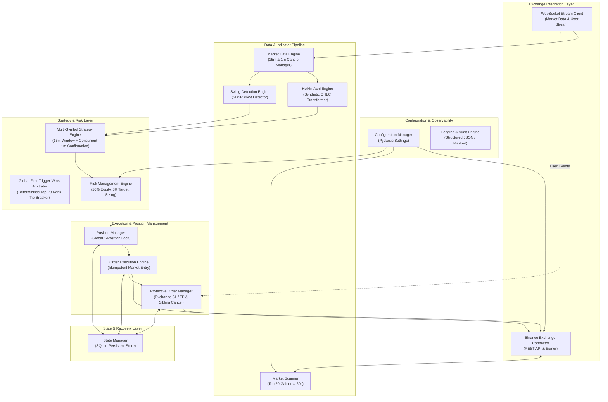
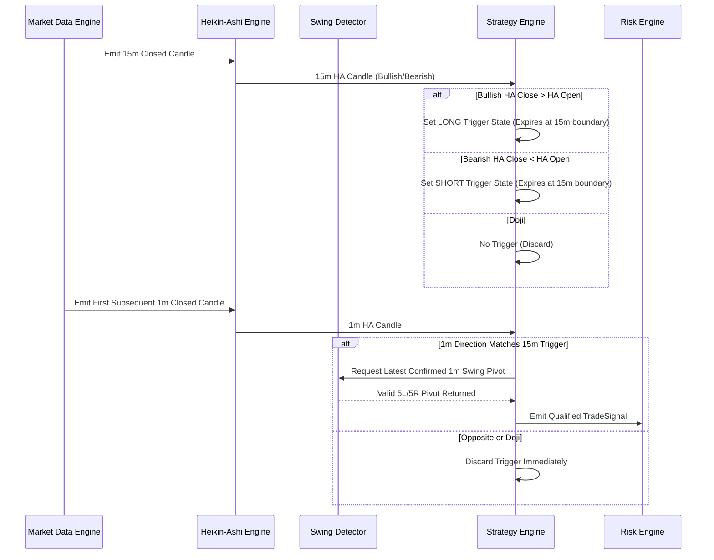
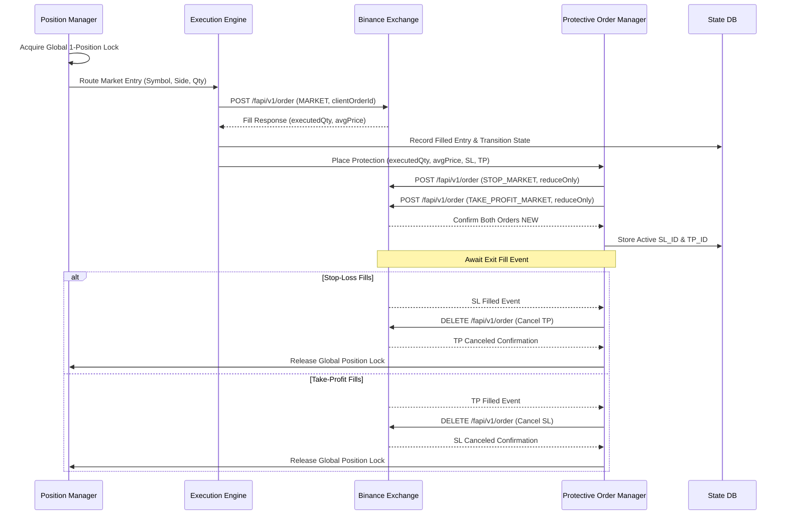

# Binance Futures HA Trading Bot — System Architecture

**Document Version:** 1.0.0  
**Phase:** P01 — Master Project Brief, Architecture & Foundation  
**Status:** Approved Foundation  

---

## 1. High-Level Architectural Overview

The system is designed as an asynchronous, event-driven, decoupled micro-layered architecture in Python 3.14+. Each domain module encapsulates distinct responsibilities and exposes clear, typed interfaces with strict separation between market data acquisition, mathematical indicator calculations, risk assessment, order execution, and persistent state management.



---

## 2. Component Directory & Module Breakdown

The system is partitioned into the following modules under `src/`:

```
src/
├── config/             # Environment, validation, trading parameters
│   ├── __init__.py
│   └── settings.py     # Pydantic BaseSettings models with credential masking
├── exchange/           # Binance USDⓈ-M Futures REST & WS client
│   ├── __init__.py
│   ├── client.py       # Async HTTP client, authentication, signing, retry logic
│   ├── endpoints.py    # Binance Futures REST endpoint definitions
│   ├── models.py       # Exchange DTOs (Account, Balance, Order, Bracket)
│   └── rate_limiter.py # Client-side token bucket rate limiter
├── scanner/            # Top 20 24h gainers ranking & filtering
│   ├── __init__.py
│   ├── scanner.py      # Universe selection and 60s periodic scheduler
│   └── filters.py      # Volume, status, and perpetual filter logic
├── market_data/        # Kline streaming, validation & history buffer
│   ├── __init__.py
│   ├── candle_buffer.py# Ring buffer / chronological candle storage
│   ├── feeds.py        # Kline stream handler (1m, 15m)
│   └── types.py        # Candle data classes and validation schemas
├── indicators/         # Mathematical indicator modules
│   ├── __init__.py
│   ├── heikin_ashi.py  # Pure mathematical HA candle calculator
│   └── swing_points.py # Pure 5-left/5-right pivot high/low detector
├── strategy/           # Multi-timeframe strategy state machine
│   ├── __init__.py
│   ├── engine.py       # 15m trigger -> 1m confirmation coordinator
│   └── signals.py      # Signal generation, validation, and payload DTOs
├── risk/               # Sizing, leverage brackets, balance checks
│   ├── __init__.py
│   ├── calculator.py   # 10% risk budget, stop distance, fee/slippage sizing
│   ├── brackets.py     # Binance leverage bracket parsing & max leverage selection
│   └── validator.py    # Exchange lot size, minNotional, and precision filters
├── execution/          # Order placement, client order IDs, fills
│   ├── __init__.py
│   ├── order_router.py # Market order submission, idempotency check, fills
│   └── client_id.py    # Unique deterministic client order ID generator
├── positions/          # Position tracking, global lock, protective SL/TP
│   ├── __init__.py
│   ├── manager.py      # Global 1-position lock, position lifecycle
│   └── protective.py   # SL / TP order submission, monitoring, sibling cancel
├── state/              # Persistent SQLite storage and startup reconciliation
│   ├── __init__.py
│   ├── database.py     # SQLite connection, migrations, and atomic transactions
│   ├── repository.py   # CRUD for positions, orders, signals, and audits
│   └── reconciler.py   # Startup reconciliation against exchange state
├── backtesting/        # Chronological replay & backtest adapters (Amendment 01)
│   ├── __init__.py
│   ├── clock.py        # Deterministic simulated UTC clock & event priority queue
│   ├── data_adapter.py # Historical OHLCV store, quality checks & rolling 24h ticker reconstructor
│   ├── exec_adapter.py # Conservative simulated fill, slippage, fee, funding & SL/TP engine
│   ├── ledger.py       # Chronological equity accounting & isolated margin tracker
│   ├── metrics.py      # Market, strategy, performance, risk, cost & equity report builder
│   └── runner.py       # Forward-walking replay loop sharing live Scanner/Strategy/Risk/PM core
└── monitoring/         # Logging, telemetry, and secret protection
    ├── __init__.py
    ├── logger.py       # Structured logging with secret redaction
    └── metrics.py      # Basic runtime counters and health status
```

---

## 3. Core Module Responsibilities & Interfaces

### 3.1 Configuration Manager (`src/config/settings.py`)
- **Responsibilities:**
  - Loads and validates environment variables from `.env` or system environment.
  - Enforces strict data types, ranges, and defaults via Pydantic.
  - Protects sensitive credentials (`BINANCE_API_KEY`, `BINANCE_API_SECRET`) from being printed in `__repr__` or logs.
  - Controls operational modes (`testnet` vs `production`).

### 3.2 Binance Exchange Connector (`src/exchange/`)
- **Responsibilities:**
  - Implements asynchronous HMAC-SHA256 request signing using Unix timestamp and millisecond offset.
  - Enforces server time synchronization via `/fapi/v1/time`.
  - Implements exponential backoff retry logic for transient network failures (HTTP 5xx, connection drops).
  - Handles rate-limit headers (`X-MBX-USED-WEIGHT-*`) and reacts to HTTP 429 before IP ban occurs.
  - Strictly operates against Testnet endpoints during development.

### 3.3 Market Scanner (`src/scanner/`)
- **Responsibilities:**
  - Fetches 24-hour ticker statistics (`/fapi/v1/ticker/24hr`).
  - Filters for active USDT perpetual contracts (`status == "TRADING"`, `quoteAsset == "USDT"`, `contractType == "PERPETUAL"`).
  - Enforces minimum 24-hour quote volume filter.
  - Ranks by `priceChangePercent` descending; resolves ties deterministically using quote volume and symbol name.
  - Selects the top 20 symbols and updates the active trading universe every 60 seconds.

### 3.4 Market Data Engine (`src/market_data/`)
- **Responsibilities:**
  - Fetches historical REST klines on startup to pre-seed buffers (minimum 100 candles for 1m and 50 for 15m).
  - Subscribes to live WebSocket kline streams for universe symbols.
  - Validates chronological order, detects missing candles, and discards unclosed candles.
  - Emits `CandleClosedEvent` strictly when `kline.x == True`.

### 3.5 Heikin-Ashi Engine (`src/indicators/heikin_ashi.py`)
- **Responsibilities:**
  - Implements exact mathematical formulas:
    - $HA\_Close = (Open + High + Low + Close) / 4$
    - First $HA\_Open = (Open + Close) / 2$
    - Subsequent $HA\_Open = (Prev\_HA\_Open + Prev\_HA\_Close) / 2$
    - $HA\_High = \max(High, HA\_Open, HA\_Close)$
    - $HA\_Low = \min(Low, HA\_Open, HA\_Close)$
  - Completely pure, deterministic calculation with zero look-ahead bias.

### 3.6 Swing Detection Engine (`src/indicators/swing_points.py`)
- **Responsibilities:**
  - Evaluates actual market OHLC klines (never synthetic HA prices).
  - Detects confirmed swing pivots requiring strictly 5 candles left and 5 candles right.
  - A pivot at bar $i$ is only emitted after bar $i+5$ has closed.
  - Calculates stop price with configurable percentage buffer.

### 3.7 Strategy Engine & Arbitrator (`src/strategy/`)
- **Responsibilities (Amendment v1.1):**
  - Manages the global 15-minute confirmation window across registered candidates from the top-20 snapshot.
  - Concurrently monitors 1m closed HA candles for all registered candidates throughout the entire 15m window.
  - Implements atomic global first-trigger-wins arbitration.
  - Resolves simultaneous confirmations deterministically using the original top-20 snapshot ranking and alphabetical symbol tie-breaking.
  - Cancels remaining candidate watchers immediately upon winner selection.
  - Enforces the strict rule that if the winner fails risk validation, no secondary candidate from that window may be chosen.

### 3.8 Risk Management Engine (`src/risk/`)
- **Responsibilities:**
  - Computes nominal risk budget: $Equity \times 0.10$.
  - Calculates stop distance: $|Entry - SL|$.
  - Calculates gross 3R target price: $Entry \pm 3 \times StopDistance$.
  - Calculates position quantity incorporating estimated fees and slippage.
  - Retrieves symbol leverage brackets and selects maximum permitted leverage.
  - Validates isolated margin availability, step size, min quantity, and min notional.
  - Rejects any trade that would exceed the 10% risk budget due to rounding or exchange constraints.

### 3.9 Execution Engine & Protective Order Manager (`src/execution/`, `src/positions/`)
- **Responsibilities:**
  - Generates unique, traceable client order IDs.
  - Enforces global single-position lock.
  - Submits market entry orders with isolated margin and selected leverage.
  - Retrieves actual fill price and executed quantity.
  - Submits exchange-side `STOP_MARKET` and `TAKE_PROFIT_MARKET` orders with `reduceOnly=true`.
  - Listens to order execution events: when SL or TP fills, immediately cancels sibling order and verifies zero position.

### 3.10 State Manager & Recovery (`src/state/`)
- **Responsibilities:**
  - Maintains SQLite database with WAL (Write-Ahead Logging) mode.
  - Persists state transitions atomically.
  - Startup reconciliation: queries open positions and orders on Binance, aligns local database, cleans orphaned orders, and halts if manual intervention is required.

### 3.11 Chronological Backtesting & Historical Replay Engine (`src/backtesting/` — Amendment 01)
- **Responsibilities:**
  - Enforces **zero strategy divergence**: wraps the exact shared `MarketScanner`, `HeikinAshiSeries`, `MultiSymbolStrategyEngine`, `SwingDetector`, `RiskValidator`, `OrderRouter`, `ProtectiveOrderManager`, and `PositionManager` via adapter interfaces.
  - Advances a deterministic UTC simulated clock event-by-event with strict same-timestamp tie-breaking.
  - Reconstructs historical contract eligibility (including listing/delisting timestamps) and rolling 24-hour gain/volume snapshots every 60 seconds without look-ahead bias.
  - Simulates conservative next-available-price fills, spread, slippage, taker fees, funding rates, and actual-OHLC SL/TP execution (recording conservative same-candle ambiguity resolution).
  - Tracks live-equivalent account equity, isolated margin, and full per-trade audit trails for 100% reproducibility.

---

## 4. Key Workflows & State Diagrams

### 4.1 Signal Generation & Confirmation Workflow



### 4.2 Trade Execution & Protective Order Lifecycle



---

## 5. Technology Stack & Decision Rationale

| Layer | Component | Choice | Rationale |
|---|---|---|---|
| **Runtime** | Python | 3.14+ | Standard language, native async/await, modern type hints, high developer velocity. |
| **Networking** | HTTP Client | `httpx` | Fully async, HTTP/2 support, robust connection pooling, cleaner API than `aiohttp`. |
| **WebSockets** | Streaming | `websockets` | Lightweight, native asyncio, robust framing, minimal overhead. |
| **Validation** | Data Models | `pydantic` & `pydantic-settings` | High-performance Rust-backed validation, environment variable parsing, automatic secret masking. |
| **Storage** | Persistence | `sqlite3` (with WAL mode) | Zero-configuration, atomic transactions, embedded ACID compliance, ideal for single-instance bot state. |
| **Testing** | Test Framework | `pytest`, `pytest-asyncio`, `pytest-cov` | Industry standard, fixture ecosystem, native async coroutine testing, branch coverage tracking. |

---

## 6. Security & Credential Protection Architecture

1. **Zero Secret Leakage:**
   - Secrets are typed as `pydantic.SecretStr`.
   - Custom string representations ensure `repr()` and `str()` output `**********`.
   - Logging formatters intercept any dictionary or string containing key patterns (`API_SECRET`, `signature`, `X-MBX-APIKEY`) and sanitize before writing to disk or console.
2. **Permission Principle of Least Privilege:**
   - Futures trading requires only "Enable Futures" permission.
   - Spot trading, margin borrowing, and withdrawals **MUST NOT** be enabled on the API key.
3. **Environment Isolation:**
   - Default URLs point strictly to `https://testnet.binancefuture.com` and `wss://stream.binancefuture.com/ws`.
   - Production execution requires an explicit configuration flag `APP_ENV=production` AND human sign-off (blocked during development).
