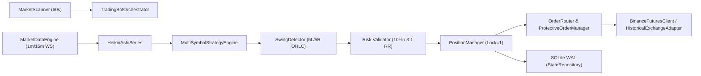

# Developer Guide

---

## 1. Architecture & Module Responsibilities

| Package | Responsibility |
|---|---|
| `src/config/` | `Settings` (`pydantic-settings`), validators, `SecretStr` redaction |
| `src/exchange/` | Async `httpx` REST client, HMAC-SHA256 signer, rate limiter, typed models |
| `src/scanner/` | Top-20 24h USDT perpetual gainer ranking & liquidity filters |
| `src/market_data/` | REST seeding, WebSocket kline stream, ring buffers |
| `src/indicators/` | Pure Heikin-Ashi & 5L/5R OHLC swing pivot detectors |
| `src/strategy/` | 15m window snapshot, concurrent 1m monitoring, `GlobalSlotArbitrator` |
| `src/risk/` | Equity risk budget, friction sizing, bracket lookup, liquidation safety |
| `src/execution/` | Collision-resistant `clientOrderId`, `OrderRouter`, `BinanceUserDataStream` |
| `src/positions/` | `PositionManager` (global 1-position lock), `ProtectiveOrderManager` (SL/TP + sibling cancel) |
| `src/state/` | `DatabaseManager` (SQLite WAL), `StateRepository`, `StartupReconciler` |
| `src/backtesting/` | `SimulatedClock`, `HistoricalMarketStore`, `HistoricalExchangeAdapter`, `AccountLedger`, `ChronologicalBacktestRunner` |
| `src/monitoring/` | `RedactingFormatter` & rotating file logging |

## 2. Extending the System
- **New Execution Adapter (e.g., Live Paper Wallet):** Implement the `BinanceFuturesClient` async methods used by `MarketScanner`, `MarketDataEngine`, `OrderRouter`, `ProtectiveOrderManager`, and `StartupReconciler` (see `HistoricalExchangeAdapter` in `src/backtesting/exec_adapter.py` as the reference pattern).
- **New Indicator / Strategy Rule:** Add pure indicator logic under `src/indicators/`, wire into `MultiSymbolStrategyEngine` (`src/strategy/engine.py`), and update `ChronologicalBacktestRunner` if new timeframe buffers are required.
- **No Frontend / HTTP Server:** If adding a web dashboard later, expose read-only endpoints from `StateRepository` / `TradingBotOrchestrator` and keep API keys strictly server-side.
