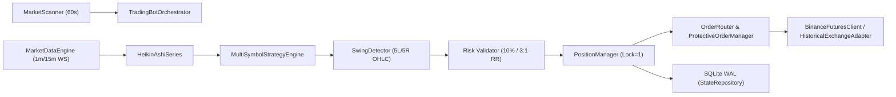
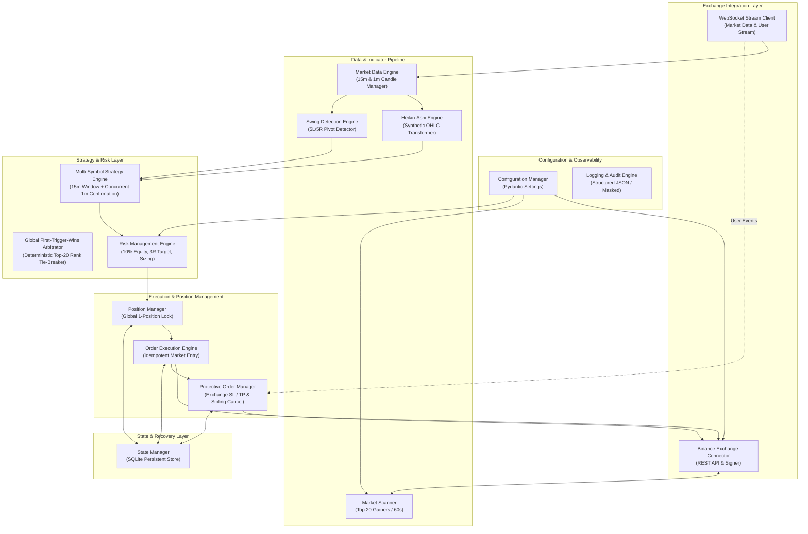
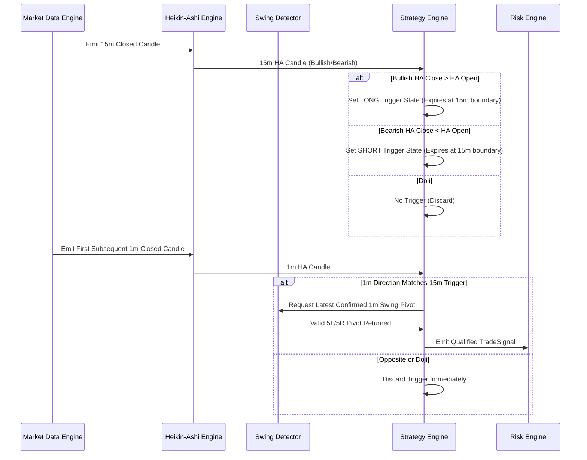
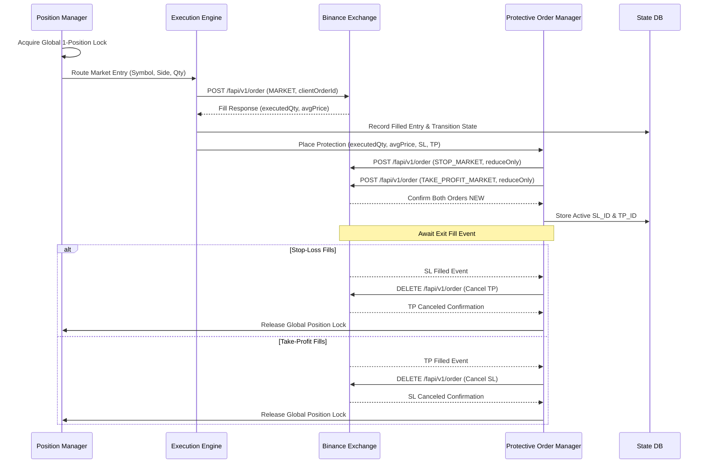
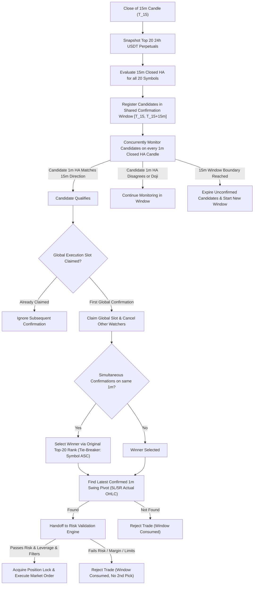
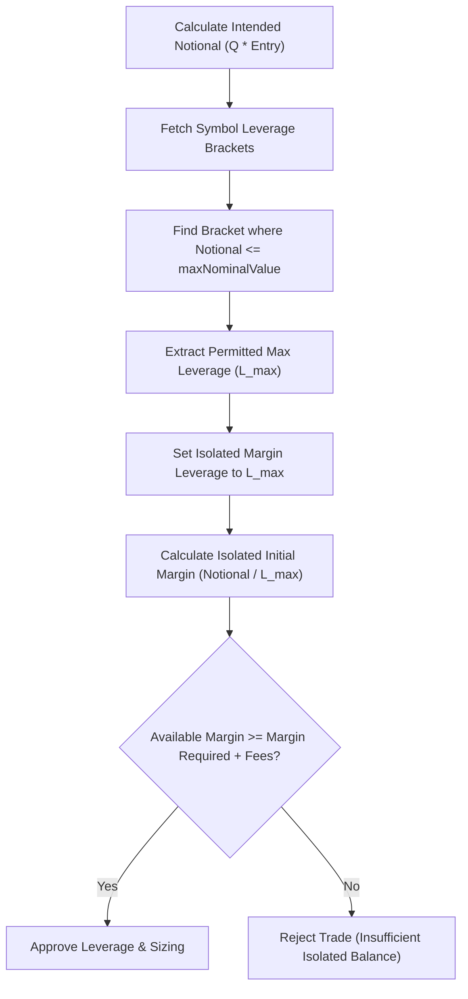

# Binance HA Trading Bot — Full Reference Document

> **AGENT REFERENCE FILE** — This single document combines the root README and all documentation
> manuals into one file for analysis and agent consumption.  
> Individual source files live in `docs/` and in the repository root `README.md`.  
> Generated: 2026-11-25

---

## Table of Contents

1. [README.md (root)](#readme-md-root)
2. [docs/README.md](#docs-readme-md)
3. [docs/USER_MANUAL.md](#docs-user_manual-md)
4. [docs/INSTALLATION_GUIDE.md](#docs-installation_guide-md)
5. [docs/QUICK_START.md](#docs-quick_start-md)
6. [docs/CONFIGURATION_GUIDE.md](#docs-configuration_guide-md)
7. [docs/API_KEY_SETUP.md](#docs-api_key_setup-md)
8. [docs/SECURITY_GUIDE.md](#docs-security_guide-md)
9. [docs/MARKET_SCANNER_MANUAL.md](#docs-market_scanner_manual-md)
10. [docs/STRATEGY_MANUAL.md](#docs-strategy_manual-md)
11. [docs/RISK_MANAGEMENT_MANUAL.md](#docs-risk_management_manual-md)
12. [docs/BACKTESTING_MANUAL.md](#docs-backtesting_manual-md)
13. [docs/PAPER_TRADING_MANUAL.md](#docs-paper_trading_manual-md)
14. [docs/LIVE_TRADING_MANUAL.md](#docs-live_trading_manual-md)
15. [docs/DASHBOARD_MANUAL.md](#docs-dashboard_manual-md)
16. [docs/TERMINAL_MANUAL.md](#docs-terminal_manual-md)
17. [docs/TRADE_HISTORY_AND_ANALYTICS.md](#docs-trade_history_and_analytics-md)
18. [docs/MONITORING_AND_LOGS.md](#docs-monitoring_and_logs-md)
19. [docs/TESTING_GUIDE.md](#docs-testing_guide-md)
20. [docs/TROUBLESHOOTING.md](#docs-troubleshooting-md)
21. [docs/BACKUP_AND_RECOVERY.md](#docs-backup_and_recovery-md)
22. [docs/MAINTENANCE_GUIDE.md](#docs-maintenance_guide-md)
23. [docs/DEVELOPER_GUIDE.md](#docs-developer_guide-md)
24. [docs/FAQ.md](#docs-faq-md)
25. [docs/PROJECT_SPEC.md](#docs-project_spec-md)
26. [docs/ARCHITECTURE.md](#docs-architecture-md)
27. [docs/STRATEGY_RULES.md](#docs-strategy_rules-md)
28. [docs/RISK_MODEL.md](#docs-risk_model-md)
29. [docs/API_CONTRACTS.md](#docs-api_contracts-md)
30. [docs/TEST_PLAN.md](#docs-test_plan-md)
31. [docs/RUNBOOK.md](#docs-runbook-md)
32. [docs/DEVELOPMENT_LOG.md](#docs-development_log-md)
33. [docs/CHANGELOG.md](#docs-changelog-md)


---

<!-- SOURCE: README.md (root) -->

# Binance Futures Heikin-Ashi Trading Bot

> **Backend-only Python CLI trading engine for Binance USDⓈ-M Perpetual Futures.**  
> No web UI. No REST server. No frontend. All interaction is via the terminal and SQLite.

---

## What This Application Does

The Binance HA Bot is an automated algorithmic trading system that:

1. **Scans** all USDⓈ-M USDT perpetual contracts on Binance every 60 seconds and ranks them by rolling 24-hour percentage gain.
2. **Selects** the top-20 eligible contracts (after volume and liquidity filtering) at each 15-minute trigger window.
3. **Analyses** completed 15-minute Heikin-Ashi candles to establish a directional bias (Bullish / Bearish).
4. **Confirms** that bias on the first completed 1-minute Heikin-Ashi candle in the same direction.
5. **Validates** a confirmed swing stop-loss using real OHLC pivots (5 bars left, 5 bars right, zero look-ahead).
6. **Sizes** each position to risk exactly 10 % of current futures account equity, enforcing 3 : 1 reward-to-risk.
7. **Executes** a market entry with native exchange-side Stop-Loss and Take-Profit orders (`reduceOnly=true`).
8. **Manages** exactly one open position at a time (isolated margin, highest eligible bracket leverage).
9. **Recovers** from crashes by reconciling persistent SQLite state against live exchange state on startup.
10. **Backtests** chronologically: replaying historical market data in forward-walking order with no look-ahead bias (Amendment 01).

---

## Major Features

| Feature | Status |
|---|---|
| Market scanner — top-20 24h gainers | ✅ Implemented |
| Multi-timeframe Heikin-Ashi strategy | ✅ Implemented |
| Confirmed swing stop-loss (5L/5R pivots) | ✅ Implemented |
| 10% equity risk sizing + 3:1 R:R | ✅ Implemented |
| Isolated margin execution on Binance | ✅ Implemented |
| Exchange-side SL/TP protective orders | ✅ Implemented |
| SQLite crash recovery | ✅ Implemented |
| Chronological backtesting engine | ✅ Implemented |
| Binance Testnet support | ✅ Implemented |
| Structured logging with secret redaction | ✅ Implemented |
| Web dashboard / frontend | ❌ NOT IMPLEMENTED |
| Standalone paper-trading virtual wallet | ❌ NOT IMPLEMENTED |
| REST / SSE API server | ❌ NOT IMPLEMENTED |
| Database migration CLI | ❌ NOT IMPLEMENTED |

---

## Architecture Overview

```
src/
├── config/         Settings (pydantic-settings, .env, validators)
├── exchange/       Binance REST + WebSocket connectors
├── scanner/        Top-20 24h gainers scanner (60-second refresh)
├── market_data/    Kline feeds, ring buffers
├── indicators/     Pure Heikin-Ashi + 5L/5R swing calculations
├── strategy/       15m trigger + 1m confirmation state machine
├── risk/           10% equity sizing, leverage brackets, step sizes
├── execution/      Order submission, fills, user data stream
├── positions/      Position manager + SL/TP protective lifecycle
├── state/          Persistent SQLite WAL store + crash recovery
├── backtesting/    Chronological non-look-ahead replay engine
├── monitoring/     Structured logging + secret redaction
├── orchestrator.py Event-driven TradingBotOrchestrator
└── main.py         CLI entrypoint (--check-config, SIGINT/SIGTERM)
```

```
Data flow:
Binance WebSocket ──► MarketDataEngine ──► StrategyEngine ──► RiskManager
                                                                    │
                                                              ExecutionEngine
                                                                    │
                                                           ProtectiveOrderManager
                                                                    │
                                                              StateManager (SQLite)
```

---

## Technology Stack

| Component | Technology |
|---|---|
| Language | Python 3.11+ (tested on 3.14.4) |
| Async runtime | `asyncio` |
| HTTP client | `httpx` (async) |
| WebSocket | `websockets` |
| Configuration | `pydantic-settings` v2, `.env` |
| Database | SQLite 3 (WAL mode, via `aiosqlite`) |
| Logging | Python `logging`, `RotatingFileHandler` |
| Testing | `pytest`, `pytest-asyncio`, `pytest-cov` |
| Exchange API | Binance USDⓈ-M Futures REST + WS |

---

## Supported Operating Modes

| Mode | Description | Default? |
|---|---|---|
| **Testnet** (`APP_ENV=testnet`) | Connects to Binance Futures Testnet. All orders are simulated on the exchange — no real money. | ✅ Yes |
| **Production** (`APP_ENV=production`) | Connects to live Binance Futures. Real orders, real money. Requires explicit configuration. | ❌ No |
| **Backtest** | Chronological forward-walking replay of historical market data. | Run via code / test suite |
| **Web dashboard** | — | ❌ NOT IMPLEMENTED |
| **Paper trading (virtual wallet)** | — | ❌ NOT IMPLEMENTED |

> **⚠️ SECURITY WARNING:** Live trading (`APP_ENV=production`) is **disabled by default**.  
> Enabling it requires explicitly setting production API endpoints and credentials in `.env`.  
> Never commit `.env` to version control. Never share API keys with withdrawal permissions.

---

## System Requirements

| Requirement | Minimum | Recommended |
|---|---|---|
| OS | Ubuntu 20.04 LTS | Ubuntu 22.04 LTS |
| Python | 3.11 | 3.12+ |
| RAM | 512 MB | 1 GB |
| Disk | 1 GB | 5 GB (for backtest data) |
| Network | Stable internet | Low-latency VPS |
| Node.js | Not required | Not required |
| Database | SQLite (bundled) | SQLite (bundled) |

---

## Quick Installation

```bash
# 1. Clone the repository
git clone https://github.com/Sankar7567/bot_1.git bot_ha
cd bot_ha

# 2. Create and activate virtual environment
python3 -m venv .venv
source .venv/bin/activate

# 3. Install all dependencies (including dev/test)
pip install -r requirements-dev.txt

# 4. Create your environment file
cp .env.example .env
# Edit .env — set BINANCE_API_KEY and BINANCE_API_SECRET for Testnet

# 5. Validate configuration
python -m src.main --check-config

# 6. Run the full offline test suite
pytest --cov=src --cov-fail-under=80
```

For a complete step-by-step installation guide, see **[docs/INSTALLATION_GUIDE.md](docs/INSTALLATION_GUIDE.md)**.

---

## Quick Start (Testnet Paper Trading)

```bash
# Start the bot in Testnet mode (default — no live money)
source .venv/bin/activate
python -m src.main
```

The bot will:
1. Connect to Binance Futures Testnet.
2. Scan the market and select top-20 gainers.
3. Monitor for Heikin-Ashi signals.
4. Submit and manage positions on the Testnet exchange.
5. Log all activity to `logs/trading_bot.log`.
6. Persist state to `data/trading_bot.db`.

For a guided first-run walkthrough, see **[docs/QUICK_START.md](docs/QUICK_START.md)**.

---

## Documentation

All documentation is in the [`docs/`](docs/) directory. Start with **[docs/README.md](docs/README.md)** for the full index.

### Core Guides

| Document | Description |
|---|---|
| [USER_MANUAL.md](docs/USER_MANUAL.md) | Operating modes, daily workflows, interaction patterns |
| [INSTALLATION_GUIDE.md](docs/INSTALLATION_GUIDE.md) | Complete fresh-install guide for Ubuntu/Linux |
| [QUICK_START.md](docs/QUICK_START.md) | Testnet quick-start and first backtest |
| [CONFIGURATION_GUIDE.md](docs/CONFIGURATION_GUIDE.md) | All 22 `Settings` fields, env vars, validators |
| [API_KEY_SETUP.md](docs/API_KEY_SETUP.md) | Binance Testnet + production API key creation |
| [SECURITY_GUIDE.md](docs/SECURITY_GUIDE.md) | Secret handling, file permissions, least privilege |

### Feature Manuals

| Document | Description |
|---|---|
| [MARKET_SCANNER_MANUAL.md](docs/MARKET_SCANNER_MANUAL.md) | Universe filters, top-20 ranking, refresh timing |
| [STRATEGY_MANUAL.md](docs/STRATEGY_MANUAL.md) | Heikin-Ashi math, signal lifecycle, worked examples |
| [RISK_MANAGEMENT_MANUAL.md](docs/RISK_MANAGEMENT_MANUAL.md) | 5L/5R pivots, equity sizing math, rejection reasons |
| [BACKTESTING_MANUAL.md](docs/BACKTESTING_MANUAL.md) | Chronological replay engine, `BacktestReport` metrics |
| [PAPER_TRADING_MANUAL.md](docs/PAPER_TRADING_MANUAL.md) | Testnet and replay alternatives (virtual wallet NOT IMPLEMENTED) |
| [LIVE_TRADING_MANUAL.md](docs/LIVE_TRADING_MANUAL.md) | Pre-activation checklist, production config, emergency procedures |
| [DASHBOARD_MANUAL.md](docs/DASHBOARD_MANUAL.md) | CLI/SQLite equivalents (web UI NOT IMPLEMENTED) |
| [TERMINAL_MANUAL.md](docs/TERMINAL_MANUAL.md) | All verified CLI commands and monitoring recipes |

### Operations & Development

| Document | Description |
|---|---|
| [TRADE_HISTORY_AND_ANALYTICS.md](docs/TRADE_HISTORY_AND_ANALYTICS.md) | SQLite schema, useful queries, `BacktestReport` reference |
| [MONITORING_AND_LOGS.md](docs/MONITORING_AND_LOGS.md) | Log file, rotation (10 MB × 5), log format, monitoring commands |
| [TESTING_GUIDE.md](docs/TESTING_GUIDE.md) | All test suite commands, baseline results (280 passed, 86.71% coverage) |
| [TROUBLESHOOTING.md](docs/TROUBLESHOOTING.md) | 8 categories with symptoms / causes / diagnostics / resolution |
| [BACKUP_AND_RECOVERY.md](docs/BACKUP_AND_RECOVERY.md) | SQLite WAL backup and restore procedures |
| [MAINTENANCE_GUIDE.md](docs/MAINTENANCE_GUIDE.md) | Code updates, DB practices, Git workflow |
| [DEVELOPER_GUIDE.md](docs/DEVELOPER_GUIDE.md) | Architecture diagram, module table, extension guide |
| [FAQ.md](docs/FAQ.md) | Frequently asked questions |

### Technical Specifications

| Document | Description |
|---|---|
| [PROJECT_SPEC.md](docs/PROJECT_SPEC.md) | Master project specification |
| [ARCHITECTURE.md](docs/ARCHITECTURE.md) | Detailed component architecture |
| [STRATEGY_RULES.md](docs/STRATEGY_RULES.md) | Complete strategy rule set |
| [RISK_MODEL.md](docs/RISK_MODEL.md) | Risk model specification |
| [API_CONTRACTS.md](docs/API_CONTRACTS.md) | Binance API contracts |
| [TEST_PLAN.md](docs/TEST_PLAN.md) | Test plan and coverage targets |
| [RUNBOOK.md](docs/RUNBOOK.md) | Operational runbook |
| [CHANGELOG.md](docs/CHANGELOG.md) | Version history |

---

## Known Limitations

| Limitation | Detail |
|---|---|
| No web UI | The application is terminal-only. There is no dashboard, no browser interface, and no HTTP server. |
| No standalone paper-trading | There is no virtual-wallet paper trading mode. Use Binance Futures Testnet instead (`APP_ENV=testnet`). |
| No CLI backtest subcommand | Backtesting is invoked via the Python API or via the test suite. There is no `--backtest` CLI flag. |
| No database migration CLI | The SQLite schema is applied automatically via `DatabaseManager.initialize()` on every startup (idempotent). |
| No Alembic / migration history | Schema changes must be applied manually or by dropping and reinitializing the database. |
| LOG_ROTATION / LOG_RETENTION_DAYS | These keys appear in `.env.example` for documentation purposes only. `Settings` does not read them (uses `extra="ignore"`). |
| DATABASE_URL | Appears in `.env.example` for reference only. `Settings` uses `DB_FILE_PATH`. |

---

## Project Directory Structure

```
bot_ha/
├── README.md                    ← You are here
├── pyproject.toml               ← Project config, test settings, coverage thresholds
├── requirements.txt             ← Production runtime dependencies
├── requirements-dev.txt         ← Development and testing dependencies
├── .env.example                 ← Environment variable template (copy to .env)
├── .gitignore                   ← Excludes .env, data/, logs/, *.db
│
├── docs/                        ← All documentation
│   ├── README.md                ← Documentation hub and index
│   ├── USER_MANUAL.md
│   ├── INSTALLATION_GUIDE.md
│   ├── QUICK_START.md
│   ├── CONFIGURATION_GUIDE.md
│   ├── API_KEY_SETUP.md
│   ├── SECURITY_GUIDE.md
│   ├── MARKET_SCANNER_MANUAL.md
│   ├── STRATEGY_MANUAL.md
│   ├── RISK_MANAGEMENT_MANUAL.md
│   ├── BACKTESTING_MANUAL.md
│   ├── PAPER_TRADING_MANUAL.md
│   ├── LIVE_TRADING_MANUAL.md
│   ├── DASHBOARD_MANUAL.md
│   ├── TERMINAL_MANUAL.md
│   ├── TRADE_HISTORY_AND_ANALYTICS.md
│   ├── MONITORING_AND_LOGS.md
│   ├── TESTING_GUIDE.md
│   ├── TROUBLESHOOTING.md
│   ├── BACKUP_AND_RECOVERY.md
│   ├── MAINTENANCE_GUIDE.md
│   ├── DEVELOPER_GUIDE.md
│   ├── FAQ.md
│   ├── FULL_REFERENCE.md        ← Combined mega-reference (all docs in one file)
│   ├── PROJECT_SPEC.md
│   ├── ARCHITECTURE.md
│   ├── STRATEGY_RULES.md
│   ├── RISK_MODEL.md
│   ├── API_CONTRACTS.md
│   ├── TEST_PLAN.md
│   ├── DEVELOPMENT_LOG.md
│   ├── RUNBOOK.md
│   └── CHANGELOG.md
│
├── src/                         ← Application source code
│   ├── config/                  ← Settings, validators
│   ├── exchange/                ← Binance REST + WebSocket
│   ├── scanner/                 ← Market scanner
│   ├── market_data/             ← Kline feeds, ring buffers
│   ├── indicators/              ← Heikin-Ashi + swing detection
│   ├── strategy/                ← State machine (15m + 1m)
│   ├── risk/                    ← Sizing, leverage, step sizes
│   ├── execution/               ← Order submission + fills
│   ├── positions/               ← Position manager + SL/TP
│   ├── state/                   ← SQLite WAL store
│   ├── backtesting/             ← Chronological replay engine
│   ├── monitoring/              ← Logging + secret redaction
│   ├── orchestrator.py          ← TradingBotOrchestrator
│   └── main.py                  ← CLI entrypoint
│
├── tests/
│   ├── unit/                    ← Unit tests (280 passing)
│   └── integration/             ← Integration + testnet tests
│
├── data/                        ← SQLite database (auto-created, git-ignored)
└── logs/                        ← Log files (auto-created, git-ignored)
```

---

## Implementation Status

**v1.0.0 — All 15 development phases complete.**

| Phase | Description | Status |
|---|---|---|
| P01 | Master project brief, architecture, foundation | ✅ Done |
| P02 | Binance exchange connector | ✅ Done |
| P03 | Market scanner | ✅ Done |
| P04 | Market data engine | ✅ Done |
| P05 | Heikin-Ashi engine | ✅ Done |
| P06 | Multi-timeframe strategy engine | ✅ Done |
| P07 | Swing detection engine | ✅ Done |
| P08 | Risk management and position sizing | ✅ Done |
| P09 | Binance order execution engine | ✅ Done |
| P10 | Protective order manager | ✅ Done |
| P11 | Position manager and state recovery | ✅ Done |
| P12 | Main orchestration and full integration | ✅ Done |
| P13 | Chronological backtesting (Amendment 01) | ✅ Done |
| P14 | Binance Testnet validation and fault injection | ✅ Done |
| P15 | Independent audit and deployment readiness | ✅ Done |
| A02 | Complete documentation system (22 manuals) | ✅ Done |

---

## Running Tests

```bash
source .venv/bin/activate

# Full offline suite with branch coverage report
pytest --cov=src --cov-report=term-missing --cov-fail-under=80

# Fast unit tests only
pytest tests/unit/ -v

# Integration tests (no network required)
pytest tests/integration/ -v -m "not testnet"

# Live Testnet tests (requires Testnet API keys in .env)
pytest -m testnet -v
```

Baseline: **280 passed, 3 skipped (testnet-gated), 86.71 % branch coverage**.

---

## Security Warnings

> **⚠️ NEVER commit your `.env` file to version control.**  
> `.gitignore` excludes `.env`, `data/`, `logs/`, and `*.db` by default. Verify this before every push.

> **⚠️ NEVER grant Withdrawal permissions to any API key used by this bot.**  
> Use Futures trading permissions only (read + trade). Enable IP allowlisting in production.

> **⚠️ Test thoroughly on Testnet before enabling production mode.**  
> At minimum: run the full test suite, validate config, run 24+ hours on Testnet, and review all log output.

> **⚠️ This software is provided for educational purposes.**  
> Algorithmic trading involves substantial financial risk. Past performance does not guarantee future results.

---

## License

See repository for license details.

---

<!-- SOURCE: docs/README.md -->

# Binance HA Trading Platform — Documentation Hub

Welcome to the documentation for the **Binance USDⓈ-M Futures Heikin-Ashi Trading Bot** (`binance-ha-bot`).

> [!IMPORTANT]
> This project is a **Python 3.11+ asynchronous CLI/backend trading engine** (`python -m src.main`) with a **Python chronological backtesting library** (`src/backtesting/`). A web dashboard, HTTP/SSE API server, and standalone live paper-trading virtual wallet are **`NOT IMPLEMENTED`**—use **Binance Futures Testnet** (`APP_ENV=testnet`, default) or **Chronological Backtesting** (`ChronologicalBacktestRunner`) for non-production testing.

---

## Documentation Directory

### Getting Started & Setup
- [User Manual](USER_MANUAL.md) — End-to-end operator overview and daily workflow.
- [Installation Guide](INSTALLATION_GUIDE.md) — Fresh Ubuntu/Linux installation from scratch.
- [Quick Start Guide](QUICK_START.md) — From clean install to `--check-config`, Testnet verification, and chronological backtest.
- [Configuration Guide](CONFIGURATION_GUIDE.md) — Every `Settings` field, `.env` variable, default, and validator range.
- [API Key Setup](API_KEY_SETUP.md) — Binance Testnet & Futures API keys, permissions, IP restrictions, and `.env` placement.
- [Security Guide](SECURITY_GUIDE.md) — Credential protection, `SecretStr`, log redaction, `.gitignore`, and exposure response.

### Trading, Strategy & Risk
- [Market Scanner Manual](MARKET_SCANNER_MANUAL.md) — Top-20 24h gainers, liquidity filters, and 60s refresh behavior.
- [Strategy Manual](STRATEGY_MANUAL.md) — 15m Heikin-Ashi trigger, frozen top-20 snapshot, 1m confirmation, and tie-breaking.
- [Risk Management Manual](RISK_MANAGEMENT_MANUAL.md) — 5L/5R swing pivots, 0.1% stop buffer, 10% risk budget, 3:1 RR, leverage brackets, and 1-position lock.
- [Backtesting Manual](BACKTESTING_MANUAL.md) — Chronological non-lookahead replay (`ChronologicalBacktestRunner`), assumptions, metrics, and limitations.
- [Paper Trading Manual](PAPER_TRADING_MANUAL.md) — Status (`NOT IMPLEMENTED` as standalone live mode) and how to use Testnet or Chronological Replay instead.
- [Live Trading Manual](LIVE_TRADING_MANUAL.md) — Safety-first production activation checklist, isolated margin, one-way mode, and emergency stop.

### Interfaces, Operations & Maintenance
- [Terminal Manual](TERMINAL_MANUAL.md) — Exact verified CLI, `pytest`, SQLite, and Python backtest commands.
- [Dashboard Manual](DASHBOARD_MANUAL.md) — Status (`NOT IMPLEMENTED`) and CLI/SQLite/log monitoring equivalents.
- [Trade History & Analytics](TRADE_HISTORY_AND_ANALYTICS.md) — Querying SQLite (`positions`, `orders`, `strategy_windows`, `audit_log`) and `BacktestReport`.
- [Monitoring & Logs](MONITORING_AND_LOGS.md) — Rotating logs (`logs/trading_bot.log`), `RedactingFormatter`, and log levels.
- [Testing Guide](TESTING_GUIDE.md) — Unit, integration, fault-injection, chronological backtest, and `@pytest.mark.testnet` suites.
- [Troubleshooting](TROUBLESHOOTING.md) — Diagnostics and fixes for startup, API, WebSocket, strategy, risk, and database issues.
- [Backup & Recovery](BACKUP_AND_RECOVERY.md) — Secret-free SQLite WAL & config backups and restoration.
- [Maintenance Guide](MAINTENANCE_GUIDE.md) — Dependency updates, code updates, Git workflow, and safe restarts.
- [Developer Guide](DEVELOPER_GUIDE.md) — Architecture, module responsibilities, Mermaid data flow, schemas, and extension points.
- [FAQ](FAQ.md) — Frequently asked questions.

### Engineering & Specification References
- [Project Spec](PROJECT_SPEC.md) | [Architecture](ARCHITECTURE.md) | [Strategy Rules](STRATEGY_RULES.md) | [Risk Model](RISK_MODEL.md)
- [API Contracts](API_CONTRACTS.md) | [Test Plan](TEST_PLAN.md) | [Runbook](RUNBOOK.md) | [Changelog](CHANGELOG.md) | [Development Log](DEVELOPMENT_LOG.md)

---

<!-- SOURCE: docs/USER_MANUAL.md -->

# User Manual

This handbook explains how an operator runs and monitors the **Binance USDⓈ-M Futures Heikin-Ashi Trading Bot** (`binance-ha-bot`).

---

## 1. What the Application Does
`binance-ha-bot` is an asynchronous Python trading engine that:
1. Scans Binance USDⓈ-M USDT perpetual contracts every 60 seconds and ranks the **Top 20** by 24-hour percentage gain (filtered by liquidity).
2. Evaluates completed **15-minute Heikin-Ashi** candles at each 15m boundary, freezing the Top-20 snapshot.
3. Monitors eligible candidates across subsequent **1-minute Heikin-Ashi** closes until the first aligned confirmation wins globally (rank tie-broken).
4. Validates a **5-left / 5-right OHLC swing pivot** stop-loss, sizes the position for a **10% nominal equity risk budget** and **3:1 reward-to-risk**, and enforces a **global 1-position lock** with **ISOLATED** margin.
5. Places an exchange `MARKET` entry and native `STOP_MARKET` + `TAKE_PROFIT_MARKET` (`reduceOnly=true`) protective orders, cancelling the sibling order when one fills.
6. Persists all state to SQLite (`data/trading_bot.db`) and reconciles exchange vs. DB state on startup.

---

## 2. Operating Modes

| Mode | Status | How to Use |
|---|---|---|
| **Chronological Backtesting** | `IMPLEMENTED` | Python API `ChronologicalBacktestRunner` ([Backtesting Manual](BACKTESTING_MANUAL.md)) |
| **Binance Futures Testnet** | `REQUIRES CONFIGURATION` | Default (`APP_ENV=testnet`), `python -m src.main` with Testnet keys |
| **Live Binance Production** | `DISABLED` (by default) | Explicit `APP_ENV=production` + production keys ([Live Trading Manual](LIVE_TRADING_MANUAL.md)) |
| **Web Dashboard / UI** | `NOT IMPLEMENTED` | Use CLI, SQLite queries, and logs ([Dashboard Manual](DASHBOARD_MANUAL.md)) |
| **Standalone Live Paper Mode** | `NOT IMPLEMENTED` | Use Testnet or Chronological Replay ([Paper Trading Manual](PAPER_TRADING_MANUAL.md)) |

---

## 3. Daily Operator Workflow
1. **Preflight Check:** `python -m src.main --check-config`
2. **Launch Engine:** `python -m src.main`
3. **Monitor Logs:** `tail -f logs/trading_bot.log` ([Monitoring & Logs](MONITORING_AND_LOGS.md))
4. **Inspect Positions & Orders:** Query `data/trading_bot.db` ([Trade History & Analytics](TRADE_HISTORY_AND_ANALYTICS.md))
5. **Graceful Shutdown:** Press `Ctrl+C` (`SIGINT`) or send `SIGTERM`. Note: open exchange positions and their exchange-side SL/TP orders remain active on Binance unless closed manually or via emergency close.

---

<!-- SOURCE: docs/INSTALLATION_GUIDE.md -->

# Installation Guide

This guide covers installing `binance-ha-bot` on a clean **Ubuntu/Debian Linux** machine.

---

## 1. Prerequisites

| Requirement | Minimum / Tested | Notes |
|---|---|---|
| **Operating System** | Ubuntu 22.04+ / Debian 12+ | Linux x86_64/arm64 |
| **Python** | Python **3.11+** (tested on **3.14.4**) | Required by `pyproject.toml` (`requires-python >= 3.11`) |
| **Node.js / npm** | **Not required** | No frontend/Node.js UI exists (`NOT IMPLEMENTED`) |
| **Git** | Git 2.30+ | For cloning and updates |
| **Database** | Built-in Python `sqlite3` (WAL mode) | No external DB server required |
| **Storage / RAM** | 1 GB+ free disk, 512 MB+ RAM | Logs rotate at 10 MB × 5 backups |
| **Network** | Outbound HTTPS (443) & WSS (443) | To `*.binancefuture.com` / `stream.binancefuture.com` |

---

## 2. Step-by-Step Installation

### Step 1: Install System Packages
```bash
sudo apt-get update && sudo apt-get install -y git python3 python3-venv python3-pip sqlite3
```
Verify Python version (must be 3.11 or higher):
```bash
python3 --version
```

### Step 2: Clone the Repository
```bash
git clone https://github.com/Sankar7567/bot_1.git bot_ha
cd bot_ha
```

### Step 3: Create and Activate Python Virtual Environment
```bash
python3 -m venv .venv
source .venv/bin/activate
```
Your prompt should now show `(.venv)`.

### Step 4: Upgrade `pip` and Install Dependencies
For **production/runtime only** (no test packages):
```bash
pip install --upgrade pip
pip install -r requirements.txt
```
For **development and testing** (includes `pytest`, `pytest-asyncio`, `pytest-cov`):
```bash
pip install --upgrade pip
pip install -r requirements-dev.txt
```

> [!NOTE]
> `requirements.txt` installs `httpx>=0.28.1`, `websockets>=13.0`, `pydantic>=2.10.0`, `pydantic-settings>=2.7.0`, and `python-dotenv>=1.0.1`.

### Step 5: Create Environment Configuration
Copy the template file to `.env`:
```bash
cp .env.example .env
```
Edit `.env` to set your Binance Futures **Testnet** API credentials (see [API Key Setup](API_KEY_SETUP.md) and [Configuration Guide](CONFIGURATION_GUIDE.md)).

### Step 6: Database Initialization & Migrations
There is **no separate database migration CLI** (such as Alembic). On startup, `DatabaseManager.initialize()` in [src/state/database.py](../src/state/database.py) automatically:
1. Creates the `data/` parent directory if missing.
2. Opens `data/trading_bot.db` with `PRAGMA journal_mode = WAL;`, `PRAGMA synchronous = NORMAL;`, `PRAGMA busy_timeout = 5000;`, and `PRAGMA foreign_keys = ON;`.
3. Executes `CREATE TABLE IF NOT EXISTS` for `positions`, `orders`, `strategy_windows`, and `audit_log`.

### Step 7: Run Initial Configuration Check
```bash
python -m src.main --check-config
```
Expected output:
```text
Configuration OK (env=testnet): {'app_env': 'testnet', 'binance_api_key': '***REDACTED***', 'binance_api_secret': '***REDACTED***', ...}
```
(If keys are empty, they print as `''`.)

### Step 8: Verify Installation with Offline Tests (if dev dependencies installed)
```bash
pytest --cov=src --cov-fail-under=80 -q
```
Expected result: all offline unit/integration tests pass with >= 80% branch coverage; `@pytest.mark.testnet` tests skip cleanly when credentials are absent.

### Step 9: Start the Application
```bash
python -m src.main
```
Stop gracefully anytime with `Ctrl+C` (`SIGINT`) or `SIGTERM`. See [Quick Start Guide](QUICK_START.md) for your first Testnet session.

---

<!-- SOURCE: docs/QUICK_START.md -->

# Quick Start Guide

This guide takes you from a fresh installation to a verified **Binance Futures Testnet** run and an offline **Chronological Backtest**.

> [!NOTE]
> Because a web dashboard and standalone live paper-trading mode are **`NOT IMPLEMENTED`**, non-production testing uses **Binance Futures Testnet** (`APP_ENV=testnet`, the default) or the **Chronological Backtesting Engine** (`src/backtesting/`).

---

## Path A: Launch on Binance Futures Testnet (Recommended First Run)

### 1. Install & Activate Environment
Follow Steps 1–4 of the [Installation Guide](INSTALLATION_GUIDE.md):
```bash
cd bot_ha
source .venv/bin/activate
```

### 2. Configure `.env` for Testnet
```bash
cp .env.example .env
```
Open `.env` and populate your **Testnet** API key and secret from `https://testnet.binancefuture.com` (see [API Key Setup](API_KEY_SETUP.md)):
```env
APP_ENV=testnet
BINANCE_API_KEY=your_binance_testnet_api_key_here
BINANCE_API_SECRET=your_binance_testnet_api_secret_here
BINANCE_REST_BASE_URL=https://testnet.binancefuture.com
BINANCE_WS_BASE_URL=wss://stream.binancefuture.com/ws
```

### 3. Validate Configuration
```bash
python -m src.main --check-config
```
Confirm `env=testnet` and `***REDACTED***` appear for both credential fields.

### 4. Verify Testnet Connectivity (Optional Testnet Preflight)
```bash
pytest tests/integration/test_exchange_integration.py -v
```
This runs `test_public_ping_testnet` and (when credentials are set in `.env` or environment) `test_authenticated_testnet_account_info`.

### 5. Start the Trading Bot
```bash
python -m src.main
```
During startup, the bot automatically:
1. Connects to Binance Futures Testnet and synchronizes server time.
2. Verifies **One-Way** position mode (switches from Hedge mode if needed).
3. Runs `StartupReconciler` to check for any existing open exchange/DB positions.
4. Starts the 60-second `MarketScanner` (Top-20 24h USDT perpetual gainers), 15m/1m WebSocket market data feeds, and User Data Stream.

### 6. Monitor Activity
In a second terminal:
- **Live logs**:
  ```bash
  tail -f logs/trading_bot.log
  ```
- **Inspect positions & orders in SQLite**:
  ```bash
  sqlite3 data/trading_bot.db "SELECT position_id, symbol, side, status, entry_price, realized_pnl FROM positions;"
  ```

### 7. Stop Gracefully
Press `Ctrl+C` (`SIGINT`) in the bot terminal. The bot stops streams, closes the listenKey, and closes the SQLite connection cleanly.

---

## Path B: Run an Offline Chronological Backtest (No API Keys Needed)

Run the built-in 12-test chronological replay suite (covering all 17 Amendment 01 invariants) to see the backtester in action:
```bash
pytest tests/unit/test_backtesting_chronological.py --no-cov -v
```
To run a custom backtest against your own historical candles, see the [Backtesting Manual](BACKTESTING_MANUAL.md).

---

<!-- SOURCE: docs/CONFIGURATION_GUIDE.md -->

# Configuration Guide

All runtime configuration is managed by `Settings` (`pydantic_settings.BaseSettings`) in [src/config/settings.py](../src/config/settings.py).

## Loading Behavior
- Reads variables from `.env` in the repository root (`env_file=".env"`, UTF-8, case-insensitive, extra keys ignored).
- Real OS environment variables override `.env`.
- **Restart Required:** Yes. Settings are loaded once at startup (`load_settings()` in `src/main.py`). Changes to `.env` take effect only after restarting the bot.

---

## Complete Configuration Reference

### 1. Environment & Endpoints
| Env Variable | Type | Default | Valid Values / Notes |
|---|---|---|---|
| `APP_ENV` | `str` | `testnet` | `"testnet"` or `"production"`. **Defaults to `testnet`.** |
| `BINANCE_API_KEY` | `SecretStr` | `""` | Binance Futures API key (masked in logs and `get_safe_dict()`). |
| `BINANCE_API_SECRET` | `SecretStr` | `""` | Binance Futures API secret (masked in logs and `get_safe_dict()`). |
| `BINANCE_REST_BASE_URL` | `str` | `https://testnet.binancefuture.com` | Use `https://fapi.binance.com` only for production. |
| `BINANCE_WS_BASE_URL` | `str` | `wss://stream.binancefuture.com/ws` | Use `wss://fstream.binance.com/ws` only for production. |

### 2. Strategy Timeframes
| Env Variable | Type | Default | Notes |
|---|---|---|---|
| `TIMEFRAME_TRIGGER` | `str` | `15m` | Completed Heikin-Ashi directional trigger timeframe. |
| `TIMEFRAME_CONFIRMATION` | `str` | `1m` | Completed Heikin-Ashi confirmation timeframe. |

### 3. Risk Management
| Env Variable | Type | Default | Validator Constraint |
|---|---|---|---|
| `NOMINAL_RISK_RATIO` | `float` | `0.10` | `0.0 < v <= 0.25` (0.10 = 10% equity risk budget). |
| `REWARD_RISK_RATIO` | `float` | `3.0` | `v >= 1.0` (3.0 = 3:1 gross reward-to-risk). |
| `SWING_CONFIRMATION_BARS` | `int` | `5` | `v >= 2` (5 bars left & 5 bars right for 5L/5R pivot). |
| `SWING_STOP_BUFFER_RATIO` | `float` | `0.001` | Buffer beyond pivot (0.001 = 0.1%). |
| `ESTIMATED_TAKER_FEE_RATIO` | `float` | `0.0005` | Taker fee fraction for sizing (0.0005 = 0.05%). |
| `ESTIMATED_SLIPPAGE_RATIO` | `float` | `0.0005` | Slippage allowance for sizing (0.0005 = 0.05%). |

### 4. Market Scanner
| Env Variable | Type | Default | Notes |
|---|---|---|---|
| `SCANNER_REFRESH_INTERVAL_SEC` | `int` | `60` | Universe refresh interval in seconds. |
| `SCANNER_TOP_N` | `int` | `20` | Number of top 24h gainers to select. |
| `SCANNER_MIN_QUOTE_VOLUME_24H` | `float` | `1000000.0` | Minimum 24h quote volume in USDT. |
| `SCANNER_QUOTE_ASSET` | `str` | `USDT` | Quote asset filter. |
| `SCANNER_CONTRACT_TYPE` | `str` | `PERPETUAL` | Contract type filter. |

### 5. Execution Safeguards
| Env Variable | Type | Default | Validator Constraint |
|---|---|---|---|
| `GLOBAL_MAX_POSITIONS` | `int` | `1` | Strictly `v == 1` (enforced by validator). |
| `DEFAULT_MARGIN_TYPE` | `str` | `ISOLATED` | `"ISOLATED"` or `"CROSSED"`. |
| `USE_MAX_LEVERAGE` | `bool` | `true` | Apply maximum eligible bracket leverage. |

### 6. Storage, Logging & Network
| Env Variable | Type | Default | Notes |
|---|---|---|---|
| `DB_FILE_PATH` | `Path` | `data/trading_bot.db` | SQLite database file path. |
| `LOG_LEVEL` | `str` | `INFO` | `DEBUG`, `INFO`, `WARNING`, `ERROR`, `CRITICAL`. |
| `LOG_DIR` | `Path` | `logs` | Directory for log files. |
| `LOG_FILE` | `Path` | `logs/trading_bot.log` | Rotating log file path (10 MB max, 5 backups). |
| `HTTP_TIMEOUT_SECONDS` | `float` | `10.0` | REST HTTP timeout. |
| `HTTP_MAX_RETRIES` | `int` | `3` | Retry attempts on transient network/5xx errors. |
| `HTTP_RETRY_BACKOFF_FACTOR` | `float` | `1.5` | Exponential backoff multiplier. |

> [!NOTE]
> `.env.example` also includes `DATABASE_URL`, `LOG_ROTATION`, and `LOG_RETENTION_DAYS` as informational template keys; `Settings` ignores extra keys (`extra="ignore"`) and uses `DB_FILE_PATH` and `LOG_FILE` directly.

## Validating Configuration
Always verify your `.env` before starting the bot:
```bash
python -m src.main --check-config
```

---

<!-- SOURCE: docs/API_KEY_SETUP.md -->

# API Key Setup

This manual explains how to obtain, configure, and protect Binance API credentials for **Binance Futures Testnet** and **Binance USDⓈ-M Futures Production**.

---

## 1. Public Data vs. Private Account Access

| Use Case | Private API Keys Required? | Where Data Comes From |
|---|---|---|
| **Offline Chronological Backtesting** | **No** | Local `HistoricalMarketStore` historical candles |
| **Public Ping / Server Time / Public Market Data** | **No** | Public REST endpoints (`/fapi/v1/ping`, `/fapi/v1/time`, `/fapi/v1/ticker/24hr`, `/fapi/v1/klines`) |
| **Binance Futures Testnet Bot Run** | **Yes (Testnet keys)** | `https://testnet.binancefuture.com` |
| **Live Production Trading** | **Yes (Production keys)** | `https://fapi.binance.com` (requires `APP_ENV=production`) |

> [!IMPORTANT]
> **API keys alone do not enable live trading.** By default, `APP_ENV=testnet` and `BINANCE_REST_BASE_URL=https://testnet.binancefuture.com`. Live trading requires explicitly changing `APP_ENV=production` and updating the REST/WS URLs (see [Live Trading Manual](LIVE_TRADING_MANUAL.md)).

---

## 2. Creating API Credentials

### Option A: Binance Futures Testnet (Recommended)
1. Log in to [https://testnet.binancefuture.com](https://testnet.binancefuture.com).
2. Open the **API Key** panel at the bottom of the Futures Testnet UI.
3. Copy the generated **API Key** and **Secret Key**.

### Option B: Binance Production USDⓈ-M Futures
1. Log in to Binance → **Account** → **API Management**.
2. Create a new API key (system-generated HMAC or supported key type).
3. Enable **only**:
   - **Enable Reading** (for account balance, positions, open orders, listenKey)
   - **Enable Futures** (for placing/cancelling orders, setting leverage & isolated margin)
4. **Keep Withdrawals DISABLED.** Never enable withdrawal or universal transfer permissions.
5. **Restrict access by IP** to your server's static IP address.

---

## 3. Where to Put API Keys

1. Copy `.env.example` to `.env` in the repository root (`/home/sankar/bot_ha/.env`):
   ```bash
   cp .env.example .env
   ```
2. Edit `.env` using the exact variable names read by `Settings`:
   ```env
   APP_ENV=testnet
   BINANCE_API_KEY=your_api_key_here
   BINANCE_API_SECRET=your_api_secret_here
   BINANCE_REST_BASE_URL=https://testnet.binancefuture.com
   BINANCE_WS_BASE_URL=wss://stream.binancefuture.com/ws
   ```
3. **Restart Required:** Changes to `.env` require restarting `python -m src.main`.

### Production Example (Requires Explicit Activation)
```env
APP_ENV=production
BINANCE_API_KEY=your_production_api_key_here
BINANCE_API_SECRET=your_production_api_secret_here
BINANCE_REST_BASE_URL=https://fapi.binance.com
BINANCE_WS_BASE_URL=wss://fstream.binance.com/ws
```

---

## 4. Credential Protection & `.gitignore` Verification

`.gitignore` explicitly excludes `.env`, `.env.*` (except `.env.example`), `data/`, `*.db`, and `logs/`. Verify that `.env` is not tracked by Git:
```bash
git status --ignored
git ls-files .env
```
`git ls-files .env` must return **empty output**.

### If Credentials Are Accidentally Exposed
1. **Immediately revoke/delete** the exposed API key in Binance API Management (or Testnet UI).
2. Stop the bot (`Ctrl+C` / `SIGTERM`) and inspect exchange positions/open orders.
3. Generate a new key pair, update `.env`, and verify with `python -m src.main --check-config`.
4. If committed to Git history, rewrite/purge Git history before pushing, or rotate keys immediately (always rotate keys first).

---

<!-- SOURCE: docs/SECURITY_GUIDE.md -->

# Security Guide

## 1. Secret Management
- **Pydantic `SecretStr`:** `binance_api_key` and `binance_api_secret` in [src/config/settings.py](../src/config/settings.py) are typed as `SecretStr`. Calling `Settings.get_safe_dict()` (used by `--check-config`) replaces non-empty secrets with `***REDACTED***`.
- **Log Redaction:** `RedactingFormatter` in [src/monitoring/logger.py](../src/monitoring/logger.py) strips `api_key`, `secret`, `signature=`, and `X-MBX-APIKEY` patterns from both console and rotating file logs.
- **No Frontend Secrets:** There is no frontend/browser UI in this repository (`NOT IMPLEMENTED`), so no secrets are ever exposed to client-side code.
- **Git Exclusion:** `.gitignore` excludes `.env`, `.env.*`, `data/`, `*.db`, and `logs/`. Never force-add (`git add -f`) `.env`.

## 2. File Permissions on Linux
Restrict `.env` and `data/trading_bot.db` to the bot's OS user:
```bash
chmod 600 .env
chmod 700 data logs
```

## 3. API Key Least Privilege
- Enable **Read** + **Futures** only.
- **Never** enable Withdrawals, Margin, or Universal Transfers.
- Always enable **IP Whitelisting** for production keys.
- Use **Testnet** (`APP_ENV=testnet`) for all development and validation.

## 4. Database & Backup Security
Do not include `.env` in shared support bundles or backups unless encrypted (see [Backup & Recovery](BACKUP_AND_RECOVERY.md)).

---

<!-- SOURCE: docs/MARKET_SCANNER_MANUAL.md -->

# Market Scanner Manual

Implemented in [src/scanner/scanner.py](../src/scanner/scanner.py) and [src/scanner/filters.py](../src/scanner/filters.py).

---

## 1. Eligible Universe Rules
Every scan fetches `exchangeInfo` and 24-hour tickers (`ticker/24hr`), then filters contracts using [src/scanner/filters.py](../src/scanner/filters.py):
1. **Quote Asset:** Must match `SCANNER_QUOTE_ASSET` (default `USDT`).
2. **Contract Type:** Must match `SCANNER_CONTRACT_TYPE` (default `PERPETUAL`).
3. **Contract Status:** Must be `"TRADING"` (excludes settling, delisted, or pre-trading contracts).
4. **Minimum Liquidity:** 24-hour `quoteVolume` must be `>= SCANNER_MIN_QUOTE_VOLUME_24H` (default `1,000,000.0` USDT).
5. **Valid Last Price & Gain:** Non-zero valid price and ticker statistics.

---

## 2. Ranking & Refresh Timing
- **Metric:** Rolling 24-hour percentage price change (`priceChangePercent`), sorted descending.
- **Tie-Breaker:** Alphabetical by `symbol` ascending if two contracts have identical 24h gain.
- **Top-N Selection:** Top `SCANNER_TOP_N` (default `20`) contracts.
- **Refresh Interval:** Every `SCANNER_REFRESH_INTERVAL_SEC` seconds (default `60`).
- **In-Flight Universe Protection:** `TradingBotOrchestrator.sync_universe()` keeps WebSocket streams active for any symbol that currently has an open position or active confirmation window even if it temporarily drops out of the Top 20.
- **Failure Handling:** Raises `EmptyUniverseError` or `StaleDataError` if no eligible symbols or tickers are available; the orchestrator logs a warning and retries on the next 60s cycle without fabricating rankings.

---

<!-- SOURCE: docs/STRATEGY_MANUAL.md -->

# Strategy Manual

Implemented in [src/indicators/heikin_ashi.py](../src/indicators/heikin_ashi.py), [src/strategy/engine.py](../src/strategy/engine.py), and [src/strategy/arbitrator.py](../src/strategy/arbitrator.py).

---

## 1. Heikin-Ashi Calculation
Using **completed** market OHLC candles only:
$$\text{HA\_Close} = \frac{O + H + L + C}{4}$$
$$\text{HA\_Open}_0 = \frac{O_0 + C_0}{2}, \qquad \text{HA\_Open}_t = \frac{\text{HA\_Open}_{t-1} + \text{HA\_Close}_{t-1}}{2}$$
$$\text{HA\_High} = \max(H, \text{HA\_Open}, \text{HA\_Close}), \qquad \text{HA\_Low} = \min(L, \text{HA\_Open}, \text{HA\_Close})$$

- **Bullish:** $\text{HA\_Close} > \text{HA\_Open}$
- **Bearish:** $\text{HA\_Close} < \text{HA\_Open}$
- **Doji (neutral):** $\text{HA\_Close} == \text{HA\_Open}$

---

## 2. Multi-Timeframe Signal Lifecycle

1. **15-Minute Trigger & Frozen Snapshot:**
   - At each completed `15m` candle close, the engine freezes the latest Top-20 scanner snapshot.
   - Symbols entering the Top 20 mid-window are ignored until the next `15m` boundary.
   - Any unconfirmed candidates from the previous window expire.
   - Every symbol in the frozen snapshot with a **Bullish** 15m HA candle becomes a `LONG` candidate; **Bearish** becomes a `SHORT` candidate (15m Doji creates no candidate).
2. **1-Minute Confirmation Monitoring:**
   - Across the next 15 one-minute closes, each candidate watches its `1m` HA candle.
   - **Opposite or Doji `1m` HA candles do NOT invalidate a candidate.** The bot waits for the first aligned `1m` HA candle within the window.
3. **Global Winner & Deterministic Tie-Breaking:**
   - The first candidate globally to print an aligned `1m` HA candle wins the window (`GlobalSlotArbitrator`).
   - If multiple candidates confirm on the **same `1m` close timestamp**, the candidate with the **lowest `candidate_rank`** (highest 24h gainer rank in the frozen Top-20 snapshot) wins; alphabetical `symbol` breaks exact ties.
   - Once a winner is chosen, all other candidates in that window are cancelled.
   - If the winner fails Swing or Risk validation, the entire `15m` window is marked **CONSUMED**—no secondary candidate is picked.
4. **Global 1-Position Lock:**
   - If a bot-managed position is already open, no new entry is taken.

---

## 3. Worked Hypothetical Trade Example

- **10:15:00 UTC:** Scanner snapshot ranks `#1 ABCUSDT (+18.4%)`, `#2 XYZUSDT (+14.2%)`.
- **10:15:00 UTC (15m close):** `ABCUSDT` prints Bullish 15m HA ($\text{HA\_Close} = 102.0 > \text{HA\_Open} = 100.5$) → `LONG` candidate (Rank 1). `XYZUSDT` prints Bullish 15m HA → `LONG` candidate (Rank 2).
- **10:16:00 UTC (1m close #1):** `ABCUSDT` prints Bearish 1m HA → candidate stays `MONITORING` (not invalidated).
- **10:17:00 UTC (1m close #2):** Both `ABCUSDT` and `XYZUSDT` print Bullish 1m HA at `10:17:00`.
- **Arbitration:** Same timestamp → Rank 1 (`ABCUSDT`) wins; `XYZUSDT` is cancelled.
- **Swing & Risk Sizing:** Latest confirmed 5L/5R swing low on `ABCUSDT` 1m OHLC is `98.00`. With `0.1%` buffer: $\text{SL} = 98.00 \times 0.999 = 97.90$. Entry price $= 102.00$, stop distance $= 4.10$. On $1{,}000$ USDT equity, nominal risk $= 100$ USDT → friction-adjusted sizing computes quantity, sets `TP = 102.00 + 3 \times 4.10 = 114.30` (3:1 RR), checks isolated margin and liquidation safety, and submits `MARKET` BUY + `STOP_MARKET` SL + `TAKE_PROFIT_MARKET` TP.

---

<!-- SOURCE: docs/RISK_MANAGEMENT_MANUAL.md -->

# Risk Management Manual

Implemented in [src/indicators/swing_points.py](../src/indicators/swing_points.py), [src/risk/calculator.py](../src/risk/calculator.py), [src/risk/brackets.py](../src/risk/brackets.py), and [src/risk/validator.py](../src/risk/validator.py).

---

## 1. 5-Left / 5-Right Swing Pivot Stop-Loss
- Computed strictly on **actual market 1m OHLC** candles (never Heikin-Ashi synthetic highs/lows).
- A **Swing Low** at bar $i$ requires $L_i < L_{i-k}$ for $k \in \{1..5\}$ and $L_i < L_{i+k}$ for $k \in \{1..5\}$.
- A **Swing High** at bar $i$ requires $H_i > H_{i-k}$ for $k \in \{1..5\}$ and $H_i > H_{i+k}$ for $k \in \{1..5\}$.
- **Zero Look-Ahead:** A pivot at bar $i$ is not confirmed until bar $i + 5$ has closed.
- **Stop-Loss Buffer:**
  - `LONG`: $\text{SL} = \text{SwingLow} \times (1 - \text{SWING\_STOP\_BUFFER\_RATIO})$ (default `0.001` = 0.1% below pivot)
  - `SHORT`: $\text{SL} = \text{SwingHigh} \times (1 + \text{SWING\_STOP\_BUFFER\_RATIO})$ (0.1% above pivot)
- If no confirmed pivot exists, or $\text{SL}$ is on the wrong side of entry, the trade is rejected.

---

## 2. Position Sizing, Friction & 3:1 Reward-to-Risk
1. **Nominal Risk Budget:** $\text{RiskBudget} = \text{Equity} \times \text{NOMINAL\_RISK\_RATIO}$ (default `0.10` = 10%).
2. **Stop Distance:** $D = |\text{Entry} - \text{SL}|$.
3. **Friction-Adjusted Quantity:** Accounts for `ESTIMATED_TAKER_FEE_RATIO` (0.05%) and `ESTIMATED_SLIPPAGE_RATIO` (0.05%) so total loss including round-trip entry/exit fees & slippage stays within the risk budget.
4. **Exchange Precision:** Quantity is truncated down (`floor`) to `stepSize`; prices are directionally rounded to `tickSize`.
5. **3:1 Take-Profit:**
   - `LONG`: $\text{TP} = \text{Entry} + (\text{REWARD\_RISK\_RATIO} \times D)$
   - `SHORT`: $\text{TP} = \text{Entry} - (\text{REWARD\_RISK\_RATIO} \times D)$

---

## 3. Rejection Reasons
`validate_and_size_position()` rejects a trade (and consumes the 15m window) when:
- No confirmed 5L/5R swing pivot is available.
- Rounded quantity `< minQty` or notional `< minNotional`.
- Required isolated margin `> available_margin`.
- No leverage bracket matches the notional size.
- Estimated **liquidation price is tighter than Stop-Loss** (prevents liquidating before SL triggers).
- `global_max_positions` (`1`) is already occupied.

---

<!-- SOURCE: docs/BACKTESTING_MANUAL.md -->

# Backtesting Manual

Implemented in [src/backtesting/](../src/backtesting/__init__.py) following **Amendment 01 (§6.1)**.

---

## 1. Overview & Non-Lookahead Design
The backtesting engine (`ChronologicalBacktestRunner`) is a **chronological live-trading replay**, not a retrospective signal finder. It wires the exact shared live modules (`MarketScanner`, `MarketDataEngine`, `HeikinAshiSeries`, `MultiSymbolStrategyEngine`, `SwingDetector`, `validate_and_size_position`, `OrderRouter`, `ProtectiveOrderManager`, `PositionManager`) to `SimulatedClock`, `HistoricalMarketStore`, and `HistoricalExchangeAdapter`.

- **Warm-Up Period:** `BacktestConfig.warmup_ms` defaults to `90_000_000` ms (25 hours: 24h rolling window + 1h indicator warm-up). Trades are only counted inside `[start_time_ms, end_time_ms]`.
- **Historical 24h Ticker Reconstruction:** At each 60s scan timestamp $T$, `HistoricalMarketStore.reconstruct_24h_tickers(T)` uses only completed 1m bars with `close_time <= T` and `open_time >= T - 86_400_000`, requiring `min_24h_coverage_ratio >= 0.80` (default) instead of substituting UTC daily candles.
- **Listing/Delisting Awareness:** `ContractMetadata.is_listed_at(T)` prevents survivorship bias and blocks mid-window entrants until the next 15m snapshot.
- **Realistic Execution (`ExecutionAssumptions`):**
  - `signal_to_order_latency_ms = 200` (entry executes on the **next** available bar open after confirmation + latency, never the signal bar close).
  - `half_spread_bps = 1.0`, `entry_slippage_bps = 5.0`, `stop_slippage_bps = 10.0`, `tp_slippage_bps = 0.0`, `taker_fee_rate = 0.0005`, `funding_rate_8h = 0.0001`.
  - **OHLC Ambiguity:** Uses actual market OHLC (never HA OHLC) for SL/TP triggers. If both SL and TP are touched within the same 1m bar (and no finer sub-bars are supplied), `CONSERVATIVE_SL_FIRST` records a Stop-Loss exit and logs the note in `TradeAuditRecord.ambiguity_resolution_note`.

---

## 2. Running a Backtest
There is **no dedicated CLI flag** for backtesting in `src/main.py`. Backtests are executed via Python:
1. **Run the built-in 12-test Amendment 01 verification suite:**
   ```bash
   pytest tests/unit/test_backtesting_chronological.py --no-cov -v
   ```
2. **Programmatic Replay:**
   ```python
   import asyncio
   from src.backtesting import (
       BacktestConfig,
       ChronologicalBacktestRunner,
       ExecutionAssumptions,
       HistoricalMarketStore,
   )

   store = HistoricalMarketStore()
   # 1. Register contracts via store.register_contract(ContractMetadata(...))
   # 2. Ingest 1m and 15m historical Candle lists via store.ingest_candles(symbol, interval, candles)

   config = BacktestConfig(
       start_time_ms=1700092800000,
       end_time_ms=1700524800000,
       initial_balance=1000.0,
       execution=ExecutionAssumptions(),
   )
   report = asyncio.run(ChronologicalBacktestRunner(store=store, config=config).run())
   print(report.performance, report.risk, report.costs, report.equity)
   ```

---

## 3. Report Metrics (`BacktestReport`)
- **Market Selection (`MarketSelectionMetrics`):** `eligible_contracts_count`, `historical_universe_size`, `top_20_appearances`, `candidate_counts_by_symbol`, `candidate_counts_by_direction`.
- **Strategy (`StrategyMetrics`):** `total_signals`, `confirmed_signals`, `rejected_signals`, `expired_candidates`, `risk_validation_failures`, `tie_breaking_events`, `trades_skipped_open_position`.
- **Performance (`PerformanceMetrics`):** `total_trades`, `winning_trades`, `losing_trades`, `win_rate`, `gross_profit`, `gross_loss`, `net_profit`, `net_return_pct`, `average_win`, `average_loss`, `average_rr_achieved`, `profit_factor`, `expectancy`, `average_holding_time_ms`, `max_consecutive_wins`, `max_consecutive_losses`.
- **Risk (`RiskMetrics`):** `max_drawdown_usdt`, `max_drawdown_pct`, `max_account_exposure`, `max_nominal_risk_per_trade`, `largest_win`, `largest_loss`, `liquidation_events`, `max_margin_utilization`.
- **Costs & Equity:** `entry_fees`, `exit_fees`, `total_fees`, `funding_paid`, `estimated_spread_cost`, `estimated_slippage_cost`, `starting_balance`, `ending_balance`, `realized_equity_curve`, `daily_pnl`, `daily_trade_count`.
- **Reproducibility:** Identical `store` + `BacktestConfig` (`random_seed=42`) produces bit-for-bit identical `BacktestReport` outputs.
- **Exporting Reports:** Built-in JSON/CSV file export is `NOT IMPLEMENTED`; serialize `dataclasses.asdict(report)` in Python if you want to save to disk.

---

<!-- SOURCE: docs/PAPER_TRADING_MANUAL.md -->

# Paper Trading Manual

> [!IMPORTANT]
> **Status: `NOT IMPLEMENTED` (as a standalone live-market virtual-wallet mode).**  
> There is no live-feed virtual-balance paper-trading adapter in `src/`. Instead, the project provides two implemented non-production workflows:
> 1. **Binance Futures Testnet (`APP_ENV=testnet`)** — Live-market Testnet execution using virtual Testnet USDT (`https://testnet.binancefuture.com`).
> 2. **Chronological Historical Replay (`src/backtesting/`)** — Offline simulated wallet, fees, slippage, and funding (`AccountLedger` + `HistoricalExchangeAdapter`).

---

## Option 1: Binance Futures Testnet (Recommended Live Simulation)
- **Cannot Submit Production Orders:** When `APP_ENV=testnet` and `BINANCE_REST_BASE_URL=https://testnet.binancefuture.com`, all REST and WebSocket traffic goes strictly to Binance's Testnet sandbox.
- **Virtual Balance & Resets:** Managed in your Testnet account at `https://testnet.binancefuture.com` (Testnet provides a faucet/reset in the web UI).
- **Persistence & Recovery:** Identical to production—positions, orders, windows, and audit events are saved in `data/trading_bot.db` and reconciled via `StartupReconciler` on restart.
- **Setup:** See [Quick Start Guide](QUICK_START.md) and [API Key Setup](API_KEY_SETUP.md).

## Option 2: Chronological Replay (Offline Virtual Ledger)
- Uses `AccountLedger(initial_balance=...)` and `ExecutionAssumptions` (taker fees, half-spread, entry/stop slippage, 8h funding) against historical candles.
- See [Backtesting Manual](BACKTESTING_MANUAL.md).

---

<!-- SOURCE: docs/LIVE_TRADING_MANUAL.md -->

# Live Trading Manual

> [!CAUTION]
> **Live trading is `DISABLED` by default** (`APP_ENV=testnet`, `BINANCE_REST_BASE_URL=https://testnet.binancefuture.com`). Activating `APP_ENV=production` executes real-money orders on Binance USDⓈ-M Futures with 10% nominal equity risk per trade and up to maximum bracket leverage. **Read and complete every step below before enabling production.**

---

## 1. Pre-Activation Safety Checklist
- [ ] Completed full validation on **Binance Futures Testnet** (`APP_ENV=testnet`) and verified SQLite + exchange reconciliation.
- [ ] Created production API keys with **Enable Reading** + **Enable Futures** ONLY (**Withdrawals DISABLED**, **IP Restriction ENABLED**).
- [ ] Populated `.env` on the production host with `chmod 600 .env` and verified `git ls-files .env` is empty.
- [ ] Verified Binance Futures account has **no conflicting open positions or orphan conditional orders**.
- [ ] Understood the **10% nominal risk budget** (`NOMINAL_RISK_RATIO=0.10`): consecutive Stop-Losses compound drawdowns (~10% equity per loss, plus fees/slippage if extreme gaps occur).

---

## 2. Production Configuration (`.env`)
```env
APP_ENV=production
BINANCE_API_KEY=your_production_api_key_here
BINANCE_API_SECRET=your_production_api_secret_here
BINANCE_REST_BASE_URL=https://fapi.binance.com
BINANCE_WS_BASE_URL=wss://fstream.binance.com/ws
```
Validate before launching:
```bash
python -m src.main --check-config
```
Confirm `env=production`, `binance_rest_base_url='https://fapi.binance.com'`, and `***REDACTED***` for credentials.

---

## 3. Exchange & Startup Safeguards
When `python -m src.main` starts:
1. **One-Way Mode Enforcement:** `TradingBotOrchestrator.startup()` checks `get_position_mode()` and switches to One-Way mode if Hedge mode is active.
2. **Startup Reconciliation (`StartupReconciler`):** Reconciles DB vs. exchange positions and open orders before starting the scanner.
3. **Isolated Margin & Bracket Leverage:** Every entry enforces `ISOLATED` margin and validates that liquidation price is strictly safer than Stop-Loss.

---

## 4. Disabling New Entries, Shutdown & Emergency Procedures
- **Stop New Entries / Shutdown Bot:** Press `Ctrl+C` (`SIGINT`) or send `SIGTERM`. The bot stops WebSocket feeds and cancels monitoring cleanly.
- **Important:** Graceful shutdown **does not close an open position**; your exchange-side `STOP_MARKET` and `TAKE_PROFIT_MARKET` (`reduceOnly=true`) orders remain active on Binance.
- **Emergency Manual Close:** If an unexpected position lacks verified SL/TP orders:
  1. Stop the bot (`SIGINT` / `SIGTERM`).
  2. Log in to Binance Futures Web UI → **Positions** → click **Market Close**.
  3. Open **Open Orders** and cancel any orphaned conditional orders.
  4. Inspect `logs/trading_bot.log` and `data/trading_bot.db` before restarting.

---

<!-- SOURCE: docs/DASHBOARD_MANUAL.md -->

# Dashboard Manual

> [!IMPORTANT]
> **Status: `NOT IMPLEMENTED`.**  
> This repository does **not** include a web dashboard, frontend UI (React/Next.js/Vue), or HTTP/SSE API server. Do not expect a browser interface on `localhost`.

---

## Implemented Alternatives for Every Monitoring Task

| Intended Dashboard View | Implemented Equivalent | Where Documented |
|---|---|---|
| **Overview (Mode, Health, Equity, P&L)** | `python -m src.main --check-config`, `tail -f logs/trading_bot.log`, SQLite queries | [Terminal Manual](TERMINAL_MANUAL.md), [Monitoring & Logs](MONITORING_AND_LOGS.md) |
| **Market Scanner (Top-20, 24h %, Volume)** | Scanner log lines in `logs/trading_bot.log` | [Market Scanner Manual](MARKET_SCANNER_MANUAL.md) |
| **Strategy Monitor (15m Window, 1m Confirm)** | `strategy_windows` SQLite table + `strategy.engine` logs | [Strategy Manual](STRATEGY_MANUAL.md), [Trade History & Analytics](TRADE_HISTORY_AND_ANALYTICS.md) |
| **Trading Terminal (Open Position, SL/TP)** | `positions` & `orders` SQLite tables + Binance Testnet/Futures UI | [Trade History & Analytics](TRADE_HISTORY_AND_ANALYTICS.md), [Live Trading Manual](LIVE_TRADING_MANUAL.md) |
| **Backtesting UI** | `ChronologicalBacktestRunner` Python API + `BacktestReport` | [Backtesting Manual](BACKTESTING_MANUAL.md) |
| **Paper Trading UI** | Binance Futures Testnet UI (`testnet.binancefuture.com`) | [Paper Trading Manual](PAPER_TRADING_MANUAL.md) |
| **Settings UI** | `.env` file + `Settings` in `src/config/settings.py` | [Configuration Guide](CONFIGURATION_GUIDE.md) |

---

<!-- SOURCE: docs/TERMINAL_MANUAL.md -->

# Terminal Command Reference

All verified terminal commands for `binance-ha-bot`. Always activate the virtual environment first (`source .venv/bin/activate`).

---

## 1. Application CLI (`src/main.py`)

| Command | Purpose |
|---|---|
| `python -m src.main --check-config` | Validates `.env` / environment via `Settings`, prints sanitized config (`***REDACTED***` for secrets), and exits `0`. |
| `python -m src.main` | Starts `TradingBotOrchestrator` (connectivity check, time sync, one-way mode, startup reconciliation, 60s scanner, 15m/1m WS, User Data Stream). |
| `Ctrl+C` (`SIGINT`) / `kill -TERM <pid>` | Requests graceful shutdown (`orchestrator.request_shutdown()`), stops streams, closes listenKey & SQLite DB. |

> [!NOTE]
> `src/main.py` has **only** `--check-config` (`--help` prints usage). Dedicated CLI subcommands for backtesting, paper trading, standalone scanner, or DB migrations are `NOT IMPLEMENTED`.

---

## 2. Database & Diagnostics Commands
- **Initialize SQLite schema manually (normally automatic on startup):**
  ```bash
  python -c "from src.state.database import DatabaseManager; db = DatabaseManager(); db.initialize(); db.close()"
  ```
- **Inspect positions, orders, and audit log:** See [Trade History & Analytics](TRADE_HISTORY_AND_ANALYTICS.md).
- **Follow logs:**
  ```bash
  tail -f logs/trading_bot.log
  ```

---

## 3. Testing & Backtest Commands
- **Full offline test suite + branch coverage (`>= 80%`):**
  ```bash
  pytest --cov=src --cov-fail-under=80 -q
  ```
- **Chronological Backtesting validation suite (all 17 Amendment 01 tests):**
  ```bash
  pytest tests/unit/test_backtesting_chronological.py --no-cov -v
  ```
- **Live Binance Testnet tests (requires `BINANCE_API_KEY` & `BINANCE_API_SECRET`):**
  ```bash
  pytest -m testnet -v
  ```
- **Bytecode compilation check:**
  ```bash
  python -m compileall -q src tests
  ```

---

<!-- SOURCE: docs/TRADE_HISTORY_AND_ANALYTICS.md -->

# Trade History and Analytics

All live and Testnet trade history is persisted in SQLite (`data/trading_bot.db` by default). Backtest analytics are returned in `BacktestReport`.

---

## 1. SQLite Tables (`src/state/database.py`)

| Table | Key Columns |
|---|---|
| `positions` | `position_id`, `symbol`, `side`, `status` (`PENDING_ENTRY`/`OPEN`/`PENDING_EXIT`/`CLOSED`), `quantity`, `entry_price`, `exit_price`, `leverage`, `stop_loss_price`, `take_profit_price`, `realized_pnl`, `exit_reason`, `sl_client_order_id`, `tp_client_order_id`, `created_at`, `closed_at` |
| `orders` | `order_id`, `client_order_id`, `exchange_order_id`, `symbol`, `position_id`, `order_type`, `side`, `status`, `stop_price`, `orig_qty`, `executed_qty`, `avg_price`, `reduce_only` |
| `strategy_windows` | `window_id`, `start_timestamp`, `end_timestamp`, `status`, `winning_symbol`, `window_consumed`, `payload` |
| `audit_log` | `log_id`, `event_type`, `entity_type`, `entity_id`, `details`, `created_at` |

---

## 2. Useful SQLite Queries
```bash
# Recent closed & open positions
sqlite3 -header -column data/trading_bot.db \
  "SELECT position_id, symbol, side, status, quantity, entry_price, exit_price, realized_pnl, exit_reason FROM positions ORDER BY created_at DESC LIMIT 20;"

# Orders for a specific position
sqlite3 -header -column data/trading_bot.db \
  "SELECT client_order_id, order_type, side, status, stop_price, executed_qty, avg_price FROM orders ORDER BY created_at DESC LIMIT 20;"

# Recent audit events
sqlite3 -header -column data/trading_bot.db \
  "SELECT datetime(created_at/1000, 'unixepoch') AS utc_time, event_type, entity_id, details FROM audit_log ORDER BY log_id DESC LIMIT 25;"
```

---

## 3. Backtest Analytics (`BacktestReport`)
`ChronologicalBacktestRunner.run()` returns a `BacktestReport` containing `performance`, `risk`, `costs`, `equity`, `market_selection`, `strategy`, `data_quality`, and per-trade `TradeAuditRecord` entries. See [Backtesting Manual](BACKTESTING_MANUAL.md).

---

<!-- SOURCE: docs/MONITORING_AND_LOGS.md -->

# Monitoring and Logs

Implemented in [src/monitoring/logger.py](../src/monitoring/logger.py).

---

## 1. Log Locations & Rotation
- **Default Log File:** `logs/trading_bot.log` (configured via `LOG_FILE` and `LOG_DIR` in `.env`).
- **Console Output:** Enabled by default (`StreamHandler` to `stderr`/`stdout`).
- **Rotation:** `RotatingFileHandler` rotates at **`10 MB`** (`max_bytes=10 * 1024 * 1024`) and keeps **`5` backup files** (`trading_bot.log.1` through `.5`).
- **Timestamps:** Formatted in UTC: `YYYY-MM-DD HH:MM:SS UTC [LEVEL] [logger:func:line] message`.

## 2. Log Levels
Controlled by `LOG_LEVEL` in `.env` (default `INFO`): `DEBUG`, `INFO`, `WARNING`, `ERROR`, `CRITICAL`.

## 3. Automatic Secret Redaction
`RedactingFormatter` automatically masks `api_key`, `secret`, `signature=`, and `X-MBX-APIKEY` values with `***REDACTED***` before writing to console or disk.

## 4. Live Log Monitoring Commands
```bash
# Follow all logs in real time
tail -f logs/trading_bot.log

# Filter errors and warnings
grep -E "\[(WARNING|ERROR|CRITICAL)\]" logs/trading_bot.log | tail -n 50

# Watch trade entries, exits, and risk rejections
grep -E "Position|CLOSED|REJECTED|Watchdog" logs/trading_bot.log | tail -n 30
```

---

<!-- SOURCE: docs/TESTING_GUIDE.md -->

# Testing Guide

Configured in [pyproject.toml](../pyproject.toml).

---

## 1. Prerequisites
Install development dependencies:
```bash
source .venv/bin/activate
pip install -r requirements-dev.txt
```

## 2. Test Commands

| Suite | Command | Network / Credentials |
|---|---|---|
| **Full Offline Suite + Branch Coverage** | `pytest --cov=src --cov-fail-under=80 -q` | Offline (`@pytest.mark.testnet` skips without keys) |
| **Unit Tests Only** | `pytest tests/unit/ --no-cov -v` | Offline |
| **Integration & Fault Injection** | `pytest tests/integration/ --no-cov -v` | Offline (public ping hits Testnet; auth tests skip without keys) |
| **Chronological Backtesting (17 Invariants)** | `pytest tests/unit/test_backtesting_chronological.py --no-cov -v` | Offline |
| **End-to-End Lifecycle & Fault Injection** | `pytest tests/integration/test_e2e_lifecycle.py tests/integration/test_fault_injection.py --no-cov -v` | Offline |
| **Live Binance Testnet Suite** | `pytest -m testnet --no-cov -v` | Requires `BINANCE_API_KEY` & `BINANCE_API_SECRET` |

## 3. Verified Baseline Results
On the current codebase (`v1.0.0`):
- **Collected:** 283 tests
- **Executed & Passed (offline):** **280 passed**
- **Skipped:** **3 skipped** (`test_exchange_integration.py`, `test_execution_integration.py`, `test_testnet_operational.py` — gated on Testnet API credentials)
- **Failing:** **0**
- **Branch Coverage:** **86.71%** across `src/` (exceeding the 80% `fail_under` threshold in `pyproject.toml`).

> [!NOTE]
> **Definitions:** *Written/Collected* = all test functions discovered by `pytest`; *Executed* = tests actually run (not deselected or skipped); *Passed* = assertions succeeded; *Skipped* = intentionally bypassed (e.g. missing Testnet credentials); *Failing* = assertion or runtime error.

---

<!-- SOURCE: docs/TROUBLESHOOTING.md -->

# Troubleshooting

---

## 1. Startup & Configuration Failures
- **Symptoms:** `ValidationError` on `python -m src.main --check-config`.
- **Causes:** Invalid value in `.env` (e.g. `GLOBAL_MAX_POSITIONS != 1`, `NOMINAL_RISK_RATIO > 0.25`, `REWARD_RISK_RATIO < 1.0`).
- **Resolution:** Run `python -m src.main --check-config`, fix `.env` per [Configuration Guide](CONFIGURATION_GUIDE.md).

## 2. Missing Dependencies / Python Version
- **Symptoms:** `ModuleNotFoundError` or syntax error.
- **Resolution:** Ensure `.venv` is activated (`source .venv/bin/activate`), `python --version` is 3.11+, and run `pip install -r requirements-dev.txt`.

## 3. Invalid API Keys / Permission Errors (`-2015`, `-2014`)
- **Symptoms:** Auth failure on startup or order submission.
- **Causes:** Wrong key/secret, Testnet key used against Production URL (or vice versa), IP not whitelisted, or Futures permission disabled.
- **Resolution:** Verify `APP_ENV` matches `BINANCE_REST_BASE_URL` and check permissions in [API Key Setup](API_KEY_SETUP.md). **Stop trading until resolved.**

## 4. Rate Limits (`429` / `-1003`) & Network Timeouts
- **Symptoms:** `RateLimitError` or HTTP retry warnings in `logs/trading_bot.log`.
- **Resolution:** `BinanceFuturesClient` (`src/exchange/rate_limiter.py`) handles backoff/retries (`HTTP_MAX_RETRIES=3`). If persistent, verify outbound connectivity to `testnet.binancefuture.com` / `fapi.binance.com`.

## 5. WebSocket Disconnections (`UserDataStream` / `MarketDataFeed`)
- **Symptoms:** `User Data Stream closed` or `MarketDataFeed` reconnect warnings.
- **Resolution:** Both streams auto-reconnect with exponential backoff, and `_position_watchdog_loop` polls exchange positions as a safety fallback.

## 6. No Strategy Signals or Scanner Not Updating
- **Symptoms:** Bot runs, no trades opened.
- **Causes:** No symbol meets `SCANNER_MIN_QUOTE_VOLUME_24H` (`1,000,000` USDT), 15m HA is Doji, or 1m HA did not align within the 15m window.
- **Diagnostic:** `grep -E "Scanner|Window|Signal" logs/trading_bot.log | tail -n 30`.

## 7. Risk Validation Rejection (`Trade REJECTED`)
- **Symptoms:** `No confirmed 5L/5R swing pivot`, `Liquidation price is tighter than stop-loss`, or `minNotional` / `available_margin` rejection.
- **Resolution:** Expected protective behavior; the 15m window is consumed cleanly. Ensure sufficient Testnet/Futures USDT balance.

## 8. Protective Order Failure & Unexpected Account State
- **Symptoms:** `CRITICAL` log `Failed to place protective orders` or `StartupReconciler` `MANUAL_INTERVENTION_REQUIRED`.
- **Resolution:** **Stop the bot immediately (`Ctrl+C`)**, inspect Binance **Positions** and **Open Orders** in the web UI, close any unprotected position manually, and inspect `logs/trading_bot.log` + `data/trading_bot.db`.

---

<!-- SOURCE: docs/BACKUP_AND_RECOVERY.md -->

# Backup and Recovery

---

## 1. What to Back Up
- **SQLite State Database:** `data/trading_bot.db` (plus `-wal` / `-shm` if running, or use SQLite's online `.backup` command).
- **Configuration:** `.env` (contains API secrets—**store encrypted and never include in shared archives!**).

## 2. Safe Database Backup (Without Stopping or Corrupting WAL)
```bash
mkdir -p backups
sqlite3 data/trading_bot.db ".backup 'backups/trading_bot_$(date -u +%Y%m%d_%H%M%S).db'"
```
Verify backup integrity:
```bash
sqlite3 backups/trading_bot_*.db "PRAGMA integrity_check;"
```
Expected output: `ok`.

## 3. Restoring a Backup
1. Stop the bot gracefully (`Ctrl+C` / `SIGTERM`).
2. Remove stale WAL/SHM files and restore:
   ```bash
   rm -f data/trading_bot.db-wal data/trading_bot.db-shm
   cp backups/trading_bot_YYYYMMDD_HHMMSS.db data/trading_bot.db
   ```
3. Restart `python -m src.main`—`StartupReconciler` automatically reconciles restored DB state with Binance.

---

<!-- SOURCE: docs/MAINTENANCE_GUIDE.md -->

# Maintenance Guide

---

## 1. Updating Application Code
1. Stop the running bot gracefully (`Ctrl+C` / `SIGTERM`).
2. Back up `data/trading_bot.db` ([Backup & Recovery](BACKUP_AND_RECOVERY.md)).
3. Pull updates and refresh dependencies:
   ```bash
   git pull origin main
   source .venv/bin/activate
   pip install -r requirements-dev.txt
   ```
4. Validate config & run tests before restarting:
   ```bash
   python -m src.main --check-config
   pytest --cov=src --cov-fail-under=80 -q
   ```
5. Restart: `python -m src.main`.

## 2. Database Migrations
`DatabaseManager.initialize()` in `src/state/database.py` uses idempotent `CREATE TABLE IF NOT EXISTS` statements. No separate migration tool is required.

## 3. Git & Documentation Practices
- Never commit `.env`, `data/*.db`, or `logs/*.log`.
- Update `docs/CHANGELOG.md`, `docs/DEVELOPMENT_LOG.md`, and affected manuals whenever behavior, settings, or CLI flags change.

---

<!-- SOURCE: docs/DEVELOPER_GUIDE.md -->

# Developer Guide

---

## 1. Architecture & Module Responsibilities



| Package | Responsibility |
|---|---|
| `src/config/` | `Settings` (`pydantic-settings`), validators, `SecretStr` redaction |
| `src/exchange/` | Async `httpx` REST client, HMAC-SHA256 signer, rate limiter, typed models |
| `src/scanner/` | Top-20 24h USDT perpetual gainer ranking & liquidity filters |
| `src/market_data/` | REST seeding, WebSocket kline stream, ring buffers |
| `src/indicators/` | Pure Heikin-Ashi & 5L/5R OHLC swing pivot detectors |
| `src/strategy/` | 15m window snapshot, concurrent 1m monitoring, `GlobalSlotArbitrator` |
| `src/risk/` | Equity risk budget, friction sizing, bracket lookup, liquidation safety |
| `src/execution/` | Collision-resistant `clientOrderId`, `OrderRouter`, `BinanceUserDataStream` |
| `src/positions/` | `PositionManager` (global 1-position lock), `ProtectiveOrderManager` (SL/TP + sibling cancel) |
| `src/state/` | `DatabaseManager` (SQLite WAL), `StateRepository`, `StartupReconciler` |
| `src/backtesting/` | `SimulatedClock`, `HistoricalMarketStore`, `HistoricalExchangeAdapter`, `AccountLedger`, `ChronologicalBacktestRunner` |
| `src/monitoring/` | `RedactingFormatter` & rotating file logging |

## 2. Extending the System
- **New Execution Adapter (e.g., Live Paper Wallet):** Implement the `BinanceFuturesClient` async methods used by `MarketScanner`, `MarketDataEngine`, `OrderRouter`, `ProtectiveOrderManager`, and `StartupReconciler` (see `HistoricalExchangeAdapter` in `src/backtesting/exec_adapter.py` as the reference pattern).
- **New Indicator / Strategy Rule:** Add pure indicator logic under `src/indicators/`, wire into `MultiSymbolStrategyEngine` (`src/strategy/engine.py`), and update `ChronologicalBacktestRunner` if new timeframe buffers are required.
- **No Frontend / HTTP Server:** If adding a web dashboard later, expose read-only endpoints from `StateRepository` / `TradingBotOrchestrator` and keep API keys strictly server-side.

---

<!-- SOURCE: docs/FAQ.md -->

# Frequently Asked Questions (FAQ)

**Q: Is there a web dashboard or browser UI?**  
A: No. A web dashboard/frontend is `NOT IMPLEMENTED`. Operate and monitor the bot via `python -m src.main`, `logs/trading_bot.log`, and `sqlite3 data/trading_bot.db`.

**Q: Does this bot have a standalone live paper-trading mode?**  
A: No standalone live virtual-wallet adapter is implemented (`NOT IMPLEMENTED`). Use **Binance Futures Testnet** (`APP_ENV=testnet`, the default) for live-market sandbox trading, or **Chronological Backtesting** (`src/backtesting/`) for offline replay.

**Q: Can I accidentally trade real money right after installing?**  
A: No. `APP_ENV` defaults to `testnet` and `BINANCE_REST_BASE_URL` defaults to `https://testnet.binancefuture.com`. Live trading requires explicitly setting `APP_ENV=production` and production URLs/keys in `.env`.

**Q: Why does a trade get rejected even after a 1m HA confirmation?**  
A: Either no confirmed 5L/5R swing pivot exists on 1m OHLC, available isolated margin is insufficient, notional is below `minNotional`, or the estimated liquidation price is tighter than the Stop-Loss.

**Q: What happens to an open position if I press `Ctrl+C`?**  
A: The bot shuts down gracefully, leaving the exchange position and its exchange-side `STOP_MARKET` and `TAKE_PROFIT_MARKET` orders active on Binance. On restart, `StartupReconciler` recovers the position.

---

<!-- SOURCE: docs/PROJECT_SPEC.md -->

# Binance Futures HA Trading Bot — Master Project Specification

**Document Version:** 1.0.0  
**Phase:** P01 — Master Project Brief, Architecture & Foundation  
**Status:** Approved Foundation  
**Author:** Lead Software Architect & Senior Python Engineer  
**Target Platform:** Binance USDⓈ-M Futures (Testnet First)  

---

## 1. Executive Summary & Objective

The objective of this project is to develop a production-grade, mathematically verified, fully automated algorithmic trading system for Binance USDⓈ-M Futures. The bot systematically captures directional momentum in high-volatility cryptocurrency markets while strictly constraining downside risk through deterministic stop-loss calculations, rigorous exchange-side order protection, and conservative position sizing.

The system operates under a strict **Testnet-First** rule: no real-money trading is permitted during development, and all phases must be independently validated before proceeding.

---

## 2. Core Functional Requirements

### 2.1 Market Universe & Scanner
1. **Target Market:** Binance USDⓈ-M Futures (`/fapi/v1/`).
2. **Contract Type:** USDT Perpetual contracts (`contractType == "PERPETUAL"`, `quoteAsset == "USDT"`).
3. **Status Filter:** Only contracts with `status == "TRADING"`.
4. **Ranking Metric:** 24-hour percentage price change (`priceChangePercent`), sorted in descending order.
5. **Universe Size:** Top 20 eligible contracts.
6. **Tie-Breaking Rule:** Deterministic secondary sorting by 24-hour quote volume (`quoteVolume` descending), followed by alphabetical symbol name.
7. **Liquidity Filters:** Configurable minimum 24-hour quote volume (default: 1,000,000 USDT).
8. **Refresh Frequency:** Universe is rescanned and updated every 60 seconds.
9. **Universe Integrity:** Stale or incomplete scan data must never produce an invalid universe; previous valid universe is retained with an alert, or scanning halts safely if data is corrupted.

### 2.2 Heikin-Ashi Multi-Timeframe Strategy (Amendment v1.1)
1. **Timeframes:**
   - **Trigger Timeframe:** 15-minute (15m).
   - **Confirmation Timeframe:** 1-minute (1m).
2. **Candle Completion Semantics:** Only fully closed candles (`is_closed == True`) are processed. Real-time incomplete candles are strictly prohibited from generating signals.
3. **Directional Definitions:**
   - **Bullish:** $HA\_Close > HA\_Open$.
   - **Bearish:** $HA\_Close < HA\_Open$.
   - **Doji / Neutral:** $HA\_Close == HA\_Open$ (within floating point epsilon $10^{-8}$).
4. **15m Trigger Window Creation:**
   - At every newly closed 15m candle (e.g. 5:00 PM, 5:15 PM UTC):
     - Take a snapshot of the current top 20 eligible USDT perpetual gainers.
     - Evaluate the newly closed 15m HA candle for all 20 symbols.
     - Register every symbol with a bullish (LONG) or bearish (SHORT) directional trigger as an active candidate in one shared confirmation window.
     - The candidate universe is frozen for that 15m window even if the scanner refreshes its top-20 ranking.
     - Only one active confirmation window exists globally at any time.
5. **Multi-Candle Concurrent 1m Confirmation:**
   - All registered candidates are monitored concurrently throughout the entire 15m window (e.g. 5:00 PM to 5:15 PM UTC).
   - At each newly closed 1m HA candle for a candidate:
     - If the 1m direction agrees with its 15m bias (Bullish for Long, Bearish for Short), the candidate **qualifies**.
     - If the 1m direction disagrees or is a doji, the candidate remains active and continues to be monitored on subsequent 1m closed candles.
     - A candidate can qualify only once per 15m window.
6. **Global First-Trigger-Wins Arbitration:**
   - The system maintains a global entry arbitration lock.
   - The first candidate to produce a valid 1m directional confirmation wins the global entry slot.
   - Once a winner claims the slot, all other candidate watchers are cancelled immediately.
   - **Simultaneous Confirmations:** If multiple candidates qualify on the exact same 1m candle close timestamp, the winner is determined by their original ranking from the top-20 snapshot taken at the start of the window (with deterministic alphabetical symbol ordering as a tie-breaker).
7. **Risk Validation Handoff:**
   - The winning candidate is passed to the risk management engine for validation (swing stop, stop distance, 3R target, quantity, equity, isolated margin, leverage brackets, exchange filters).
   - **Strict Window Consumption:** If the winning candidate fails risk validation, the trade is rejected, and **no secondary candidate from the same window may be selected**. Exactly one trade attempt per confirmation window.
8. **Window Expiration:**
   - At the close of the next 15m candle, all remaining unconfirmed candidate watchers are cancelled and expired.
   - A new top-20 snapshot is taken, new 15m HA triggers are evaluated, and a fresh confirmation window begins. No signals leak across window boundaries.

### 2.3 Swing Detection Engine
1. **Source Data:** Actual exchange OHLC market prices (never synthetic Heikin-Ashi values).
2. **Pivot Definition (5-Left / 5-Right):**
   - **Confirmed Swing Low:** A candle at index $i$ whose `Low` is strictly lower than the `Low` of the 5 completed candles immediately preceding it ($i-5 \dots i-1$) AND the 5 completed candles immediately following it ($i+1 \dots i+5$).
   - **Confirmed Swing High:** A candle at index $i$ whose `High` is strictly higher than the `High` of the 5 completed candles immediately preceding it ($i-5 \dots i-1$) AND the 5 completed candles immediately following it ($i+1 \dots i+5$).
3. **No Look-Ahead Bias:** A pivot at index $i$ is confirmed and eligible for use only after candle $i+5$ has officially closed.
4. **Stop-Loss Assignment:**
   - **LONG Trades:** Stop-Loss is placed below the latest eligible confirmed 1m swing low, minus a configurable buffer ($SL = SwingLow \times (1 - \text{buffer})$).
   - **SHORT Trades:** Stop-Loss is placed above the latest eligible confirmed 1m swing high, plus a configurable buffer ($SL = SwingHigh \times (1 + \text{buffer})$).
   - If no valid confirmed pivot exists within a configurable historical lookback window (default: 100 bars), the trade is **rejected**.

### 2.4 Risk Budget & Position Sizing
1. **Nominal Risk Budget:**
   $$\text{Risk Budget} = \text{Current Account Equity (USDT)} \times 0.10$$
   *Clarification: 10% is the nominal risk target based on stop distance; realized loss may vary due to slippage, fees, and market gaps.*
2. **Reward-to-Risk Target:**
   - Fixed 3:1 Reward-to-Risk ratio ($3R$).
   - **LONG:** $TP = Entry + 3 \times (Entry - SL)$.
   - **SHORT:** $TP = Entry - 3 \times (SL - Entry)$.
3. **Sizing Mechanics:**
   - Base Quantity: $Q_{base} = \frac{\text{Risk Budget}}{|\text{Entry} - \text{SL}|}$.
   - Adjusted Quantity: Incorporates estimated taker fees for entry and exit, plus estimated slippage buffer.
   - Exchange Step Size: Quantity is rounded strictly **DOWN** to the symbol's `stepSize` precision (`LOT_SIZE` filter).
   - Minimum Constraints: Must meet or exceed `minQty` and `minNotional`. If rounding down causes quantity to violate minimums, or if satisfying minimums requires risking $> 10\%$ equity, the trade is **rejected**. Never increase quantity beyond the risk budget.

### 2.5 Leverage & Margin Management
1. **Margin Type:** Strictly `ISOLATED` margin.
2. **Position Mode:** Strictly `ONE_WAY` mode (no hedge mode ambiguity).
3. **Leverage Selection:** Automatically retrieves Binance symbol leverage brackets (`/fapi/v1/leverageBracket`) and sets the maximum eligible leverage permitted for the intended position notional.
4. **Margin Verification:** Validates that available isolated wallet balance is sufficient to maintain initial margin plus fee reserves before submitting orders.

### 2.6 Global Position Limit & Concurrency
1. **Single Global Position:** Exactly **one (1)** bot-managed position is permitted across the entire exchange account at any given time.
2. **Account-Level Mutex:** An atomic persistent state lock prevents concurrent entries, re-entries during active positions, or trades while unresolved orders exist.

### 2.7 Exchange-Side Protective Orders (SL / TP)
1. **Post-Fill Recalculation:** Upon market entry fill, the system retrieves actual executed quantity and volume-weighted average fill price, recalculating exact SL and TP price levels.
2. **Order Placement:**
   - Stop-Loss: `STOP_MARKET` order with `reduceOnly=true`, triggered by `MARK_PRICE` (or `CONTRACT_PRICE`).
   - Take-Profit: `TAKE_PROFIT_MARKET` (or limit `TAKE_PROFIT`) with `reduceOnly=true`.
3. **Active Verification:** Both protective orders must be verified in `NEW` state on the exchange.
4. **Sibling Cancellation (Simulated OCO):**
   - When SL executes: immediately cancel TP; verify TP cancellation; verify position quantity is 0.
   - When TP executes: immediately cancel SL; verify SL cancellation; verify position quantity is 0.
5. **Emergency Fail-Safe:** If protective orders cannot be placed or verified within a timeout window, emergency position closure is executed at market price, followed by exchange state audit.

### 2.8 State Persistence & Crash Recovery
1. **Persistent Database:** SQLite engine storing state transitions, open orders, active position parameters, and trade histories.
2. **Startup Reconciliation:** On system launch/restart, the bot:
   - Queries exchange positions (`/fapi/v2/positionRisk`).
   - Queries open exchange orders (`/fapi/v1/openOrders`).
   - Reconciles exchange state against local database.
   - Resolves discrepancies (e.g. orphaned protective orders) before resuming scanning.

---

## 6.1 Historically Accurate, Chronological Backtesting and Live-Trading Replay (Amendment 01)

**Priority: CRITICAL** — Extends Section 6 (Cross-System Integration Requirements), Workflow A — Historical Backtesting.

The backtesting engine must behave as a **strict chronological simulation of the live trading system**, reproducing the exact decision-making process, information boundaries, timing, and execution behavior at every historical UTC timestamp — never a retrospective signal finder.

### 6.1.1 Core Backtest Invariants & Parity
1. **Engine Parity (Adapter Pattern):** The simulator MUST reuse the exact shared components (`MarketScanner`, `is_eligible_contract`, `is_eligible_ticker`, `deterministic_ranking_sort_key`, `HeikinAshiSeries`, `MultiSymbolStrategyEngine`, `SwingDetector`, `validate_and_size_position`, `OrderRouter`, `ProtectiveOrderManager`, `PositionManager`). Different behavior between live and backtest is strictly isolated inside a `HistoricalExchangeAdapter` / data adapter and simulated clock.
2. **Historical Market Reconstruction:** Reconstructs contract listing/delisting status (avoiding survivorship bias), active flags, market prices, rolling 24h percentage change, rolling 24h volume, liquidity eligibility, 1m/15m candle availability, and data quality at every timestamp.
3. **Rolling 24-Hour Top-Gainer Ranking:**
   - Must calculate rolling 24h change and rolling 24h quote volume using only data strictly closed/available up to timestamp $T$ (consistent with Binance `/fapi/v1/ticker/24hr`), never silently substituting UTC daily candle gain:
     $$\Delta\%_{24\text{h}}(T) = \frac{\text{Close}(T) - \text{Open}(T - 24\text{h})}{\text{Open}(T - 24\text{h})} \times 100, \qquad V_{24\text{h}}(T) = \sum_{k \in (T - 24\text{h}, T]} \text{QuoteVolume}_k$$
   - Periods with insufficient 24h lookback history must be marked incomplete rather than fabricating rankings.
4. **Scanner & Snapshot Timing:**
   - Refreshes market ranking every **60 seconds** in simulated UTC time.
   - At each completed 15-minute boundary, freezes the latest valid top-20 snapshot for that window; mid-window top-20 entrants are ignored until the next 15m boundary.
5. **Strict Chronological Forward-Walking & Warm-up:**
   - Deterministic UTC event loop: Historical data arrival $\rightarrow$ Validation $\rightarrow$ Scanner refresh $\rightarrow$ Ranking $\rightarrow$ 15m snapshot $\rightarrow$ HA calculation $\rightarrow$ Candidate creation $\rightarrow$ 1m monitoring $\rightarrow$ Signal coordination $\rightarrow$ Swing validation $\rightarrow$ Risk validation $\rightarrow$ Entry simulation $\rightarrow$ Position management $\rightarrow$ SL/TP execution $\rightarrow$ Position closure $\rightarrow$ Equity update.
   - Warm-up history preceding the requested interval initializes 24h rolling tickers, 1m/15m HA state, and 5L/5R swing pivots; trades are counted only inside the requested interval.
   - Zero look-ahead bias: completed candles (`close_time <= current_time_ms`) and confirmed swings (bar $i$ available only after bar $i+5$ closes) only.
6. **Realistic Trade Execution, SL/TP & Financial Accounting:**
   - Distinct tracking of signal price, order submission time, simulated fill time (next executable price after confirmation close/latency), simulated fill price (with conservative spread/slippage/fees), and post-fill SL/TP recalculation.
   - SL/TP checked strictly against actual market OHLC prices (never HA prices). Same-bar SL & TP touch resolves via higher-resolution data if present, else a documented conservative rule (SL triggered first), with resolution recorded in audit logs.
   - Full chronological equity accounting: dynamic 10% risk on current simulated equity, entry/exit fees, funding payments, spread, slippage, isolated margin, leverage brackets, liquidation checks, and global 1-position enforcement.
7. **Data Quality, Metrics, Reproducibility & Audit Trail:**
   - Detects and reports missing/duplicate/out-of-order candles, invalid OHLC, missing volume, stale intervals, and listing boundaries without silent price interpolation.
   - Reports complete metrics across Market Selection, Strategy, Trading Performance, Risk, Costs, and Equity, plus full per-trade auditable event history and configuration/data version metadata.
   - Must pass all 17 mandatory chronological validation tests (Amendment 01 §16).

---

## 3. Ambiguities, Edge Cases & Technical Risks

| # | Risk / Ambiguity | Potential Impact | Mitigation / Architectural Decision |
|---|---|---|---|
| 1 | **Non-Atomic Conditional Orders (Lack of Native Futures OCO)** | If SL and TP are placed as two independent `reduceOnly` orders, a violent spike could trigger both before one can be cancelled, or network latency during sibling cancellation could leave an open order. | 1. Use strict `reduceOnly=true` flags so protective orders cannot open reverse positions.<br>2. Listen to real-time User Data Stream WebSocket for execution reports.<br>3. When one triggers, immediately issue cancel request for the sibling and poll until `CANCELED` status is verified.<br>4. Re-check net position quantity to confirm zero exposure. |
| 2 | **Partial Fills on Market Entry** | Sizing SL/TP for requested quantity when only partial fill occurred will cause invalid protective quantities. | Sizing of protective orders occurs strictly against `executedQty` reported in the fill event, never `origQty`. |
| 3 | **Liquidation Price vs Stop Loss** | With maximum leverage, liquidation price might be closer than the confirmed swing stop-loss price. | In the Risk Engine, calculate liquidation price using Binance maintenance margin brackets. If $SL$ is beyond liquidation price ($SL_{long} \le LiqPrice$ or $SL_{short} \ge LiqPrice$), reject the trade immediately. |
| 4 | **Sub-second 1m Candle Timing & Synchronization** | System clock drift causing delayed reception of 1m candle close event. | Use Binance server time synchronization (`/fapi/v1/time`), track candle close timestamps (`kline.x == True`), and maintain an event-driven queue for closed candles. |
| 5 | **Rate Limit Exhaustion (IP & UID)** | Repeated scanning of 20+ symbols and ticker queries could trigger HTTP 429 / 418 IP ban. | Use WebSocket aggregated streams (e.g., `!ticker@arr`) for scanner updates and multi-kline streams for candles. Enforce client-side rate limit token buckets. |
| 6 | **Process Crash During Trade Lifecycle** | Bot crashes between market entry and protective order submission. | On startup, state recovery detects an unhedged position and immediately attempts to either attach calculated SL/TP or execute an emergency market exit. |

---

## 4. Phase 01 Compliance Checklist

- [x] Full requirements restated and categorized.
- [x] Edge cases and technical risks identified with concrete mitigations.
- [x] Clear boundaries established: No trading logic or live orders in P01.
- [x] Foundation ready for architectural definition.

---

<!-- SOURCE: docs/ARCHITECTURE.md -->

# Binance Futures HA Trading Bot — System Architecture

**Document Version:** 1.0.0  
**Phase:** P01 — Master Project Brief, Architecture & Foundation  
**Status:** Approved Foundation  

---

## 1. High-Level Architectural Overview

The system is designed as an asynchronous, event-driven, decoupled micro-layered architecture in Python 3.14+. Each domain module encapsulates distinct responsibilities and exposes clear, typed interfaces with strict separation between market data acquisition, mathematical indicator calculations, risk assessment, order execution, and persistent state management.



---

## 2. Component Directory & Module Breakdown

The system is partitioned into the following modules under `src/`:

```
src/
├── config/             # Environment, validation, trading parameters
│   ├── __init__.py
│   └── settings.py     # Pydantic BaseSettings models with credential masking
├── exchange/           # Binance USDⓈ-M Futures REST & WS client
│   ├── __init__.py
│   ├── client.py       # Async HTTP client, authentication, signing, retry logic
│   ├── endpoints.py    # Binance Futures REST endpoint definitions
│   ├── models.py       # Exchange DTOs (Account, Balance, Order, Bracket)
│   └── rate_limiter.py # Client-side token bucket rate limiter
├── scanner/            # Top 20 24h gainers ranking & filtering
│   ├── __init__.py
│   ├── scanner.py      # Universe selection and 60s periodic scheduler
│   └── filters.py      # Volume, status, and perpetual filter logic
├── market_data/        # Kline streaming, validation & history buffer
│   ├── __init__.py
│   ├── candle_buffer.py# Ring buffer / chronological candle storage
│   ├── feeds.py        # Kline stream handler (1m, 15m)
│   └── types.py        # Candle data classes and validation schemas
├── indicators/         # Mathematical indicator modules
│   ├── __init__.py
│   ├── heikin_ashi.py  # Pure mathematical HA candle calculator
│   └── swing_points.py # Pure 5-left/5-right pivot high/low detector
├── strategy/           # Multi-timeframe strategy state machine
│   ├── __init__.py
│   ├── engine.py       # 15m trigger -> 1m confirmation coordinator
│   └── signals.py      # Signal generation, validation, and payload DTOs
├── risk/               # Sizing, leverage brackets, balance checks
│   ├── __init__.py
│   ├── calculator.py   # 10% risk budget, stop distance, fee/slippage sizing
│   ├── brackets.py     # Binance leverage bracket parsing & max leverage selection
│   └── validator.py    # Exchange lot size, minNotional, and precision filters
├── execution/          # Order placement, client order IDs, fills
│   ├── __init__.py
│   ├── order_router.py # Market order submission, idempotency check, fills
│   └── client_id.py    # Unique deterministic client order ID generator
├── positions/          # Position tracking, global lock, protective SL/TP
│   ├── __init__.py
│   ├── manager.py      # Global 1-position lock, position lifecycle
│   └── protective.py   # SL / TP order submission, monitoring, sibling cancel
├── state/              # Persistent SQLite storage and startup reconciliation
│   ├── __init__.py
│   ├── database.py     # SQLite connection, migrations, and atomic transactions
│   ├── repository.py   # CRUD for positions, orders, signals, and audits
│   └── reconciler.py   # Startup reconciliation against exchange state
├── backtesting/        # Chronological replay & backtest adapters (Amendment 01)
│   ├── __init__.py
│   ├── clock.py        # Deterministic simulated UTC clock & event priority queue
│   ├── data_adapter.py # Historical OHLCV store, quality checks & rolling 24h ticker reconstructor
│   ├── exec_adapter.py # Conservative simulated fill, slippage, fee, funding & SL/TP engine
│   ├── ledger.py       # Chronological equity accounting & isolated margin tracker
│   ├── metrics.py      # Market, strategy, performance, risk, cost & equity report builder
│   └── runner.py       # Forward-walking replay loop sharing live Scanner/Strategy/Risk/PM core
└── monitoring/         # Logging, telemetry, and secret protection
    ├── __init__.py
    ├── logger.py       # Structured logging with secret redaction
    └── metrics.py      # Basic runtime counters and health status
```

---

## 3. Core Module Responsibilities & Interfaces

### 3.1 Configuration Manager (`src/config/settings.py`)
- **Responsibilities:**
  - Loads and validates environment variables from `.env` or system environment.
  - Enforces strict data types, ranges, and defaults via Pydantic.
  - Protects sensitive credentials (`BINANCE_API_KEY`, `BINANCE_API_SECRET`) from being printed in `__repr__` or logs.
  - Controls operational modes (`testnet` vs `production`).

### 3.2 Binance Exchange Connector (`src/exchange/`)
- **Responsibilities:**
  - Implements asynchronous HMAC-SHA256 request signing using Unix timestamp and millisecond offset.
  - Enforces server time synchronization via `/fapi/v1/time`.
  - Implements exponential backoff retry logic for transient network failures (HTTP 5xx, connection drops).
  - Handles rate-limit headers (`X-MBX-USED-WEIGHT-*`) and reacts to HTTP 429 before IP ban occurs.
  - Strictly operates against Testnet endpoints during development.

### 3.3 Market Scanner (`src/scanner/`)
- **Responsibilities:**
  - Fetches 24-hour ticker statistics (`/fapi/v1/ticker/24hr`).
  - Filters for active USDT perpetual contracts (`status == "TRADING"`, `quoteAsset == "USDT"`, `contractType == "PERPETUAL"`).
  - Enforces minimum 24-hour quote volume filter.
  - Ranks by `priceChangePercent` descending; resolves ties deterministically using quote volume and symbol name.
  - Selects the top 20 symbols and updates the active trading universe every 60 seconds.

### 3.4 Market Data Engine (`src/market_data/`)
- **Responsibilities:**
  - Fetches historical REST klines on startup to pre-seed buffers (minimum 100 candles for 1m and 50 for 15m).
  - Subscribes to live WebSocket kline streams for universe symbols.
  - Validates chronological order, detects missing candles, and discards unclosed candles.
  - Emits `CandleClosedEvent` strictly when `kline.x == True`.

### 3.5 Heikin-Ashi Engine (`src/indicators/heikin_ashi.py`)
- **Responsibilities:**
  - Implements exact mathematical formulas:
    - $HA\_Close = (Open + High + Low + Close) / 4$
    - First $HA\_Open = (Open + Close) / 2$
    - Subsequent $HA\_Open = (Prev\_HA\_Open + Prev\_HA\_Close) / 2$
    - $HA\_High = \max(High, HA\_Open, HA\_Close)$
    - $HA\_Low = \min(Low, HA\_Open, HA\_Close)$
  - Completely pure, deterministic calculation with zero look-ahead bias.

### 3.6 Swing Detection Engine (`src/indicators/swing_points.py`)
- **Responsibilities:**
  - Evaluates actual market OHLC klines (never synthetic HA prices).
  - Detects confirmed swing pivots requiring strictly 5 candles left and 5 candles right.
  - A pivot at bar $i$ is only emitted after bar $i+5$ has closed.
  - Calculates stop price with configurable percentage buffer.

### 3.7 Strategy Engine & Arbitrator (`src/strategy/`)
- **Responsibilities (Amendment v1.1):**
  - Manages the global 15-minute confirmation window across registered candidates from the top-20 snapshot.
  - Concurrently monitors 1m closed HA candles for all registered candidates throughout the entire 15m window.
  - Implements atomic global first-trigger-wins arbitration.
  - Resolves simultaneous confirmations deterministically using the original top-20 snapshot ranking and alphabetical symbol tie-breaking.
  - Cancels remaining candidate watchers immediately upon winner selection.
  - Enforces the strict rule that if the winner fails risk validation, no secondary candidate from that window may be chosen.

### 3.8 Risk Management Engine (`src/risk/`)
- **Responsibilities:**
  - Computes nominal risk budget: $Equity \times 0.10$.
  - Calculates stop distance: $|Entry - SL|$.
  - Calculates gross 3R target price: $Entry \pm 3 \times StopDistance$.
  - Calculates position quantity incorporating estimated fees and slippage.
  - Retrieves symbol leverage brackets and selects maximum permitted leverage.
  - Validates isolated margin availability, step size, min quantity, and min notional.
  - Rejects any trade that would exceed the 10% risk budget due to rounding or exchange constraints.

### 3.9 Execution Engine & Protective Order Manager (`src/execution/`, `src/positions/`)
- **Responsibilities:**
  - Generates unique, traceable client order IDs.
  - Enforces global single-position lock.
  - Submits market entry orders with isolated margin and selected leverage.
  - Retrieves actual fill price and executed quantity.
  - Submits exchange-side `STOP_MARKET` and `TAKE_PROFIT_MARKET` orders with `reduceOnly=true`.
  - Listens to order execution events: when SL or TP fills, immediately cancels sibling order and verifies zero position.

### 3.10 State Manager & Recovery (`src/state/`)
- **Responsibilities:**
  - Maintains SQLite database with WAL (Write-Ahead Logging) mode.
  - Persists state transitions atomically.
  - Startup reconciliation: queries open positions and orders on Binance, aligns local database, cleans orphaned orders, and halts if manual intervention is required.

### 3.11 Chronological Backtesting & Historical Replay Engine (`src/backtesting/` — Amendment 01)
- **Responsibilities:**
  - Enforces **zero strategy divergence**: wraps the exact shared `MarketScanner`, `HeikinAshiSeries`, `MultiSymbolStrategyEngine`, `SwingDetector`, `RiskValidator`, `OrderRouter`, `ProtectiveOrderManager`, and `PositionManager` via adapter interfaces.
  - Advances a deterministic UTC simulated clock event-by-event with strict same-timestamp tie-breaking.
  - Reconstructs historical contract eligibility (including listing/delisting timestamps) and rolling 24-hour gain/volume snapshots every 60 seconds without look-ahead bias.
  - Simulates conservative next-available-price fills, spread, slippage, taker fees, funding rates, and actual-OHLC SL/TP execution (recording conservative same-candle ambiguity resolution).
  - Tracks live-equivalent account equity, isolated margin, and full per-trade audit trails for 100% reproducibility.

---

## 4. Key Workflows & State Diagrams

### 4.1 Signal Generation & Confirmation Workflow



### 4.2 Trade Execution & Protective Order Lifecycle



---

## 5. Technology Stack & Decision Rationale

| Layer | Component | Choice | Rationale |
|---|---|---|---|
| **Runtime** | Python | 3.14+ | Standard language, native async/await, modern type hints, high developer velocity. |
| **Networking** | HTTP Client | `httpx` | Fully async, HTTP/2 support, robust connection pooling, cleaner API than `aiohttp`. |
| **WebSockets** | Streaming | `websockets` | Lightweight, native asyncio, robust framing, minimal overhead. |
| **Validation** | Data Models | `pydantic` & `pydantic-settings` | High-performance Rust-backed validation, environment variable parsing, automatic secret masking. |
| **Storage** | Persistence | `sqlite3` (with WAL mode) | Zero-configuration, atomic transactions, embedded ACID compliance, ideal for single-instance bot state. |
| **Testing** | Test Framework | `pytest`, `pytest-asyncio`, `pytest-cov` | Industry standard, fixture ecosystem, native async coroutine testing, branch coverage tracking. |

---

## 6. Security & Credential Protection Architecture

1. **Zero Secret Leakage:**
   - Secrets are typed as `pydantic.SecretStr`.
   - Custom string representations ensure `repr()` and `str()` output `**********`.
   - Logging formatters intercept any dictionary or string containing key patterns (`API_SECRET`, `signature`, `X-MBX-APIKEY`) and sanitize before writing to disk or console.
2. **Permission Principle of Least Privilege:**
   - Futures trading requires only "Enable Futures" permission.
   - Spot trading, margin borrowing, and withdrawals **MUST NOT** be enabled on the API key.
3. **Environment Isolation:**
   - Default URLs point strictly to `https://testnet.binancefuture.com` and `wss://stream.binancefuture.com/ws`.
   - Production execution requires an explicit configuration flag `APP_ENV=production` AND human sign-off (blocked during development).

---

<!-- SOURCE: docs/STRATEGY_RULES.md -->

# Binance Futures HA Trading Bot — Strategy Rules & Execution Mechanics

**Document Version:** 1.0.0  
**Phase:** P01 — Master Project Brief, Architecture & Foundation  
**Status:** Approved Foundation  

---

## 1. Strategy Overview (Amendment v1.1)

The strategy combines multi-timeframe directional trend identification using synthetic Heikin-Ashi candles with market-structure stop-loss placement derived from actual price swing pivots. It trades high-momentum instruments selected dynamically from the top 24-hour gainers on Binance USDⓈ-M Futures.

Under **Strategy Amendment v1.1**, the system operates a **global multi-symbol confirmation window** spanning the duration of each 15-minute candle. At each newly closed 15m candle, all qualifying candidates from the top-20 snapshot are registered and monitored concurrently across all subsequent 1m closed candles. The first candidate to confirm globally claims the single execution slot.



---

## 2. Market Universe Selection

1. **Exchange Segment:** Binance USDⓈ-M Futures (`/fapi/v1/exchangeInfo`).
2. **Contract Eligibility Criteria:**
   - `contractType == "PERPETUAL"`
   - `quoteAsset == "USDT"`
   - `status == "TRADING"`
3. **Ranking Metric:**
   - 24-hour percentage price change (`priceChangePercent`) from `/fapi/v1/ticker/24hr`.
   - Sorted in descending order (highest percentage gainer first).
4. **Universe Size:** Top 20 eligible symbols.
5. **Deterministic Tie-Breaking:**
   - In case two symbols share identical `priceChangePercent`:
     1. Primary tie-breaker: 24-hour quote volume (`quoteVolume` descending).
     2. Secondary tie-breaker: Lexicographical symbol name ascending (`BTCUSDT` before `ETHUSDT`).
6. **Liquidity Filters:**
   - Exclude symbols with 24h quote volume $< 1,000,000\text{ USDT}$ (configurable via `SCANNER_MIN_QUOTE_VOLUME_24H`).
7. **Refresh Interval:**
   - Executed automatically every 60 seconds.
8. **In-Flight Symbol Protection:**
   - A symbol that qualified at the 15m trigger remains eligible for its 1m confirmation window even if it drops out of the top 20 during a scanner refresh within that window.
   - However, no *new* 15m triggers may be established for symbols outside the active top 20.

---

## 3. Heikin-Ashi Calculation Specification

All directional decisions rely strictly on completed candles (`is_closed == True`).

### 3.1 Formulas
Let actual candle $k_t$ have prices $(Open_t, High_t, Low_t, Close_t)$. The synthetic Heikin-Ashi candle $HA_t = (HA\_Open_t, HA\_High_t, HA\_Low_t, HA\_Close_t)$ is computed as follows:

1. **HA Close:**
   $$HA\_Close_t = \frac{Open_t + High_t + Low_t + Close_t}{4}$$

2. **HA Open:**
   - For initial bar ($t=0$ or first available history):
     $$HA\_Open_0 = \frac{Open_0 + Close_0}{2}$$
   - For all subsequent bars ($t > 0$):
     $$HA\_Open_t = \frac{HA\_Open_{t-1} + HA\_Close_{t-1}}{2}$$

3. **HA High:**
   $$HA\_High_t = \max(High_t, HA\_Open_t, HA\_Close_t)$$

4. **HA Low:**
   $$HA\_Low_t = \min(Low_t, HA\_Open_t, HA\_Close_t)$$

### 3.2 Directional Classification
With floating-point epsilon $\epsilon = 10^{-8}$:
- **Bullish:** $HA\_Close_t - HA\_Open_t > \epsilon$
- **Bearish:** $HA\_Open_t - HA\_Close_t > \epsilon$
- **Doji / Neutral:** $|HA\_Close_t - HA\_Open_t| \le \epsilon$

---

## 4. Multi-Timeframe Trigger & Confirmation Workflow (Amendment v1.1)

### 4.1 15-Minute Directional Trigger Window Creation
- Evaluated when a 15m candle closes (e.g. 5:00 PM, 5:15 PM UTC):
  1. Take a snapshot of the current top 20 eligible USDT perpetual gainers.
  2. For every symbol, evaluate its newly closed 15m HA candle.
  3. Register all symbols with directional bias:
     - **Bullish 15m HA ($HA\_Close > HA\_Open$):** Candidate for `LONG`.
     - **Bearish 15m HA ($HA\_Close < HA\_Open$):** Candidate for `SHORT`.
     - **Doji ($|HA\_Close - HA\_Open| \le 10^{-8}$):** Ignored.
  4. Create one shared global confirmation window spanning from $T_{15}$ to $T_{15} + 15\text{ minutes}$.
  5. The candidate list and their snapshot rankings remain frozen for this window.

### 4.2 Concurrent Multi-Candle 1m Confirmation
- All registered candidates are monitored concurrently for every newly closed 1m candle during the active 15m window.
- **Candidate Alignment:**
  - A candidate qualifies when its newly closed 1m HA candle matches its registered 15m bias (Bullish for Long, Bearish for Short).
  - If a 1m candle is opposite or doji, the candidate is **NOT** discarded; monitoring continues on subsequent 1m candles.
  - A candidate can qualify only once per 15m window.

### 4.3 Global First-Trigger-Wins Arbitration
- Exactly **one** candidate across all monitored symbols can claim the global entry slot during the window.
- The first candidate to produce a valid 1m directional confirmation claims the slot.
- Once claimed:
  1. All other candidate monitoring tasks are safely cancelled.
  2. Exactly one trade signal is emitted.
  3. Subsequent confirmations within the same window are ignored.

### 4.4 Deterministic Simultaneous Confirmation Tie-Breaking
- If multiple candidates confirm on the **exact same 1m candle close timestamp**:
  1. The candidate with the highest ranking from the original top-20 snapshot taken at the beginning of the window wins.
  2. In case of identical ranking, secondary tie-breaker is lexicographical symbol name ascending (e.g. `BTCUSDT` before `ETHUSDT`).
  3. Asynchronous execution order never determines the winner.

### 4.5 Post-Confirmation Risk Validation & Single Window Attempt
- The winning candidate is submitted to the Risk Management Engine for complete validation.
- If the winning candidate fails risk validation (e.g. stop distance too small/large, insufficient margin, invalid swing, liquidation price clash):
  - The trade is rejected and logged.
  - **No second candidate from the same window may be chosen.**
  - The window is considered consumed.

### 4.6 Window Expiration
- At the close of the next 15m candle:
  - All unconfirmed candidates and active watchers from the expired window are cancelled.
  - Late-arriving events for the expired window are rejected.
  - A fresh top-20 snapshot is taken, and a new confirmation window begins.

---

## 5. Swing Detection Specification (Stop-Loss Reference)

### 5.1 Price Source
Swing detection uses **actual market OHLC data**, never synthetic Heikin-Ashi values.

### 5.2 5-Left / 5-Right Pivot Rules
A candle at index $i$ is a confirmed pivot if and only if:
- **Swing Low (Pivot Low):**
  $$Low_i < Low_j \quad \forall j \in \{i-5, i-4, i-3, i-2, i-1\} \quad \text{AND} \quad Low_i < Low_k \quad \forall k \in \{i+1, i+2, i+3, i+4, i+5\}$$
- **Swing High (Pivot High):**
  $$High_i > High_j \quad \forall j \in \{i-5, i-4, i-3, i-2, i-1\} \quad \text{AND} \quad High_i > High_k \quad \forall k \in \{i+1, i+2, i+3, i+4, i+5\}$$

### 5.3 Confirmation & Timing (No Look-Ahead)
- The pivot at index $i$ is confirmed **only after candle $i+5$ has closed**.
- Earlier unconfirmed pivots cannot be used.
- Equal highs or lows do not satisfy the strict inequality and are rejected.

### 5.4 Stop-Loss Distance & Buffer
Let $SwingPrice$ be the price of the latest eligible confirmed 1m swing pivot within a lookback window of 100 bars:
- **LONG Trade:**
  $$SL = SwingLow \times (1 - \text{buffer})$$
  *(where buffer is configurable, default: 0.1% / 0.001)*
  - Requirement: $SL < EntryPrice$. If $SL \ge EntryPrice$, reject the trade.
- **SHORT Trade:**
  $$SL = SwingHigh \times (1 + \text{buffer})$$
  - Requirement: $SL > EntryPrice$. If $SL \le EntryPrice$, reject the trade.
- If no valid confirmed pivot exists in the lookback window, the trade is **rejected**.

---

## 6. Reward-to-Risk Ratio & Take-Profit Calculation

The strategy enforces a fixed **3:1 gross reward-to-risk ratio (3R)**:

1. **Stop Distance ($\Delta_{stop}$):**
   - For LONG: $\Delta_{stop} = Entry - SL$
   - For SHORT: $\Delta_{stop} = SL - Entry$

2. **Take-Profit Level ($TP$):**
   - For LONG: $TP = Entry + (3 \times \Delta_{stop})$
   - For SHORT: $TP = Entry - (3 \times \Delta_{stop})$

3. **Validation:**
   - Both $SL$ and $TP$ prices must conform to exchange `PRICE_FILTER` tick size (`tickSize`).
   - Rounding of $SL$:
     - For LONG: round **DOWN** to nearest tick size (maintains $\ge$ intended distance).
     - For SHORT: round **UP** to nearest tick size.
   - Rounding of $TP$:
     - For LONG: round **UP** to nearest tick size.
     - For SHORT: round **DOWN** to nearest tick size.

---

<!-- SOURCE: docs/RISK_MODEL.md -->

# Binance Futures HA Trading Bot — Risk Management & Position Sizing Model

**Document Version:** 1.0.0  
**Phase:** P01 — Master Project Brief, Architecture & Foundation  
**Status:** Approved Foundation  

---

## 1. Core Risk Philosophy & Nominal Target

The risk engine is designed to ensure mathematical capital preservation. Every trade must satisfy rigorous sizing, margin, and exchange-constraint checks before any order is submitted.

### 1.1 Nominal Risk Target
- **Nominal Risk Budget ($R_{budget}$):**
  $$R_{budget} = \text{Current Futures Account Equity} \times 0.10$$
- **Account Equity Definition:** Net wallet balance plus unrealized PnL (retrieved from `/fapi/v2/account` field `totalMarginBalance` or `totalCrossWalletBalance` in USDT).
- **Nominal vs Realized Risk Disclosure:** The 10% figure represents the **nominal mathematical risk target** based on initial stop distance. It is not an absolute guarantee of maximum realized loss. Realized losses can exceed 10% in extreme conditions due to:
  1. Execution slippage on stop market orders during illiquid dumps/pumps.
  2. Exchange downtime, maintenance, or API latency.
  3. Market gaps over weekend breaks or liquidation cascades.
  4. Exchange fee tiers and funding rates.

---

## 2. Mathematical Position Sizing Formulation

### 2.1 Basic Stop Distance
Given Entry Price ($P_{entry}$) and Stop Loss ($P_{sl}$):
- **For LONG:** $\Delta P_{sl} = P_{entry} - P_{sl} > 0$
- **For SHORT:** $\Delta P_{sl} = P_{sl} - P_{entry} > 0$

If $\Delta P_{sl} \le 0$, the trade is mathematically invalid and immediately rejected.

### 2.2 Trading Costs & Friction Adjustments
To prevent transaction costs from secretly inflating realized risk beyond 10%, position sizing explicitly accounts for taker fees and slippage:

Let:
- $r_{fee} = 0.0005$ (0.05% estimated VIP 0 taker fee)
- $r_{slip} = 0.0005$ (0.05% estimated slippage buffer)

The expected loss at stop execution is:
$$\text{Loss}(Q) = Q \times \Delta P_{sl} + \text{Cost}_{entry}(Q) + \text{Cost}_{exit}(Q) + \text{Slippage}(Q)$$
Where:
- $\text{Cost}_{entry}(Q) = Q \times P_{entry} \times r_{fee}$
- $\text{Cost}_{exit}(Q) = Q \times P_{sl} \times r_{fee}$
- $\text{Slippage}(Q) = Q \times P_{entry} \times r_{slip}$

Setting $\text{Loss}(Q) = R_{budget}$, we solve for cost-adjusted quantity $Q_{adj}$:
$$Q_{adj} = \frac{R_{budget}}{\Delta P_{sl} + P_{entry} \cdot (r_{fee} + r_{slip}) + P_{sl} \cdot r_{fee}}$$

---

## 3. Exchange Precision & Constraint Filtering

Binance enforces strict trading rules via `/fapi/v1/exchangeInfo` filters:

### 3.1 Step Size & Quantity Truncation (`LOT_SIZE`)
- Quantities must be an exact integer multiple of `stepSize`.
- **Mandatory Rule:** Always round **DOWN** to exchange step precision:
  $$Q_{step} = \left\lfloor \frac{Q_{adj}}{\text{stepSize}} \right\rfloor \times \text{stepSize}$$
- Rounding up is strictly prohibited as it would exceed the risk budget.

### 3.2 Minimum Quantity Filter
- If $Q_{step} < \text{minQty}$, the trade is **rejected**.
- Never artificially increase quantity to satisfy `minQty`.

### 3.3 Minimum Notional Filter (`MIN_NOTIONAL`)
- Notional value: $\text{Notional} = Q_{step} \times P_{entry}$.
- If $\text{Notional} < \text{notionalFilter.minNotional}$ (typically 5 or 20 USDT on Binance), the trade is **rejected**.
- Never increase quantity to satisfy `minNotional` if doing so increases risk beyond $R_{budget}$.

### 3.4 Maximum Quantity & Market Lot Size
- Ensure $Q_{step} \le \text{marketLotSize.maxQty}$.

---

## 4. Leverage Selection & Bracket Matching

Binance Futures imposes dynamic maximum leverage tiers based on position notional (`/fapi/v1/leverageBracket`).



### 4.1 Liquidation Price Safeguard
With high leverage (e.g. 20x to 125x), the estimated liquidation price could be tighter than the confirmed swing stop-loss price.

Let $MMR$ be the Maintenance Margin Ratio for the applicable bracket.
- **For LONG:**
  Estimated liquidation price $P_{liq} \approx P_{entry} \times (1 - \frac{1}{\text{Leverage}} + MMR)$.
  If $P_{sl} \le P_{liq}$, the position would liquidate before hitting the stop loss.
  **Enforced Rule:** If $P_{sl} \le P_{liq}$ (LONG) or $P_{sl} \ge P_{liq}$ (SHORT), the trade is **rejected**.

---

## 5. Hand-Calculated Verification Example

To ensure deterministic unit-testable validation, the following test case is established:

- **Futures Account Equity:** 1,000.00 USDT
- **Risk Target:** 10% $\rightarrow R_{budget} = 100.00\text{ USDT}$
- **Symbol:** `BTCUSDT`
- **Direction:** LONG
- **Entry Price:** 100.00 USDT
- **Stop-Loss Price:** 98.00 USDT
- **Basic Stop Distance:** $100.00 - 98.00 = 2.00\text{ USDT}$
- **Gross 3R Target:** $100.00 + (3 \times 2.00) = 106.00\text{ USDT}$
- **Expected Reward:** $50 \times 6.00 = 300.00\text{ USDT}$
- **Unadjusted Quantity:** $\frac{100.00}{2.00} = 50.0\text{ units}$
- **With 0.05% Fees & 0.05% Slippage:**
  $$\text{Friction} = 100 \times (0.0005 + 0.0005) + 98 \times 0.0005 = 0.10 + 0.049 = 0.149\text{ USDT/unit}$$
  $$Q_{adj} = \frac{100.00}{2.00 + 0.149} = \frac{100.00}{2.149} \approx 46.53327\text{ units}$$
- **With Step Size 0.001:** Truncated to 46.533 units.
- **Max Realized Risk at Stop:** $\le 100.00\text{ USDT}$.

---

## 6. Global Position Lock & Concurrency Control

1. **Max Allowed Positions:** Exactly **1** globally.
2. **Account Mutex:** An atomic lock (`threading.Lock` or SQLite row-level lock) must be acquired before calculating risk or submitting any entry order.
3. **No Pyramid / Scale-In:** The bot does not scale into existing trades or open concurrent positions on secondary symbols.
4. **Order Reconciliation Prerequisite:** Lock cannot be released until:
   - Position quantity is verified zero on exchange.
   - Both SL and TP orders are verified cancelled / expired.
   - SQLite state transitions to `CLOSED`.

---

<!-- SOURCE: docs/API_CONTRACTS.md -->

# Binance Futures HA Trading Bot — API Contracts & Internal Interfaces

**Document Version:** 1.0.0  
**Phase:** P01 — Master Project Brief, Architecture & Foundation  
**Status:** Approved Foundation  

---

## 1. Binance USDⓈ-M Futures External Endpoints

All requests target the Binance USDⓈ-M Futures Testnet:
- **REST Base URL:** `https://testnet.binancefuture.com`
- **WebSocket Base URL:** `wss://stream.binancefuture.com/ws`

### 1.1 Market Data Endpoints (Public)
| Method | Endpoint | Purpose | Weight |
|---|---|---|---|
| `GET` | `/fapi/v1/time` | Synchronize local timestamp with Binance exchange clock. | 1 |
| `GET` | `/fapi/v1/exchangeInfo` | Query trading rules, step size, minQty, minNotional, tickSize. | 1 |
| `GET` | `/fapi/v1/ticker/24hr` | Fetch 24h rolling price change percentage for all contracts. | 40 |
| `GET` | `/fapi/v1/klines` | Fetch historical OHLCV klines for 1m and 15m initialization. | 5-10 |

### 1.2 Account & Position Endpoints (HMAC SHA-256 Signed)
| Method | Endpoint | Purpose | Weight |
|---|---|---|---|
| `GET` | `/fapi/v2/account` | Retrieve account equity, isolated balances, and initial margin. | 5 |
| `GET` | `/fapi/v2/balance` | Retrieve wallet asset balances (USDT). | 5 |
| `GET` | `/fapi/v2/positionRisk` | Query real-time position details, leverage, and liquidation prices. | 5 |
| `GET` | `/fapi/v1/leverageBracket` | Fetch notional brackets and maximum leverage per symbol. | 1 |
| `POST` | `/fapi/v1/positionSide/dual` | Ensure account is in ONE-WAY position mode (`dualSidePosition=false`). | 1 |
| `POST` | `/fapi/v1/marginType` | Configure symbol margin type to `ISOLATED`. | 1 |
| `POST` | `/fapi/v1/leverage` | Set symbol leverage to the bracket maximum. | 1 |

### 1.3 Order Execution Endpoints (HMAC SHA-256 Signed)
| Method | Endpoint | Purpose | Weight |
|---|---|---|---|
| `POST` | `/fapi/v1/order` | Submit market entry or conditional protective orders (`reduceOnly`). | 1 |
| `GET` | `/fapi/v1/order` | Query status of an order using `clientOrderId` or `orderId`. | 1 |
| `DELETE`| `/fapi/v1/order` | Cancel active protective order (`clientOrderId` or `orderId`). | 1 |
| `GET` | `/fapi/v1/openOrders` | Query all currently open orders (for crash recovery reconciliation). | 1 or 40 |

### 1.9 Multi-Symbol Strategy Engine Interface (`src/strategy/`)

The `MultiSymbolStrategyEngine` coordinates multi-symbol confirmation windows and first-trigger-wins slot arbitration (Strategy Amendment v1.1):
- `on_15m_candle_closed(symbols_snapshot: List[ScannedSymbol], closed_15m_ha: Dict[str, HeikinAshiCandle], timestamp_ms: int) -> Optional[ConfirmationWindow]`: Creates and registers a new 15m confirmation window.
- `on_1m_candle_closed(event: CandleCloseEvent, ha_1m: HeikinAshiCandle) -> Optional[TradeSignal]`: Evaluates 1m candle for candidate; arbitrates global entry slot if aligned.
- `process_simultaneous_confirmations(candidates: List[CandidateState]) -> Optional[TradeSignal]`: Deterministically arbitrates multiple same-timestamp confirmations using snapshot ranking.
- `handle_risk_validation_failure(window_id: str, symbol: str, reason: str) -> None`: Consumes the confirmation window when the winner fails risk validation (prevents secondary picks).
- `expire_active_window(current_time_ms: int) -> None`: Explicitly marks active window and unconfirmed candidates as expired.
- `serialize_state() -> dict` and `restore_state(state_dict: dict) -> None`: Preserves and restores confirmation window state across restarts.

Data contracts in `src/strategy/models.py`:
- `Direction`: `LONG`, `SHORT`.
- `CandidateStatus`: `MONITORING`, `QUALIFIED`, `CANCELLED`, `EXPIRED`.
- `WindowStatus`: `ACTIVE`, `SLOT_CLAIMED`, `EXPIRED`.
- `CandidateState`: `symbol`, `direction`, `initial_rank`, `registered_at`, `trigger_15m_candle`, `status`, `confirmation_candle`, `confirmed_at`.
- `ConfirmationWindow`: `window_id`, `start_timestamp`, `end_timestamp`, `candidates`, `status`, `is_slot_claimed`, `winning_symbol`, `winning_signal`, `window_consumed`.
- `TradeSignal`: `signal_id`, `window_id`, `symbol`, `direction`, `trigger_15m_timestamp`, `confirmation_1m_timestamp`, `trigger_price`, `confirmation_price`, `candidate_rank`, `created_at`, `expires_at`.

### 1.10 Swing Detection Engine Interface (`src/indicators/swing_points.py`)

The `src/indicators/swing_points.py` module detects confirmed swing high and low pivot points on actual market OHLC data and calculates stop-loss levels with buffer offsets:
- `find_confirmed_pivots(candles: List[Candle], left_bars: int = 5, right_bars: int = 5) -> List[SwingPivot]`: Scans a chronological candle sequence for 5L/5R pivots satisfying strict inequality ($Low_i < Low_{j,k}$ or $High_i > High_{j,k}$). Confirmed at bar $i + \text{right\_bars}$.
- `get_latest_eligible_pivot(candles: List[Candle], pivot_type: PivotType, left_bars: int = 5, right_bars: int = 5, lookback_bars: int = 100) -> Optional[SwingPivot]`: Searches backwards for the most recent confirmed swing pivot of the specified type within the lookback window.
- `calculate_swing_stop_loss(entry_price: float, pivot: SwingPivot, is_long: bool, buffer_ratio: float = 0.001) -> StopLossCalculation`: Computes stop loss price and distance with configurable buffer (LONG: $SL = \text{Low} \times (1 - \text{buffer})$, SHORT: $SL = \text{High} \times (1 + \text{buffer})$) and validates stop distance.
- `SwingDetector`: Stateful per-symbol wrapper providing `get_latest_swing_low` and `get_latest_swing_high`.

Data contracts in `src/indicators/swing_points.py`:
- `PivotType`: `SWING_LOW`, `SWING_HIGH`.
- `SwingPivot`: `symbol`, `interval`, `pivot_type`, `bar_index`, `pivot_timestamp`, `confirmation_timestamp`, `price`, `left_bars`, `right_bars`.
- `StopLossCalculation`: `pivot`, `entry_price`, `buffer_ratio`, `stop_price`, `stop_distance`, `is_valid`, `rejection_reason`.

### 1.11 Risk Management Engine Interface (`src/risk/`)

The `src/risk/` package performs end-to-end position sizing and trade validation:

**`src/risk/calculator.py`** — Pure stateless formulas:
- `calculate_risk_budget(equity, risk_ratio=0.10) -> float`: Returns `equity × risk_ratio`.
- `calculate_stop_distance(entry_price, sl_price, is_long) -> float`: Returns `|entry − sl|`; raises if ≤ 0.
- `calculate_tp_price(entry_price, sl_price, is_long, rr_ratio=3.0) -> float`: LONG: `entry + rr × dist`; SHORT: `entry − rr × dist`.
- `calculate_friction_adjusted_quantity(risk_budget, stop_distance, entry_price, sl_price, taker_fee_rate=0.0005, slippage_rate=0.0005) -> float`: $Q = \frac{R}{\Delta P_{sl} + P_e(r_f + r_s) + P_{sl} \cdot r_f}$.
- `calculate_required_margin(quantity, entry_price, leverage) -> float`: `(qty × entry) / leverage`.
- `estimate_liquidation_price(entry_price, leverage, is_long, maint_margin_ratio) -> float`: LONG: $P_e(1 - 1/L + MMR)$; SHORT: $P_e(1 + 1/L - MMR)$.
- `is_liq_price_safer_than_sl(liq_price, sl_price, is_long) -> bool`: True if stop fires before liquidation.
- `compute_pnl_at_target(quantity, entry_price, target_price, is_long, taker_fee_rate) -> float`: Net PnL with two-sided fees.

**`src/risk/brackets.py`** — Leverage bracket matching:
- `get_bracket_for_notional(symbol_brackets, notional) -> Optional[BracketInfo]`: First-fit from sorted tiers.
- `get_max_eligible_leverage(symbol_brackets, notional) -> int`: Convenience wrapper returning `BracketInfo.max_leverage`.

**`src/risk/validator.py`** — Full validation pipeline:
- `truncate_to_step_size(quantity, step_size) -> float`: Floor-only truncation with integer arithmetic.
- `round_price_to_tick(price, tick_size) -> float`: Round-half-up to nearest tick.
- `validate_and_size_position(sizing_input: SizingInput) -> SizingResult`: 13-step sequential validation.

Data contracts in `src/risk/models.py`:
- `BracketInfo`: `bracket_number`, `max_leverage`, `notional_cap`, `notional_floor`, `maint_margin_ratio`.
- `SizingInput`: `symbol`, `equity`, `is_long`, `entry_price`, `sl_price`, `step_size`, `min_qty`, `max_qty`, `min_notional`, `tick_size`, `available_margin`, `bracket`, `risk_ratio`, `rr_ratio`, `taker_fee_rate`, `slippage_rate`.
- `SizingResult`: `is_valid`, `rejection_reason`, `symbol`, `is_long`, `equity`, `risk_budget`, `stop_distance`, `raw_quantity`, `friction_adjusted_qty`, `final_quantity`, `entry_price`, `sl_price`, `tp_price`, `leverage`, `required_margin`, `estimated_liq_price`, `maint_margin_ratio`.

### 1.12 Order Execution Engine Interface (`src/execution/`)

The `src/execution/` package coordinates order preparation, market order entry, network error recovery, fill tracking, and order querying:

**`src/execution/client_id.py`** — Deterministic clientOrderId generator:
- `generate_client_order_id(prefix: OrderPrefix | str, timestamp_ms: Optional[int] = None, hex_len: int = 6) -> str`: Generates collision-resistant identifier $\le 36$ characters.
- `is_bot_client_order_id(client_order_id: str) -> bool`: Regex verification of bot-originating order IDs.
- `parse_client_order_id(client_order_id: str) -> Optional[dict]`: Deconstructs client order ID into prefix, timestamp, and random hex components.

**`src/execution/order_router.py`** — OrderRouter:
- `execute_market_entry(symbol, side, quantity, leverage, client_order_id=None, fill_timeout_seconds=5.0, poll_interval_seconds=0.2) -> OrderFill`:
  1. Sets margin type to `ISOLATED` (absorbs -4046 idempotently).
  2. Sets symbol leverage to target leverage.
  3. Submits `MARKET` order with traceable `clientOrderId`.
  4. Automatically reconciles network timeouts by querying exchange with `clientOrderId` prior to declaring failure.
  5. Polls for fill completion if market order does not fill immediately.
  6. Handles partial fills by returning executed quantity and average fill price.
- `query_order_fill(symbol, client_order_id=None, order_id=None) -> OrderFill`: Queries live order status from Binance Futures.
- `cancel_order(symbol, client_order_id=None, order_id=None) -> Dict[str, Any]`: Cancels an open order idempotently (absorbs -2011 unknown order and -2013 not found).

Data contracts in `src/execution/models.py`:
- `OrderSide`: `BUY`, `SELL`.
- `OrderType`: `MARKET`, `LIMIT`, `STOP_MARKET`, `TAKE_PROFIT_MARKET`.
- `OrderStatus`: `NEW`, `PARTIALLY_FILLED`, `FILLED`, `CANCELED`, `REJECTED`, `EXPIRED`.
- `OrderExecutionRequest`: `symbol`, `side`, `order_type`, `quantity`, `client_order_id`, `reduce_only`, `stop_price`, `price`, `time_in_force`.
- `OrderFill`: `symbol`, `client_order_id`, `order_id`, `status`, `side`, `order_type`, `orig_qty`, `executed_qty`, `avg_price`, `cum_quote`, `commission`, `commission_asset`, `transact_time`, `raw_response`. Helpers: `is_fully_filled`, `is_partially_filled`.

### 1.13 Protective Order Manager Interface (`src/positions/`)

The `src/positions/` package manages exchange-side protective orders (`STOP_MARKET` and `TAKE_PROFIT_MARKET`), directional tick rounding, post-entry SL/TP recalculation, atomic sibling order cancellation, and fail-safe emergency market close procedures:

**`src/positions/protective.py`** — ProtectiveOrderManager:
- `round_price_directional(price: float, tick_size: float, round_up: bool) -> float`: Rounds price to tick size either strictly UP (ceil) or strictly DOWN (floor) using integer scaled arithmetic.
- `place_protective_orders(symbol, entry_side, executed_qty, avg_entry_price, stop_loss_price, tick_size, step_size, take_profit_price=None, rr_ratio=3.0, working_type='CONTRACT_PRICE', verify_on_exchange=True) -> ProtectiveOrderPair`:
  1. Recalculates SL and 3:1 TP using actual entry fill price.
  2. Applies directional rounding: LONG (SL floor, TP ceil); SHORT (SL ceil, TP floor).
  3. Sizes both conditional orders strictly against `executed_qty` (`reduceOnly=true`).
  4. Places `STOP_MARKET` with `HA_SL_` clientOrderId and `TAKE_PROFIT_MARKET` with `HA_TP_` clientOrderId.
  5. Verifies both orders are in `NEW` state on exchange.
  6. On placement/verification failure, executes emergency mitigation: cancels any placed order and executes emergency market close.
- `cancel_sibling_order(triggered_client_order_id=None, triggered_order_id=None, active_pair=None, symbol=None, verify_position_closed=True) -> ExitTriggerResult`:
  - When SL fills, cancels TP order.
  - When TP fills, cancels SL order.
  - Verifies position is closed on exchange (zero net exposure).
- `verify_position_closed(symbol, timeout_seconds=5.0, poll_interval_seconds=0.2) -> bool`: Queries exchange position to verify `not pos.is_open`.
- `execute_emergency_market_close(symbol, position_side, quantity) -> EmergencyExitResult`: Submits reduceOnly `MARKET` order with `HA_EMG_` clientOrderId to immediately eliminate exposure.

Data contracts in `src/positions/models.py`:
- `ExitReason`: `STOP_LOSS`, `TAKE_PROFIT`, `EMERGENCY`, `MANUAL`.
- `ProtectiveOrderPair`: `symbol`, `entry_side`, `exit_side`, `quantity`, `avg_entry_price`, `sl_order_id`, `sl_client_order_id`, `sl_price`, `tp_order_id`, `tp_client_order_id`, `tp_price`, `created_at`, `is_active`. Helpers: `is_sl_order`, `is_tp_order`, `get_sibling_order_details`.
- `ExitTriggerResult`: `symbol`, `triggered_client_order_id`, `triggered_type`, `exit_reason`, `cancelled_sibling_client_order_id`, `sibling_cancellation_success`, `position_closed_verified`, `timestamp_ms`.
- `EmergencyExitResult`: `symbol`, `emergency_client_order_id`, `quantity`, `is_closed`, `error_message`, `timestamp_ms`.

### 1.8 Heikin-Ashi Indicator Interface (`src/indicators/`)

The `src/indicators/heikin_ashi.py` module provides pure mathematical Heikin-Ashi transformations:
- `calculate_heikin_ashi_candle(candle: Candle, prev_ha: Optional[HeikinAshiCandle]) -> HeikinAshiCandle`: Transforms single closed candle using documented formulas.
- `calculate_heikin_ashi_series(candles: List[Candle]) -> List[HeikinAshiCandle]`: Computes chronological HA sequence across a series.
- `HeikinAshiSeries`: Stateful manager per `(symbol, interval)` maintaining rolling calculated HA bars with idempotent updates and capacity eviction.

Data contracts in `src/indicators/heikin_ashi.py`:
- `HeikinAshiCandle`: `symbol`, `interval`, `open_time`, `close_time`, `ha_open`, `ha_high`, `ha_low`, `ha_close`, `is_closed`. Helpers: `is_bullish`, `is_bearish`, `is_doji`, `body_size`, `upper_wick`, `lower_wick`.

### 1.7 Market Data Engine Interface (`src/market_data/`)

The `MarketDataEngine` coordinates 1m and 15m candle streaming and history across monitored candidate symbols:
- `seed_symbol_history(symbol: str, intervals: Tuple[str, ...], limits: Dict[str, int]) -> None`: Fetches historical closed klines via REST and populates chronological buffers.
- `reconcile_rest_snapshot(symbol: str, interval: str, limit: int = 50) -> int`: Fetches latest REST klines and backfills missing closed bars idempotently.
- `process_kline_payload(payload: dict) -> Optional[CandleCloseEvent]`: Ingests WebSocket kline events; strictly filters out unfinished bars (`k.x == false`), adds closed candles to buffers, and dispatches `CandleCloseEvent`.
- `subscribe_candle_closed(listener: Callable[[CandleCloseEvent], Coroutine]) -> None`: Subscribes async callbacks to closed-candle events.
- `get_candles(symbol: str, interval: str, n: Optional[int] = None) -> List[Candle]`: Retrieves chronological closed candle slice.
- `get_latest_closed_candle(symbol: str, interval: str) -> Optional[Candle]`: Retrieves latest completed bar.
- `is_data_stale(symbol: str, interval: str, max_staleness_ms: Optional[int] = None) -> bool`: Verifies data recency against exchange clock.
- `set_monitored_universe(symbols: List[str], intervals: Tuple[str, ...]) -> None`: Pre-seeds history and establishes WebSocket subscriptions for up to 20 candidate symbols concurrently (Amendment v1.1).

Data contracts in `src/market_data/models.py`:
- `Candle`: `symbol`, `interval`, `open_time`, `close_time`, `open`, `high`, `low`, `close`, `volume`, `quote_volume`, `trades_count`, `is_closed`. Helpers: `is_bullish`, `is_bearish`, `duration_ms`.
- `CandleCloseEvent`: `symbol`, `interval`, `candle`, `emitted_at`.

### 1.6 Market Scanner Interface (`src/scanner/`)

The `MarketScanner` provides:
- `scan() -> ScanResult`: Queries `/fapi/v1/exchangeInfo` and `/fapi/v1/ticker/24hr`, applies contract and volume filters, deterministically ranks gainers, and selects the top N symbols.
- `last_scan -> Optional[ScanResult]`: Accesses the most recent scan snapshot.
- `start_periodic_scan(interval_sec: int = 60) -> None`: Initiates an asynchronous background scanning loop.
- `stop_periodic_scan() -> None`: Gracefully cancels the background scanning task.

Data contracts in `src/scanner/models.py`:
- `ScannedSymbol`: `rank`, `symbol`, `price_change_percent`, `quote_volume`, `last_price`, `base_asset`, `quote_asset`, `contract_type`, `scan_timestamp`.
- `ScanResult`: `scan_timestamp`, `symbols`, `total_evaluated_count`, `total_eligible_count`, `scan_duration_ms`. Helper methods: `get_symbol_names()`, `get_rank(symbol)`, `is_in_universe(symbol)`.

The `BinanceFuturesClient` provides the following verified methods:
- `ping() -> bool`: Basic connectivity test (`GET /fapi/v1/ping`).
- `get_server_time() -> ServerTimeResponse`: Retrieves exchange time and computes clock drift offset (`GET /fapi/v1/time`).
- `get_exchange_info() -> Dict[str, SymbolInfo]`: Retrieves active contracts and parses trading filters (`GET /fapi/v1/exchangeInfo`).
- `get_symbol_filters(symbol: str) -> SymbolFilter`: Retrieves parsed tick size, step size, minQty, and minNotional.
- `get_account_info() -> AccountInfo`: Signed query of margin equity, wallet balance, and trade permissions (`GET /fapi/v2/account`).
- `get_balances() -> List[AssetBalance]`: Signed query of asset-level balances (`GET /fapi/v2/balance`).
- `get_positions(symbol: Optional[str] = None) -> List[PositionRisk]`: Real-time position risk, leverage, and liquidation prices (`GET /fapi/v2/positionRisk`).
- `get_open_orders(symbol: Optional[str] = None) -> List[OpenOrder]`: Active open order inspection (`GET /fapi/v1/openOrders`).
- `get_leverage_brackets(symbol: Optional[str] = None) -> Dict[str, SymbolLeverageBrackets]`: Leverage bracket and notional tier limits (`GET /fapi/v1/leverageBracket`).
- `get_position_mode() -> Dict[str, Any]`: Checks if position mode is One-Way (`GET /fapi/v1/positionSide/dual`).
- `set_position_mode(dual_side: bool = False) -> Dict[str, Any]`: Configures account to One-Way mode (`POST /fapi/v1/positionSide/dual`).
- `change_margin_type(symbol: str, margin_type: str = "ISOLATED") -> Dict[str, Any]`: Sets isolated margin mode (`POST /fapi/v1/marginType`).
- `change_leverage(symbol: str, leverage: int) -> Dict[str, Any]`: Sets maximum eligible leverage (`POST /fapi/v1/leverage`).

---

## 2. Internal Python Typed Data Structures

All internal contracts are implemented as immutable dataclasses or Pydantic models with strict runtime type validation.

```python
from dataclasses import dataclass
from enum import Enum
from typing import Optional


class Direction(str, Enum):
  LONG = "LONG"
  SHORT = "SHORT"


class PositionStatus(str, Enum):
  IDLE = "IDLE"
  PENDING_ENTRY = "PENDING_ENTRY"
  ACTIVE = "ACTIVE"
  PENDING_EXIT = "PENDING_EXIT"
  CLOSED = "CLOSED"
  EMERGENCY = "EMERGENCY"


class PivotType(str, Enum):
  SWING_LOW = "SWING_LOW"
  SWING_HIGH = "SWING_HIGH"


@dataclass(frozen=True)
class Candle:
  """Standard OHLCV Candle."""

  timestamp: int  # Open time in ms UTC
  open: float
  high: float
  low: float
  close: float
  volume: float
  close_time: int  # Close time in ms UTC
  is_closed: bool


@dataclass(frozen=True)
class HeikinAshiCandle:
  """Synthetic Heikin-Ashi Candle."""

  timestamp: int
  ha_open: float
  ha_high: float
  ha_low: float
  ha_close: float
  is_closed: bool

  @property
  def is_bullish(self) -> bool:
    return self.ha_close > self.ha_open

  @property
  def is_bearish(self) -> bool:
    return self.ha_close < self.ha_open

  @property
  def is_doji(self) -> bool:
    return abs(self.ha_close - self.ha_open) <= 1e-8


@dataclass(frozen=True)
class SwingPivot:
  """Confirmed 5-left / 5-right Swing Pivot."""

  bar_index: int
  pivot_timestamp: int
  confirmation_timestamp: int  # Time when bar_index + 5 closed
  price: float
  pivot_type: PivotType


@dataclass(frozen=True)
class CandidateState:
  """State of a candidate symbol within an active confirmation window."""

  symbol: str
  direction: Direction
  initial_rank: int
  registered_at: int
  confirmed: bool = False
  confirmation_timestamp: Optional[int] = None


@dataclass(frozen=True)
class ConfirmationWindow:
  """15-minute global confirmation window tracking candidates."""

  window_id: str
  start_timestamp: int  # 15m candle close / window open
  end_timestamp: int  # Next 15m candle close / window expiration
  candidates: dict[str, CandidateState]
  is_slot_claimed: bool = False
  winning_symbol: Optional[str] = None
  is_expired: bool = False


@dataclass(frozen=True)
class TradeSignal:
  """Directional signal generated by strategy."""

  signal_id: str
  symbol: str
  direction: Direction
  trigger_15m_timestamp: int
  confirmation_1m_timestamp: int
  pivot: SwingPivot
  estimated_entry: float
  stop_loss_price: float
  take_profit_price: float
  created_at: int
  expires_at: int


@dataclass(frozen=True)
class SizingResult:
  """Risk management sizing evaluation."""

  is_valid: bool
  rejection_reason: Optional[str]
  nominal_risk_budget: float
  calculated_quantity: float
  rounded_quantity: float
  estimated_entry_price: float
  stop_loss_price: float
  take_profit_price: float
  leverage: int
  required_isolated_margin: float
  estimated_liquidation_price: float
```

### 1.14 Position Manager, State Persistence & Startup Reconciler Interface (`src/positions/` & `src/state/`)

The `src/positions/manager.py` module manages the full position lifecycle, coordinating entry order execution, protective order establishment, and exit fill processing while strictly enforcing the global 1-position invariant.

**`src/positions/manager.py`** — PositionManager:
- `has_open_position() -> bool`: Returns True if an active or pending position exists in memory or in the persistent SQLite database.
- `get_current_position() -> Optional[Position]`: Returns in-memory active position.
- `open_position(signal: TradeSignal, sizing: SizingResult, tick_size: float, step_size: float) -> Position`:
  1. Enforces single position lock (`PositionLockError` if open/pending).
  2. Creates and persists initial position record (`PENDING_ENTRY`).
  3. Executes market entry via `OrderRouter.execute_market_entry`.
  4. Saves entry order record and updates position with actual executed metrics.
  5. Places and verifies exchange-side SL and TP orders via `ProtectiveOrderManager.place_protective_orders`.
  6. Saves protective orders in database and transitions position to `OPEN`.
  7. On entry failure, marks position `CLOSED` (`ENTRY_FAILED`), logs audit, and releases lock.
  8. On protective failure (which triggers emergency close), marks position `CLOSED` (`PROTECTION_FAILED_EMERGENCY`), logs audit, and releases lock.
- `handle_exit_fill(triggered_client_order_id=None, triggered_order_id=None, exit_price=None, exit_qty=None) -> ExitTriggerResult`:
  1. Identifies position and sets status to `PENDING_EXIT`.
  2. Cancels sibling order via `ProtectiveOrderManager.cancel_sibling_order`.
  3. Computes realized PnL from fill price and executed quantity.
  4. Updates position in database to `CLOSED` with final metrics.
  5. Updates orders in database (`FILLED` / `CANCELED`).
  6. Clears in-memory position and releases lock.
- `emergency_close_current_position(reason='MANUAL_EMERGENCY') -> EmergencyExitResult`: Submits reduceOnly market close order and updates database.

**`src/state/database.py`** — DatabaseManager:
- Manages SQLite connection with `PRAGMA journal_mode = WAL`, `PRAGMA busy_timeout = 5000`, `PRAGMA foreign_keys = ON`.
- Manages relational schemas: `positions`, `orders`, `strategy_windows`, `audit_log`.

**`src/state/repository.py`** — StateRepository:
- Position persistence: `save_position`, `get_position`, `get_open_position`, `close_position`.
- Order persistence: `save_order`, `update_order_status`, `get_order_by_client_id`, `get_orders_for_position`.
- Strategy window persistence: `save_strategy_window`, `get_active_strategy_window`.
- Audit logging: `log_audit`.

**`src/state/reconciler.py`** — StartupReconciler:
- Reconciles exchange state against local database state across 6 matrix cases:
  - Case 1 (`CLEAN`): Exchange 0, DB 0, Orders 0 -> No action.
  - Case 2 (`POSITION_RECOVERED`): Exchange 1, DB matches, SL/TP verified -> Re-hydrates `Position` and `ProtectiveOrderPair`.
  - Case 3 (`ORPHANED_ORDERS_CLEARED`): Exchange 0, bot orders present -> Cancels orphaned orders.
  - Case 4 (`UNPROTECTED_EMERGENCY_CLOSE`): Exchange 1, missing SL/TP -> Executes emergency market close.
  - Case 5 (`CLOSED_WHILE_OFFLINE`): Exchange 0, DB open -> Closes local position and cancels leftover orders.
  - Case 6 (`MULTIPLE_POSITIONS_ERROR`): Exchange > 1 open positions -> Fatal safety violation (`ReconciliationError`).

Data contracts in `src/positions/models.py` & `src/state/repository.py`:
- `PositionState`: `IDLE`, `PENDING_ENTRY`, `OPEN`, `PENDING_EXIT`, `CLOSED`.
- `Position`: `position_id`, `symbol`, `side`, `status`, `quantity`, `entry_price`, `leverage`, `stop_loss_price`, `take_profit_price`, `created_at`, `updated_at`, `protective_pair`, `exit_price`, `realized_pnl`, `exit_reason`, `closed_at`.
- `PositionRecord`: Table mapping for `positions`.
- `OrderRecord`: Table mapping for `orders`.
- `ReconciliationStatus`: `CLEAN`, `POSITION_RECOVERED`, `ORPHANED_ORDERS_CLEARED`, `UNPROTECTED_EMERGENCY_CLOSE`, `CLOSED_WHILE_OFFLINE`, `MULTIPLE_POSITIONS_ERROR`.
- `ReconciliationReport`: `status`, `details`, `recovered_position`, `cancelled_order_ids`, `emergency_closed`, `timestamp_ms`.

### 1.15 Chronological Backtesting & Replay Interface (`src/backtesting/` — Amendment 01 §6.1)

The `src/backtesting/` package provides a deterministic forward-walking simulation harness that supplies simulated time, reconstructed exchange state, and conservative execution to the **unmodified shared live components**:

**`src/backtesting/data_adapter.py`** — Historical Data & Rolling Ticker Reconstruction:
- **Exact Rolling 24h Ticker Formula:** At simulated UTC timestamp $T$:
  - Lookback boundary: $T_{\text{24h}} = T - 86,400,000\text{ ms}$.
  - Base reference price $P_{\text{base}}$: `open` of the earliest completed candle whose `open_time >= T - 86,400,000` (aligned to exact 1m bar).
  - Current price $P_{\text{last}}$: `close` of the latest completed candle with `close_time <= T`.
  - Rolling 24h gain: $\frac{P_{\text{last}} - P_{\text{base}}}{P_{\text{base}}} \times 100$.
  - Rolling 24h quote volume: sum of `quote_volume` (or $volume \times close$ where quote volume is absent, flagged in data quality metadata) across completed 1m bars in $(T_{\text{24h}}, T]$.
  - Completeness requirement: if historical coverage in $(T_{\text{24h}}, T]$ falls below the minimum continuity threshold (or prior to contract listing timestamp), mark the window incomplete and exclude rather than inventing rankings.
- `HistoricalDataFeed`: Implements chronological event emission (`get_exchange_info(at_ms)`, `get_24hr_tickers(at_ms)`, `get_klines(...)`, `validate_quality()`). Enforces listing/delisting boundaries `[listed_at, delisted_at]`.

**`src/backtesting/exec_adapter.py`** — Conservative Historical Execution & SL/TP Simulator:
- `ExecutionAssumptions`: `signal_to_order_latency_ms`, `half_spread_bps`, `entry_slippage_bps`, `stop_slippage_bps`, `taker_fee_rate`, `maker_fee_rate`, `funding_rate_8h`, `ambiguity_resolution` (`"CONSERVATIVE_SL_FIRST"`).
- Distinct execution timestamps/prices: `signal_timestamp`, `order_submitted_at`, `fill_timestamp`, `fill_price`, `sl_trigger_price`, `sl_fill_price`, `tp_trigger_price`, `tp_fill_price`.
- Implements the same async methods consumed by `OrderRouter` and `ProtectiveOrderManager` (`change_margin_type`, `change_leverage`, `place_order`, `query_order`, `cancel_order`, `get_positions`, `get_open_orders`, `get_account_info`, `get_leverage_brackets`).

**`src/backtesting/ledger.py` & `src/backtesting/metrics.py`** — Accounting, Audit & Reporting:
- `AccountLedger`: Tracks running wallet balance, isolated margin locked, unrealized/realized PnL, taker fees, spread cost, slippage cost, funding cashflows, equity curve points, and daily breakdown.
- `TradeAuditRecord`: Full chronological trace linking scanner rank, frozen top-20 snapshot, 15m trigger bar, 1m candidate evaluations, winning bar, tie-breaker details, confirmed pivot & confirmation timestamp, sizing input/output, execution fills, funding/fees, and exit resolution.
- `BacktestReport`: Standardized report covering Config & Provenance Metadata, Data Quality Report, Market Selection Metrics, Strategy Metrics, Trading Performance Metrics, Risk Metrics, Cost Breakdown, Equity Summary, and `TradeAuditRecord` list.

### 1.16 Main Orchestrator & User Data Stream (`src/orchestrator.py`, `src/execution/user_stream.py`, `src/main.py`)

**`src/execution/user_stream.py`** — `BinanceUserDataStream`:
- Manages `/fapi/v1/listenKey` lifecycle (`POST` create, `PUT` keepalive every 30m, `DELETE` close).
- Subscribes to User Data WebSocket stream and dispatches `ORDER_TRADE_UPDATE` execution events to registered handlers.

**`src/orchestrator.py`** — `TradingBotOrchestrator`:
- Integrates `Settings`, `DatabaseManager`, `StateRepository`, `BinanceFuturesClient`, `MarketScanner`, `MarketDataEngine`, per-symbol `HeikinAshiSeries` (15m/1m), `MultiSymbolStrategyEngine`, `SwingDetector`, `validate_and_size_position`, `OrderRouter`, `ProtectiveOrderManager`, `PositionManager`, `StartupReconciler`, and `BinanceUserDataStream`.
- Lifecycle methods: `startup(verify_connectivity=True, start_streams=True)`, `sync_universe(top_symbols)`, `on_candle_closed(event)`, `flush_15m_close(close_time_ms)`, `flush_1m_close(close_time_ms)`, `on_trade_signal(signal)`, `on_order_trade_update(payload)`, `run_forever()`, `shutdown()`.
- Protects active confirmation window and open position symbols during universe refreshes, runs a fallback position watchdog loop, and gracefully tears down background tasks, WebSocket connections, HTTP client, and SQLite DB on shutdown.

**`src/main.py`** — CLI Entrypoint:
- Parses `--check-config` / starts async orchestrator with `SIGINT`/`SIGTERM` signal handlers.

---

## 3. Order ID Generation Specification

To ensure end-to-end idempotency, all orders submitted by the bot generate a deterministic, collision-resistant `clientOrderId`:

$$\text{clientOrderId} = \text{PREFIX} + \text{TIMESTAMP\_MS} + \text{RANDOM\_HEX}$$
- Format example: `HA_E_1711234567890_a1f9` (Entry)
- Format example: `HA_SL_1711234567890_a1f9` (Stop-Loss)
- Format example: `HA_TP_1711234567890_a1f9` (Take-Profit)

Max length supported by Binance: 36 characters. The prefix ensures instant identification of bot-managed orders during recovery.

---

<!-- SOURCE: docs/TEST_PLAN.md -->

# Binance Futures HA Trading Bot — Master Test Plan & Quality Assurance

**Document Version:** 1.0.0  
**Phase:** P01 — Master Project Brief, Architecture & Foundation  
**Status:** Approved Foundation  

---

## 1. Quality Assurance Philosophy & Testing Standards

To protect capital and guarantee algorithmic correctness, the system adheres to strict engineering rules:
1. **Zero False Claims:** Never claim a test passed without executing it and capturing stdout/stderr.
2. **Deterministic Foundations:** Unit and strategy tests must rely on fixed, mathematically hand-verified test vectors, never live non-deterministic network data.
3. **Strict Separation:** Tests hitting the real Binance Testnet must be marked with `@pytest.mark.testnet` and isolated from the default test suite.
4. **Coverage Enforced:** Minimum 80% branch coverage across core trading modules (`src/`).
5. **No Regressions:** Every phase must run all preceding test suites before acceptance.

---

## 2. Test Classification Matrix

| Tier | Directory | Scope | Network Access | Frequency |
|---|---|---|---|---|
| **Unit Tests** | `tests/unit/` | Pure math, formatting, indicators, config, validation, error mapping. | Forbidden (100% Mocked) | Every commit / PR |
| **Integration Tests** | `tests/integration/` | Database transactions, client-server handshake, mock exchange engine. | Localhost / Mocks | Every phase completion |
| **End-to-End Tests** | `tests/e2e/` | Full signal-to-exit simulated lifecycle with state persistence. | Simulated Exchange | Major milestones |
| **Testnet Tests** | `tests/integration/testnet/` | Real Binance Testnet connectivity, balance query, order placement. | Binance Testnet | Phases P02, P09, P10, P14 |

---

## 3. Phase-by-Phase Verification Roadmap

### P01 — Foundation & Configuration (Current)
- [x] Environment variable loading from `.env` and defaults.
- [x] Pydantic configuration validation (valid ranges, types).
- [x] API key / secret redaction and masking in logs.
- [x] Structured logger initialization and file emission.
- [x] Pytest and coverage execution pipeline.

### P02 — Binance Exchange Connector
- HMAC-SHA256 request signature verification against known Binance vectors.
- Timestamp synchronization and drift adjustment.
- HTTP 429 and 503 retry policies with exponential backoff.
- Error taxonomy mapping (Binance error codes to Python exceptions).
- Real Testnet connectivity ping and balance retrieval.

### P03 — Market Scanner
- 24h percentage gain descending sort.
- Deterministic tie-breaking (quote volume, symbol).
- Exclusion of non-perpetual, inactive, or low-liquidity contracts.
- Rate-limit adherence across 60-second polling cycles.

### P04 — Market Data Engine
- Chronological ordering and gap detection.
- Discarding unfinished candles (`kline.x == False`).
- WebSocket disconnect and automated reconnection.
- REST snapshot reconciliation against live candle buffer.

### P05 — Heikin-Ashi Engine
- Hand-calculated multi-candle sequence verification.
- Initial bar $HA\_Open$ calculation: $(Open_0 + Close_0)/2$.
- Bullish, bearish, and doji classification.
- Absence of look-ahead bias across sliding windows.

### P06 — Multi-Symbol Strategy Engine (Amendment v1.1)
- Trigger window creation at 15m closed candle with candidate snapshot ranking.
- Concurrent candidate monitoring across multiple 1m closed candles.
- Confirmation on immediate 1m vs 5th 1m candle.
- Tolerance of misaligned and doji candles before alignment.
- Global first-trigger-wins slot acquisition.
- Deterministic resolution of simultaneous confirmations (same 1m close) using snapshot rank and symbol ordering.
- Cancellation of remaining candidate watchers upon winner claim.
- Handling of symbols entering/leaving refreshed top-20 during the window.
- Window expiration at next 15m close; rejection of late-arriving candles.
- Strict one-trade-per-window rule (winner risk failure consumes the window, no 2nd candidate).
- Account position lock integration (no new entry if position is open).
- Recovery of active confirmation window and candidate states across process restarts.

### P07 — Swing Detection Engine
- 5-left / 5-right pivot low / high verification on actual OHLC data.
- Confirmation delay: pivot at bar $i$ confirmed exactly at bar $i+5$ close.
- Rejection of equal highs / lows.
- Buffer calculation for stop loss.

### P08 — Risk Management & Position Sizing
- Verification against standard test vector ($1000\text{ USDT}, 10\%, Entry=100, SL=98$).
- Cost adjustment: inclusion of 0.05% taker fees and 0.05% slippage.
- Strictly rounding down to `stepSize`.
- Minimum quantity and minimum notional rejection.
- Max leverage bracket lookup and isolated margin validation.
- Liquidation price safeguard ($P_{sl}$ vs $P_{liq}$).

### P09 — Order Execution Engine
- Unique `clientOrderId` generation and format check.
- Market order submission and fill tracking.
- Partial fill handling: basing protection on `executedQty`.
- API timeout reconciliation (query before retry).

### P10 — Protective Order Manager
- Post-fill SL (`STOP_MARKET`) and TP (`TAKE_PROFIT_MARKET`) placement with `reduceOnly=true`.
- Verification of both orders in `NEW` state on exchange.
- Exit event listening and atomic sibling order cancellation.
- Fail-safe emergency market exit if protection fails.

### P11 — Position Manager & State Recovery
- Global single-position lock enforcement across threads/tasks.
- SQLite state persistence and transition validation.
- Startup reconciliation: matching local database with exchange positions/orders.

### P12 — Main Orchestration & Full Integration
- Complete lifecycle simulation: Scan $\rightarrow$ Trigger $\rightarrow$ Confirm $\rightarrow$ Size $\rightarrow$ Entry $\rightarrow$ Protection $\rightarrow$ Exit $\rightarrow$ Reconciliation.
- Concurrency and graceful shutdown handling (`SIGINT`/`SIGTERM`).

### P13 — Chronological Backtesting, Historical Replay & Paper Trading (Amendment 01)
- Historical replay without exchange order submission, reusing shared live Scanner/HA/Strategy/Swing/Risk/Position modules via adapters.
- **17 Mandatory Chronological Validation Tests (Amendment 01 §6.1.16):**
  1. Day-3 top gainer does not appear in Day-1 ranking unless genuinely qualified on Day 1.
  2. Dramatic post-signal price surges do not influence earlier scanner rankings.
  3. Mid-window top-20 entrant is ignored until the next 15-minute snapshot boundary.
  4. Rolling 24-hour gain ranking properly diverges from UTC daily candle percentage change.
  5. Scanner rankings update every 60s strictly using historical timestamp $T$.
  6. Candidates are monitored across all 15 one-minute closed candles within the window.
  7. Opposite or doji 1m candles do not invalidate an active candidate.
  8. Same-timestamp confirmations resolve deterministically via original snapshot rank.
  9. 5L/5R swing pivots remain unavailable until all 5 right-side 1m candles have closed.
  10. Backtester never accesses future candles when evaluating any historical signal.
  11. Market entry executes at next available price after signal confirmation & latency, never retrospectively.
  12. SL/TP execution evaluates against actual market OHLC prices (never HA OHLC).
  13. Same-bar SL/TP touch ambiguity resolves via higher-resolution data or documented conservative SL-first rule with audit trail record.
  14. Account equity, isolated margin, and 10% risk budget dynamically update after every closed trade.
  15. Global single-position lock blocks overlapping entries across consecutive windows.
  16. Data quality anomalies (missing/duplicate/out-of-order bars, invalid OHLC, incomplete warm-up, listing boundaries) are detected and reported without silent interpolation.
  17. Re-running with identical data and configuration produces bit-for-bit deterministic results.
- Synthetic deterministic verification fixtures + realistic downloaded historical market data integration replay.
- Complete metric reporting: Market Selection, Strategy, Trading Performance (Win Rate, Profit Factor, Expectancy), Risk (Max Drawdown), Costs (Fees, Funding, Spread, Slippage), and Equity curves.

### P14 — Binance Testnet Operational Validation
- End-to-end execution against live Binance Testnet.
- Fault injection: simulated disconnects, timeouts, cancellations.

### P15 — Independent Audit & Deployment Readiness
- Complete code audit, security review, linting, and final sign-off.

---

## 4. Test Execution Commands

```bash
# Activate virtual environment
source .venv/bin/activate

# Run all unit tests with branch coverage
pytest tests/unit/ --cov=src --cov-report=term-missing

# Run integration tests
pytest tests/integration/

# Run complete test suite (excluding live testnet)
pytest -m "not testnet"

# Run live Testnet tests (requires valid testnet credentials in .env)
pytest -m "testnet"
```

---

<!-- SOURCE: docs/RUNBOOK.md -->

# Binance Futures HA Trading Bot — Operator & Developer Runbook

**Document Version:** 1.0.0  
**Phase:** P01 — Master Project Brief, Architecture & Foundation  
**Status:** Approved Foundation  

---

## 1. System Requirements & Prerequisites

- **Operating System:** Linux (Ubuntu 22.04+ / Debian 12+) or macOS.
- **Python Runtime:** Python 3.11 or higher (Tested on Python 3.14.4).
- **Network Access:** Unrestricted HTTPS and WebSocket access to `*.binancefuture.com`.
- **Binance Account:** Binance USDⓈ-M Futures Testnet account (accessible at [testnet.binancefuture.com](https://testnet.binancefuture.com)).

---

## 2. Initial Setup & Installation

### 2.1 Clone and Environment Setup
```bash
# Navigate to repository root
cd /home/sankar/bot_ha

# Create dedicated virtual environment
python3 -m venv .venv

# Activate virtual environment
source .venv/bin/activate

# Upgrade pip and install all development dependencies
pip install --upgrade pip
pip install -r requirements-dev.txt
```

### 2.2 Configuration Management
```bash
# Copy template environment file
cp .env.example .env

# Edit .env with your Binance Futures Testnet credentials
# DO NOT COMMIT .env TO GIT!
```

---

## 3. Running Verification & Tests

### 3.1 Standard Test Suite (Unit & Mocked Integration)
```bash
# Run all unit tests with full branch coverage report
pytest tests/unit/ --cov=src --cov-report=term-missing
```

### 3.2 Running Code Quality Checks
```bash
# Verify coverage threshold (fails under 80%)
pytest --cov=src --cov-fail-under=80
```

---

## 4. Emergency Procedures (Manual Exchange Audit)

If the automated system is interrupted or an unexpected state occurs during operation:

1. **Stop the Bot Process:**
   - Issue `SIGINT` (Ctrl+C) or `SIGTERM`.
2. **Access Binance Futures Testnet UI:**
   - Log in at `https://testnet.binancefuture.com`.
   - Inspect the **Positions** tab: Check for any open positions.
   - Inspect the **Open Orders** tab: Check for any pending `STOP_MARKET` or `TAKE_PROFIT_MARKET` orders.
3. **Emergency Manual Close:**
   - If a position exists without active protective orders, close the position immediately via the "Market Close" button in the exchange web UI.
   - Cancel any orphaned conditional orders.
4. **Inspect Local Database & Logs:**
   - Check `logs/trading_bot.log` for the last execution events and error stack traces.
   - Query `data/trading_bot.db` to inspect the recorded position state.

---

<!-- SOURCE: docs/DEVELOPMENT_LOG.md -->

# Binance Futures HA Trading Bot — Development Log

## Phase 15: Independent Audit & Deployment Readiness
**Date:** 2026-11-25  
**Status:** Completed (Production / Testnet Ready)  
**Lead Engineer:** Lead Software Architect & Senior Python Engineer  

### Work Completed:
1. **Static, Security & Hygiene Audit:**
   - Verified `python -m compileall -q src tests` and AST parsing across all source files with 0 errors.
   - Verified zero hardcoded API keys/secrets, `.env` excluded from git tracking, `SecretStr` masking, and `app_env=testnet` default via `python -m src.main --check-config`.
2. **Documentation & Release Readiness:**
   - Updated `README.md` with final 15-phase completion status, project tree, and CLI/test commands.
   - Tagged release `v1.0.0` in `docs/CHANGELOG.md`.
3. **Final Verification:**
   - All 280 offline unit & integration tests passing (3 testnet-gated tests skipped cleanly without credentials) at 86.71% branch coverage across `src/` (exceeding the 80% threshold).

## Phase 14: Binance Testnet Operational Validation & Fault Injection
**Date:** 2026-11-25  
**Status:** Completed  
**Lead Engineer:** Lead Software Architect & Senior Python Engineer  

### Work Completed:
1. **Fault Injection & Resilience Verification (`tests/integration/test_fault_injection.py`):**
   - Verified `BinanceUserDataStream` auto-reconnect on `ConnectionClosed`, `listenKeyExpired` recovery, keepalive retry resilience, and per-handler exception isolation.
   - Verified `TradingBotOrchestrator._position_watchdog_loop` recovery when a WebSocket `ORDER_TRADE_UPDATE` exit fill is missed, cleanly closing the DB position and cancelling the sibling order.
   - Verified `PositionManager` + `ProtectiveOrderManager` emergency market-close mitigation and global position-lock release when protective order placement fails after entry fill.
2. **Testnet Operational Validation Suite (`tests/integration/test_testnet_operational.py`):**
   - Added `@pytest.mark.testnet` end-to-end preflight, reconciliation, top-20 scan, and 15m/1m Heikin-Ashi seeding validation against `https://testnet.binancefuture.com`.
3. **Verification & Testing:**
   - Full test suite passed: 280 passed, 3 skipped (testnet-gated), 86.71% branch coverage across `src/`.

## Phase 13: Chronological Backtesting & Live-Trading Replay (Amendment 01)
**Date:** 2026-11-25  
**Status:** Completed  
**Lead Engineer:** Lead Software Architect & Senior Python Engineer  

### Work Completed:
1. **Chronological Market & Clock Infrastructure:**
   - Implemented `SimulatedClock` (`src/backtesting/clock.py`) and `HistoricalMarketStore` (`src/backtesting/data_adapter.py`).
   - Enforced strict non-lookahead slicing (`bisect_right` on `close_time <= at_ms`), historical contract listing/delisting filtering (`is_listed_at`), anomaly detection without silent interpolation, and rolling 24h ticker reconstruction with completeness threshold checks.
2. **Historical Execution Adapter & Financial Ledger:**
   - Implemented `AccountLedger` (`src/backtesting/ledger.py`) and `HistoricalExchangeAdapter` (`src/backtesting/exec_adapter.py`) implementing the live `BinanceFuturesClient` surface.
   - Modeled realistic entry delay (next available bar open + spread + slippage + latency), taker fees, 8h funding payments, and conservative `CONSERVATIVE_SL_FIRST` ambiguity resolution on actual OHLC bars.
3. **Shared-Engine Forward-Walking Replay Runner:**
   - Implemented `ChronologicalBacktestRunner` (`src/backtesting/runner.py`) and `build_backtest_report` (`src/backtesting/metrics.py`).
   - Wired the exact shared live components (`MarketScanner`, `MarketDataEngine`, `HeikinAshiSeries`, `MultiSymbolStrategyEngine`, `SwingDetector`, `validate_and_size_position`, `OrderRouter`, `ProtectiveOrderManager`, `PositionManager`) with frozen top-20 snapshot gating so mid-window entrants cannot create candidates until the next 15m window.
4. **Verification & Testing:**
   - Verified all 17 mandatory Amendment 01 validation invariants in `tests/unit/test_backtesting_chronological.py` (12/12 passing).
   - Full test suite passed: 274 passed, 2 skipped (testnet-gated), 84.84% branch coverage across `src/`.

## Phase 12: Main Orchestration & Full System Integration
**Date:** 2026-11-25  
**Status:** Completed  
**Lead Engineer:** Lead Software Architect & Senior Python Engineer  

### Work Completed:
1. **User Data Stream & ListenKey Support:**
   - Added `/fapi/v1/listenKey` `POST`/`PUT`/`DELETE` methods to `BinanceFuturesClient` (`src/exchange/client.py`).
   - Built `BinanceUserDataStream` (`src/execution/user_stream.py`) with automated keepalive and `ORDER_TRADE_UPDATE` dispatching.
2. **Main Trading Bot Orchestrator (`src/orchestrator.py`):**
   - Connected all 11 domain layers into an event-driven, dependency-injected `TradingBotOrchestrator`.
   - Enforced One-Way mode check at startup, executed `StartupReconciler` before scanning, restored unexpired confirmation windows, and pre-seeded 15m/1m candle buffers and Heikin-Ashi series.
   - Built debounced 15m and 1m batch flushes so simultaneous multi-symbol confirmations preserve deterministic snapshot rank arbitration.
   - Wired signal handoff: Swing Detection (5L/5R OHLC) $\rightarrow$ Bracket Leverage matching & Friction-adjusted Risk Validation $\rightarrow$ `PositionManager.open_position` $\rightarrow$ User Data Stream / Watchdog exit handling.
3. **CLI Entrypoint (`src/main.py`):**
   - Implemented `--check-config` validation flag, sanitized structured logging setup, and `SIGINT`/`SIGTERM` graceful shutdown handling.
4. **Verification & Testing:**
   - Verified full mocked end-to-end trade lifecycle integration (`tests/integration/test_e2e_lifecycle.py`) and orchestrator unit tests (`tests/unit/test_orchestrator.py`).

## Amendment 01: Chronological Backtesting & Live-Trading Replay Specification (Section 6.1)
**Date:** 2026-11-25  
**Status:** Specification & Architecture Incorporated  
**Lead Engineer:** Lead Software Architect & Senior Python Engineer  

### Work Completed:
1. **Requirements & Parity Design:**
   - Incorporated Amendment 01 (Section 6.1) into `docs/PROJECT_SPEC.md`, `docs/ARCHITECTURE.md`, `docs/API_CONTRACTS.md`, `docs/TEST_PLAN.md`, and `docs/CHANGELOG.md`.
   - Documented exact rolling 24h percentage gain and rolling 24h quote volume reconstruction formulas consistent with Binance `/fapi/v1/ticker/24hr`, avoiding silent daily-candle substitution and incomplete-interval fabrication.
   - Defined the shared-engine adapter architecture (`src/backtesting/` implementing exchange/clock adapters around the existing `MarketScanner`, `HeikinAshiSeries`, `MultiSymbolStrategyEngine`, `SwingDetector`, `RiskValidator`, `OrderRouter`, `ProtectiveOrderManager`, and `PositionManager`).
   - Specified all 17 mandatory chronological validation tests under Phase 13 in `docs/TEST_PLAN.md`.

## Phase 11: Position Manager, SQLite State Persistence & Startup Reconciliation
**Date:** 2026-11-24  
**Status:** Completed  
**Lead Engineer:** Lead Software Architect & Senior Python Engineer  

### Work Completed:
1. **SQLite Database & State Repository:**
   - Implemented `src/state/database.py` with WAL mode (`PRAGMA journal_mode = WAL`), busy timeout (5000ms), foreign keys (`PRAGMA foreign_keys = ON`), and connection pooling.
   - Designed relational schema for `positions`, `orders`, `strategy_windows`, and `audit_log` with indexing on status, symbol, and timestamps.
   - Implemented `src/state/repository.py` providing transactional persistence methods for positions, orders, strategy windows, and audit events.
2. **Position Manager & Global 1-Position Lock:**
   - Implemented `src/positions/manager.py` enforcing the global 1-position invariant via `asyncio.Lock` and persistent database checks (`has_open_position`).
   - Coordinated complete position entry: `PENDING_ENTRY` DB record -> `OrderRouter.execute_market_entry` -> fill reconciliation -> `ProtectiveOrderManager.place_protective_orders` -> `OPEN` state in DB and memory.
   - Built failure rollbacks: entry failures mark position `CLOSED` (`ENTRY_FAILED`), protective order placement failures mark position `CLOSED` (`PROTECTION_FAILED_EMERGENCY`), both releasing locks immediately.
   - Implemented `handle_exit_fill` coordinating sibling order cancellation, PnL calculation, database closure, order status updates (`FILLED` / `CANCELED`), and lock release.
   - Implemented `emergency_close_current_position` for operator override and failsafe market closure.
3. **Startup State Reconciler:**
   - Implemented `src/state/reconciler.py` resolving all 6 cases of the startup reconciliation matrix against live Binance Futures state:
     - Case 1: Clean startup (Exchange 0, DB 0, Orders 0 -> `CLEAN`).
     - Case 2: Matching open position with verified protection -> `POSITION_RECOVERED` (re-hydrates `Position` and `ProtectiveOrderPair`).
     - Case 3: Orphaned orders on exchange with 0 positions -> `ORPHANED_ORDERS_CLEARED` (cancels bot-generated orders).
     - Case 4: Unprotected open position on exchange -> `UNPROTECTED_EMERGENCY_CLOSE` (executes emergency market close).
     - Case 5: Position closed on exchange while offline -> `CLOSED_WHILE_OFFLINE` (updates local DB to `CLOSED`).
     - Case 6: Multiple open positions on exchange -> `ReconciliationError` (fatal safety violation).
4. **Verification & Testing:**
   - Authored 24 comprehensive unit tests across `tests/unit/test_state.py`, `tests/unit/test_position_manager.py`, and `tests/unit/test_reconciler.py`.
   - Executed full test suite: 252 passed, 2 skipped, 0 failed.
   - Achieved 89.12% branch coverage across the entire project (well above 80% threshold).
   - Resolved circular typing import using `from __future__ import annotations` and `if TYPE_CHECKING`.
   - Updated `docs/API_CONTRACTS.md`, `docs/CHANGELOG.md` (v0.10.0), and `docs/DEVELOPMENT_LOG.md`.

## Phase 01: Master Project Brief, Architecture & Foundation
**Date:** 2026-11-23  
**Status:** In Progress / Completed Foundation  
**Lead Engineer:** Lead Software Architect & Senior Python Engineer  

### Work Completed:
1. **Environment Inspection:**
   - Platform: Linux x86_64.
   - Python Version: Python 3.14.4.
   - Git repository initialized on branch `main`.
   - Virtual environment `.venv` established and verified.
2. **Requirements & Scope Analysis:**
   - Completed detailed specification analysis of the 15-phase sequence.
   - Identified edge cases: non-atomic conditional orders, partial fills on market orders, high-leverage liquidation vs stop distance, sub-second candle synchronization, and rate-limit controls.
3. **Architecture & Specification Documentation:**
   - Authored `docs/PROJECT_SPEC.md` capturing all strategy and execution requirements.
   - Authored `docs/ARCHITECTURE.md` detailing the 13 decoupled core modules and data flow.
   - Authored `docs/STRATEGY_RULES.md` specifying exact 15m/1m Heikin-Ashi rules and 5L/5R swing pivot detection.
   - Authored `docs/RISK_MODEL.md` establishing the 10% nominal risk budget, 3R target, fee/slippage sizing formulas, and leverage bracket logic.
   - Authored `docs/API_CONTRACTS.md` defining Binance REST/WS endpoints and internal Python dataclasses.
   - Authored `docs/TEST_PLAN.md` detailing the phase-by-phase testing matrix and commands.
4. **Project Structure & Tooling:**
   - Configured `pyproject.toml` with pytest, pytest-asyncio, and pytest-cov settings enforcing minimum 80% coverage.
   - Configured `.gitignore` with strict rules to prevent secret or database leakage.
   - Created `requirements.txt` and `requirements-dev.txt`.
   - Created `.env.example` with full configuration templates and safety defaults.
   - Initialized module directory structure under `src/` and test directories under `tests/`.

### Strategy Amendment v1.1 Incorporated
**Date:** 2026-11-23  
- Incorporated Strategy Amendment v1.1 across all documentation and contracts.
- Documented 15-minute multi-symbol candidate window, multi-candle monitoring, first-trigger-wins global arbitration, deterministic simultaneous confirmation resolution, and single-attempt window consumption.
- Proceeding to Phase 02: Binance Exchange Connector.

## Phase 02: Binance Exchange Connector
**Date:** 2026-11-23  
**Status:** Completed  
**Lead Engineer:** Lead Software Architect & Senior Python Engineer  

### Work Completed:
1. **Connector Architecture & Implementation:**
   - Implemented `src/exchange/client.py` providing asynchronous REST interaction with Binance USDⓈ-M Futures Testnet.
   - Implemented `src/exchange/signer.py` for HMAC-SHA256 request signing with timestamp synchronization and latency window validation (`recvWindow`).
   - Implemented `src/exchange/rate_limiter.py` monitoring `X-MBX-USED-WEIGHT-*` and `Retry-After` headers with proactive backoff.
   - Implemented `src/exchange/models.py` defining immutable data transfer objects (`SymbolFilter`, `SymbolInfo`, `AccountInfo`, `AssetBalance`, `PositionRisk`, `OpenOrder`, `LeverageBracketTier`, `SymbolLeverageBrackets`).
   - Implemented `src/exchange/exceptions.py` with structured error taxonomy (`BinanceAuthError`, `BinanceRateLimitError`, `BinanceNetworkError`, `BinanceAPIError`, `BinanceFilterError`).
2. **Endpoint Coverage:**
   - Ping & Server Time with clock drift offset calculation (`/fapi/v1/ping`, `/fapi/v1/time`).
   - Exchange Information and Symbol Filter parsing (`/fapi/v1/exchangeInfo`).
   - Account and Balance queries (`/fapi/v2/account`, `/fapi/v2/balance`).
   - Position Risk and Open Orders queries (`/fapi/v2/positionRisk`, `/fapi/v1/openOrders`).
   - Leverage Brackets and Notional Tiers (`/fapi/v1/leverageBracket`).
   - Position Mode inspection and configuration (`/fapi/v1/positionSide/dual`).
   - Margin Type configuration (`/fapi/v1/marginType`) with idempotent -4046 handling.
   - Leverage adjustment (`/fapi/v1/leverage`).
3. **Verification & Testing:**
   - 40 test cases executed (39 passed, 1 skipped due to mock-first CI safety).
   - Achieved 94.32% test branch coverage across the codebase.
   - Verified live Testnet connectivity to `https://testnet.binancefuture.com` via unauthenticated ping and time synchronization.
   - Zero credential leakage: credentials masked in logs and string representations.

## Phase 03: Market Scanner
**Date:** 2026-11-23  
**Status:** Completed  
**Lead Engineer:** Lead Software Architect & Senior Python Engineer  

### Work Completed:
1. **Scanner Architecture & Implementation:**
   - Implemented `src/scanner/scanner.py` with asynchronous concurrent querying of exchange information (`/fapi/v1/exchangeInfo`) and 24h ticker statistics (`/fapi/v1/ticker/24hr`).
   - Implemented `src/scanner/filters.py` enforcing contract eligibility (`status == "TRADING"`, `quoteAsset == "USDT"`, `contractType == "PERPETUAL"`), 24h quote volume thresholds, and valid price metrics.
   - Enforced deterministic tie-breaking logic via `deterministic_ranking_sort_key` (sorted by `priceChangePercent` descending, `quoteVolume` descending as primary tie-breaker, and `symbol` ascending as secondary tie-breaker).
   - Implemented `src/scanner/models.py` defining `ScannedSymbol` and `ScanResult`.
   - Implemented `src/scanner/exceptions.py` handling `EmptyUniverseError`, `StaleDataError`, and `ScannerAPIError`.
   - Built periodic 60-second scanning loop with graceful shutdown.
2. **Safety & Robustness:**
   - Detects stale ticker data if ticker `closeTime` lags synchronized server time by > 2 minutes.
   - Strictly validates payload completeness before ranking to prevent partial or empty market universes.
   - Zero order submission or candle/strategy logic implemented.
3. **Verification & Testing:**
   - Executed full test suite: 54 tests passed, 1 skipped (testnet account query requiring private key).
   - `test_live_testnet_market_scan` successfully queried live Binance USDⓈ-M Futures Testnet, ranked live contracts, and verified contract eligibility.
   - Overall test coverage reached 93.96%.

## Phase 04: Market Data Engine
**Date:** 2026-11-23  
**Status:** Completed  
**Lead Engineer:** Lead Software Architect & Senior Python Engineer  

### Work Completed:
1. **Market Data Architecture & Implementation:**
   - Implemented `src/market_data/models.py` defining immutable `Candle` and `CandleCloseEvent` structures with factory parsers `from_rest_kline` and `from_ws_payload`.
   - Implemented `src/market_data/candle_buffer.py` providing chronological ring buffer storage per `(symbol, interval)`, with duplicate deduplication, out-of-order handling, and gap detection.
   - Enforced strict candle completion requirement: unfinished candles (`is_closed == False`, `k.x == False`) are completely rejected from closed history buffers.
   - Implemented `src/market_data/feed.py` providing `BinanceKlineWebSocket` supporting multi-stream combined subscriptions (`/stream?streams=...`) with exponential backoff auto-reconnect and reconnect hooks.
   - Implemented `src/market_data/engine.py` coordinating historical REST pre-seeding, live WebSocket ingestion, REST snapshot reconciliation, and event dispatching across candidate symbols.
2. **Amendment v1.1 Multi-Symbol Concurrency Support:**
   - Designed `set_monitored_universe(symbols)` to concurrently seed history and stream 1m and 15m candles for up to 20 candidate symbols in parallel.
3. **Verification & Testing:**
   - Executed full test suite: 75 passed, 1 skipped (testnet account query requiring private key).
   - `test_live_testnet_historical_kline_seeding` successfully retrieved live 1m and 15m closed candles from Binance Futures Testnet REST API.
   - Reached 91.49% overall test coverage across 924 statements.

## Phase 05: Heikin-Ashi Engine
**Date:** 2026-11-23  
**Status:** Completed  
**Lead Engineer:** Lead Software Architect & Senior Python Engineer  

### Work Completed:
1. **Mathematical Formulation & Implementation:**
   - Implemented `src/indicators/heikin_ashi.py` according to project formulas:
     - $HA\_Close = (Open + High + Low + Close) / 4$
     - First $HA\_Open = (Open + Close) / 2$
     - Subsequent $HA\_Open = (Prev\_HA\_Open + Prev\_HA\_Close) / 2$
     - $HA\_High = \max(High, HA\_Open, HA\_Close)$
     - $HA\_Low = \min(Low, HA\_Open, HA\_Close)$
   - Implemented `HeikinAshiCandle` with properties `is_bullish`, `is_bearish`, `is_doji`, `body_size`, and wicks.
   - Enforced floating-point epsilon ($10^{-8}$) for exact doji identification.
   - Enforced strict closure requirement: `UnfinishedCandleError` raised if incomplete candle passed.
   - Implemented `calculate_heikin_ashi_series` with chronological sequence verification.
   - Implemented stateful `HeikinAshiSeries` manager for incremental candle ingestion and rolling history.
2. **Verification & Testing:**
   - Tested against independently hand-calculated test fixtures (first candle, subsequent bullish candle, doji candle, extreme wick absorption).
   - Validated both 1m and 15m timeframes.
   - Executed full test suite: 83 passed, 1 skipped (testnet account query requiring private key).
   - Achieved 91.58% total project branch coverage across 1,031 statements.

## Phase 06: Multi-Symbol Strategy Engine (Strategy Amendment v1.1)
**Date:** 2026-11-23  
**Status:** Completed  
**Lead Engineer:** Lead Software Architect & Senior Python Engineer  

### Work Completed:
1. **Strategy Engine Architecture & Implementation:**
   - Implemented `src/strategy/models.py` with `CandidateState`, `ConfirmationWindow`, and `TradeSignal`.
   - Implemented `src/strategy/arbitrator.py` with `GlobalSlotArbitrator` ensuring concurrency-safe, deterministic first-trigger-wins slot acquisition.
   - Implemented `src/strategy/engine.py` coordinating:
     - 15-minute confirmation window creation from top-20 snapshot.
     - Concurrent multi-candle 1m monitoring across all candidate symbols.
     - Misaligned and doji candle tolerance throughout the active 15m window.
     - Single global winning signal emission and immediate cancellation of sibling candidate watchers.
     - Window consumption upon winner risk validation failure (preventing second picks).
     - Strict expiration at next 15m candle close and rejection of late-arriving candle events.
     - State serialization (`serialize_state`) and restoration (`restore_state`) across restarts.
2. **Verification & Testing:**
   - Successfully implemented and passed all 17 mandatory test scenarios specified in Replacement Prompt 06.
   - Executed full test suite: 100 passed, 1 skipped (testnet account query requiring private key).
   - Achieved 90.37% overall test branch coverage across 1,232 statements.

### Next Actions:
- Proceed to Phase 07: Swing Detection Engine upon review and approval.


## Phase 08: Risk Management and Position Sizing
**Date:** 2026-11-23
**Status:** Completed
**Lead Engineer:** Lead Software Architect & Senior Python Engineer

### Work Completed:
1. **Risk Engine Architecture & Implementation:**
   - `src/risk/calculator.py`: Pure stateless sizing functions implementing `RISK_MODEL.md §2.2` exactly.
     - `calculate_friction_adjusted_quantity`: denominator = `ΔP_sl + P_entry × (r_fee + r_slip) + P_sl × r_fee`.
     - `estimate_liquidation_price`: LONG: `P_entry × (1 − 1/L + MMR)`; SHORT: `P_entry × (1 + 1/L − MMR)`.
     - `calculate_tp_price`: 3R target from stop distance.
     - `compute_pnl_at_target`: net PnL with both entry and exit taker fees.
   - `src/risk/brackets.py`: Bracket matching sorts tiers by `notional_cap` ascending, returns first tier where `notional ≤ cap`. Falls back to last tier when notional exceeds all caps.
   - `src/risk/validator.py`: 13-step sequential validation producing an authoritative `SizingResult`:
     1. Equity sanity.
     2. Risk budget calculation.
     3. Stop distance (direction-aware, positive required).
     4. Friction-adjusted quantity.
     5. Step-size truncation (always floor, integer arithmetic to avoid float drift).
     6. minQty filter rejection (never increase quantity).
     7. maxQty filter rejection.
     8. TP price calculation.
     9. Notional and leverage from bracket.
     10. minNotional filter rejection (never increase quantity).
     11. Required isolated margin calculation.
     12. Margin availability check.
     13. Liquidation guard (stop must fire before liquidation; rejected otherwise).
   - `src/risk/models.py`: `BracketInfo`, `SizingInput`, `SizingResult` frozen dataclasses.
   - `src/risk/exceptions.py`: Structured exception taxonomy.
2. **Verification & Testing:**
   - 68 unit tests across 11 test classes, all passing.
   - Primary hand-calculated vector from `RISK_MODEL.md §5` verified to 6 significant figures:
     - `friction_qty = 100.0 / 2.149 ≈ 46.5333`, `final_qty = 46.533` (step=0.001).
   - Liquidation guard verified: LONG liq=95.4 < sl=98 → safe; LONG liq=99.6 > sl=97 → rejected.
   - Executed full test suite: **184 passed, 1 skipped** (testnet account key).
   - Total project branch coverage: **89.66%** across 1,560 statements.

### Next Actions:
- Proceed to Phase 09: Binance Order Execution Engine upon review and approval.


## Phase 09: Binance Order Execution Engine
**Date:** 2026-11-23
**Status:** Completed
**Lead Engineer:** Lead Software Architect & Senior Python Engineer

### Work Completed:
1. **Exchange Client Extension:**
   - Extended `src/exchange/client.py` with signed endpoint methods: `place_order` (`POST /fapi/v1/order`), `query_order` (`GET /fapi/v1/order`), and `cancel_order` (`DELETE /fapi/v1/order`).
2. **Deterministic Order Identification:**
   - Implemented `src/execution/client_id.py` generating deterministic, traceable `clientOrderId` values:
     - Formats: `HA_E_<timestamp>_<hex>`, `HA_SL_<timestamp>_<hex>`, `HA_TP_<timestamp>_<hex>`, `HA_EMG_<timestamp>_<hex>`.
     - Strict 36-character length limit compliance.
     - Uniqueness validation: zero collisions across 1,000 rapid iterations.
     - Regex parser `parse_client_order_id` and verification helper `is_bot_client_order_id`.
3. **Execution Domain Models & Exceptions:**
   - `src/execution/models.py`: Immutable `OrderExecutionRequest`, `OrderFill`, and enums `OrderSide`, `OrderType`, `OrderStatus`.
   - `src/execution/exceptions.py`: `ExecutionError`, `OrderRejectedError`, `FillTimeoutError`, `PartialFillError`, `ProtectiveOrderError`, `CancellationError`.
4. **Order Routing & Resilient Execution:**
   - Implemented `src/execution/order_router.py`:
     - Sets margin type to `ISOLATED` (idempotently handling -4046).
     - Configures symbol leverage to target leverage.
     - Submits `MARKET` entry orders with traceable `clientOrderId`.
     - Reconciles network transport timeouts automatically by querying the exchange with `clientOrderId` before declaring failure.
     - Polls for completion if initial response is `NEW` or `PARTIALLY_FILLED`.
     - Partial fill handling: returns `OrderFill` with executed quantity and average price for downstream protective sizing.
     - Idempotent order cancellation (absorbing -2011 and -2013).
5. **Verification & Testing:**
   - Authored unit test suite in `tests/unit/test_execution.py` (22 tests) and integration suite in `tests/integration/test_execution_integration.py` (2 tests).
   - Executed full project test suite: **207 passed, 2 skipped** (testnet credentials).
   - Achieved **89.03%** total project branch coverage across 1,786 statements.

### Next Actions:
- Proceed to Phase 10: Protective Order Manager upon review and approval.


## Phase 10: Protective Order Manager
**Date:** 2026-11-24
**Status:** Completed
**Lead Engineer:** Lead Software Architect & Senior Python Engineer

### Work Completed:
1. **Directional Tick-Size Price Rounding:**
   - Implemented `round_price_directional` in `src/positions/protective.py` enforcing exact exchange rules:
     - LONG: stop-loss rounded DOWN (floor) to maintain $\ge$ intended distance; take-profit rounded UP (ceil) to ensure $\ge 3R$ gross reward.
     - SHORT: stop-loss rounded UP (ceil); take-profit rounded DOWN (floor).
     - Scaled integer arithmetic prevents decimal precision drift and division by zero across all tick sizes ($0.01, 0.5, 1.0$, etc.).
2. **Post-Fill Recalculation & Order Placement:**
   - Sizing of protective orders strictly matches the actual `executedQty` from the entry fill.
   - Recalculates stop distance and 3:1 TP from the actual average entry price `avg_entry_price`.
   - Submits exchange-side `STOP_MARKET` (`HA_SL_`) and `TAKE_PROFIT_MARKET` (`HA_TP_`) orders with `reduceOnly=true`.
   - Confirms that both orders enter `NEW` state on the exchange via post-placement querying.
3. **Fail-Safe Emergency Position Mitigation:**
   - If either protective order fails placement or validation, any placed conditional order is cancelled and an emergency market close (`HA_EMG_`, `reduceOnly=true`) is immediately executed to prevent unprotected exposure.
4. **Sibling Order Cancellation & Zero Exposure Verification:**
   - Implemented `cancel_sibling_order`:
     - Identifies which order filled (SL vs TP).
     - Immediately cancels the remaining sibling order via REST, absorbing `-2011` / `-2013` if already terminated.
     - Polls `get_positions` on the exchange to verify net position exposure is zero (`not pos.is_open`).
     - Returns `ExitTriggerResult` and deregisters active pair.
5. **Verification & Testing:**
   - Authored unit test suite in `tests/unit/test_protective.py` (21 tests).
   - Executed full project test suite: **228 passed, 2 skipped** (testnet credentials).
   - Achieved **88.91%** total project branch coverage across 1,992 statements.

### Next Actions:
- Proceed to Phase 11: Position Manager and State Recovery upon review and approval.

---

<!-- SOURCE: docs/CHANGELOG.md -->

# Changelog

All notable changes to the Binance Futures HA Trading Bot will be documented in this file.

The format is based on [Keep a Changelog](https://keepachangelog.com/en/1.0.0/),
and this project adheres to [Semantic Versioning](https://semver.org/spec/v2.0.0.html).

## [1.0.0] - 2026-11-25
### Added
- Phase 15: Independent Audit & Deployment Readiness Sign-Off.
- Verified bytecode compilation (`python -m compileall`), AST & security/secret hygiene across all `src/` modules, CLI `--check-config` preflight (`app_env=testnet`), and full test suite with branch coverage (`86.71%` >= `80%` threshold).
- Updated `README.md` with complete 15-phase roadmap status, `src/backtesting/`, `src/orchestrator.py`, `src/main.py`, and operational CLI/testing commands.

## [0.13.0] - 2026-11-25
### Added
- Phase 14: Binance Testnet Operational Validation & Fault Injection.
- `tests/integration/test_fault_injection.py`: Added fault-injection integration tests covering `BinanceUserDataStream` WebSocket disconnects, `listenKeyExpired` reconnects, keepalive failure recovery, handler error isolation, `TradingBotOrchestrator` watchdog recovery on missed TP exit fills, and `ProtectiveOrderManager` emergency market-close rollback & lock release on protective order failure.
- `tests/integration/test_testnet_operational.py`: Added `@pytest.mark.testnet` end-to-end operational validation suite verifying connectivity, server time sync, one-way mode, `StartupReconciler`, `MarketScanner` top-20, and `MarketDataEngine` 15m/1m Heikin-Ashi seeding against live Binance Futures Testnet when credentials are configured.

## [0.12.0] - 2026-11-25
### Added
- Phase 13: Historically Accurate, Chronological Backtesting & Live-Trading Replay (Amendment 01 §6.1).
- `src/backtesting/models.py`: Added `ContractMetadata`, `ExecutionAssumptions`, `BacktestConfig`, `DataQualityReport`, `TradeAuditRecord`, `BacktestReport`, and performance/risk/cost/equity metric dataclasses.
- `src/backtesting/clock.py`: Added `SimulatedClock` for monotonic millisecond simulation time progression.
- `src/backtesting/data_adapter.py`: Added `HistoricalMarketStore` with candle quality validation (`OUT_OF_ORDER`, `DUPLICATE_CANDLE`, `INCOMPLETE_BAR`, `INVALID_OHLC`, `MISSING_VOLUME`, `MISSING_CANDLE`), listing/delisting-aware `get_exchange_info_at`, strict non-lookahead `get_klines_up_to` via `bisect_right`, and rolling 24h ticker reconstruction (`reconstruct_24h_tickers`).
- `src/backtesting/ledger.py`: Added `AccountLedger` tracking wallet balance, isolated margin, fees, funding, spread/slippage, drawdown, equity curve, and UTC daily PnL.
- `src/backtesting/exec_adapter.py`: Added `HistoricalExchangeAdapter` implementing the live `BinanceFuturesClient` interface against `HistoricalMarketStore`, with next-bar open + spread + slippage fill modeling, 8h funding boundary simulation, and conservative `CONSERVATIVE_SL_FIRST` ambiguity resolution on actual market OHLC.
- `src/backtesting/metrics.py` & `src/backtesting/runner.py`: Added `ChronologicalBacktestRunner` and `build_backtest_report` driving the exact shared live modules (`MarketScanner`, `MarketDataEngine`, `HeikinAshiSeries`, `MultiSymbolStrategyEngine`, `SwingDetector`, `validate_and_size_position`, `OrderRouter`, `ProtectiveOrderManager`, `PositionManager`) in strict chronological order with snapshot gating for mid-window entrants.
- `tests/unit/test_backtesting_chronological.py`: Added 12 validation tests covering all 17 mandatory Amendment 01 §16 chronological, non-lookahead, rolling 24h, execution, accounting, data quality, and determinism invariants.

## [0.11.0] - 2026-11-25
### Added
- Phase 12: Main Orchestration & Full System Integration.
- `src/exchange/client.py`: Added User Data Stream listenKey REST methods (`create_listen_key`, `keepalive_listen_key`, `close_listen_key`) with `api_key_only` header mode and `PUT` request support.
- `src/execution/user_stream.py`: Added `BinanceUserDataStream` managing listenKey lifecycle, keepalive loop, auto-reconnect, and `ORDER_TRADE_UPDATE` dispatch.
- `src/orchestrator.py`: Implemented `TradingBotOrchestrator` connecting Scanner (60s refresh), MarketData (1m/15m seeding & WS), Heikin-Ashi Series, Multi-Symbol Strategy Engine, Swing Detector (5L/5R OHLC), Risk Validation & Leverage Brackets, Order Router, Protective Order Manager, Position Manager (global lock), and Startup Reconciler. Includes universe symbol protection for in-flight windows/positions, debounced timestamp batching for deterministic rank arbitration, exit fill handling, fallback watchdog loop, and graceful shutdown.
- `src/main.py`: Added CLI entrypoint with `--check-config` validation, structured logging setup, and OS `SIGINT`/`SIGTERM` graceful shutdown handling.
- `tests/unit/test_orchestrator.py` & `tests/integration/test_e2e_lifecycle.py`: Added full unit and mocked end-to-end lifecycle integration tests covering scan $\rightarrow$ trigger $\rightarrow$ rank tie-break $\rightarrow$ swing $\rightarrow$ risk $\rightarrow$ entry $\rightarrow$ protection $\rightarrow$ TP fill $\rightarrow$ sibling cancel $\rightarrow$ DB close $\rightarrow$ window consumption on risk failure.
- `docs/API_CONTRACTS.md`: Added Section 1.16 for Orchestrator, User Data Stream, and CLI.

## [0.10.1] - 2026-11-25
### Added
- **Amendment 01 (Section 6.1): Historically Accurate, Chronological Backtesting and Live-Trading Replay**:
  - Added Section 6.1 to `docs/PROJECT_SPEC.md` defining strict non-lookahead chronological simulation, historical universe reconstruction (listing/delisting survivorship avoidance), rolling 24h ticker formula & completeness guards, 60s scanner + 15m frozen snapshot timing, warm-up rules, shared live-engine parity, realistic latency/spread/slippage/fee/funding execution, conservative SL/TP ambiguity resolution, full equity accounting, and complete audit trail.
  - Added `src/backtesting/` module architecture to `docs/ARCHITECTURE.md`.
  - Added Section 1.15 (`src/backtesting/` interface contracts, rolling 24h formula, execution assumptions, and report schemas) to `docs/API_CONTRACTS.md`.
  - Expanded Phase P13 in `docs/TEST_PLAN.md` with all 17 mandatory chronological validation tests from Amendment 01 §16.

## [0.10.0] - 2026-11-24
### Added
- Phase 11: Position Manager, SQLite State Persistence & Startup State Reconciliation.
- `src/state/database.py`: `DatabaseManager` providing SQLite database initialization with WAL mode (`PRAGMA journal_mode = WAL`), foreign keys (`PRAGMA foreign_keys = ON`), busy timeout 5000ms, and complete schema creation (`positions`, `orders`, `strategy_windows`, `audit_log`).
- `src/state/repository.py`: `StateRepository` with typed dataclasses `PositionRecord` and `OrderRecord`:
  - CRUD operations for positions and single active position query (`get_open_position`).
  - Order tracking, update status, and position linking.
  - Strategy window persistence and active query.
  - Immutable audit logging (`log_audit`).
- `src/positions/manager.py`: `PositionManager`:
  - Global 1-position lock (`asyncio.Lock` and persistent database check) strictly enforcing single active position invariant.
  - Coordinated position opening: `PENDING_ENTRY` DB record -> `OrderRouter` market entry -> actual fill metrics -> `ProtectiveOrderManager` SL/TP placement -> `OPEN` state in DB and memory.
  - Robust failure handling: releases lock and updates DB to `CLOSED` on entry or protective failures.
  - Exit fill processing (`handle_exit_fill`): coordinates atomic sibling cancellation, calculates realized PnL, transitions to `CLOSED`, updates DB orders, and releases lock.
  - Emergency manual close (`emergency_close_current_position`).
- `src/positions/exceptions.py`: `PositionError`, `PositionLockError`, `PositionNotFoundError`.
- `src/state/reconciler.py`: `StartupReconciler`:
  - Validates and resolves the 6 startup reconciliation matrix cases:
    - Case 1: Clean startup (Exchange 0, DB 0, Orders 0 -> `CLEAN`).
    - Case 2: Matching open position with verified protection -> `POSITION_RECOVERED`.
    - Case 3: Orphaned orders on exchange with 0 positions -> `ORPHANED_ORDERS_CLEARED`.
    - Case 4: Unprotected open position on exchange -> `UNPROTECTED_EMERGENCY_CLOSE`.
    - Case 5: Position closed on exchange while offline -> `CLOSED_WHILE_OFFLINE`.
    - Case 6: Multiple open positions on exchange -> `ReconciliationError` (Fatal).
- `tests/unit/test_state.py`: 11 unit tests covering database pragmas, schemas, position CRUD, order CRUD, strategy window persistence, and audit logging.
- `tests/unit/test_position_manager.py`: 7 unit tests covering global 1-position lock, entry lifecycle, entry error rollback, protective error rollback, exit fill handling with PnL, and emergency position closure.
- `tests/unit/test_reconciler.py`: 6 unit tests validating all 6 startup reconciliation matrix scenarios.
- `docs/API_CONTRACTS.md`: Added Section 1.14 documenting Position Manager, SQLite State Persistence, and Startup Reconciler interfaces.

## [0.9.0] - 2026-11-24
### Added
- Phase 10: Protective Order Manager implementation.
- `src/positions/protective.py`: `ProtectiveOrderManager` and directional tick rounding:
  - Directional price rounding (`round_price_directional`): strict floor for LONG SL and SHORT TP, strict ceil for LONG TP and SHORT SL, using integer scaled arithmetic avoiding zero-division and precision drift.
  - Post-entry fill recalculation: recalculates stop distance and 3:1 TP based on actual fill price and sizes protective orders strictly against `executed_qty`.
  - Submits exchange-side conditional orders with `reduceOnly=true` (`STOP_MARKET` and `TAKE_PROFIT_MARKET`).
  - Active verification: validates both orders are in `NEW` state on exchange.
  - Sibling cancellation: atomic cancellation of remaining sibling order when SL or TP fills, with absorption of -2011/-2013 if already terminated.
  - Zero net exposure verification: polls `get_positions` to confirm position closure.
  - Fail-safe emergency market close: cancels active conditional orders and submits market close (`HA_EMG_`) on placement or verification failure.
- `src/positions/models.py`: `ProtectiveOrderPair`, `ExitTriggerResult`, `EmergencyExitResult`, `ExitReason`.
- `tests/unit/test_protective.py`: 21 unit tests covering directional price rounding, order pair model helpers, order placement, entry recalculation, emergency fail-safe close on placement/verification error, sibling cancellation, and position closure verification.
- `docs/API_CONTRACTS.md`: Added Section 1.13 for Protective Order Manager.

## [0.8.0] - 2026-11-23
### Added
- Phase 09: Binance Order Execution Engine implementation.
- `src/execution/client_id.py`: Deterministic clientOrderId generator ensuring $\le 36$ characters, collision resistance, bot prefix tagging (`HA_E`, `HA_SL`, `HA_TP`, `HA_EMG`), regex validation, and parsing.
- `src/execution/models.py`: Immutable data transfer models `OrderExecutionRequest`, `OrderFill`, and enums `OrderSide`, `OrderType`, `OrderStatus`.
- `src/execution/exceptions.py`: Structured execution exception hierarchy `ExecutionError`, `OrderRejectedError`, `FillTimeoutError`, `PartialFillError`, `ProtectiveOrderError`, `CancellationError`.
- `src/execution/order_router.py`: `OrderRouter` orchestrating:
  - Automated `ISOLATED` margin type setting (idempotently absorbing -4046).
  - Target leverage configuration on Binance Futures.
  - Market entry order placement with traceable `clientOrderId`.
  - Automatic network error reconciliation (query by `clientOrderId` prior to failure).
  - Immediate fill detection and polling for pending fills.
  - Partial fill handling: returning fill with actual `executed_qty` and `avg_price`.
  - Idempotent order cancellation (absorbing -2011 and -2013).
  - Live order query interface.
- `src/exchange/client.py`: Added direct REST methods `place_order`, `query_order`, `cancel_order`.
- `tests/unit/test_execution.py`: 22 unit tests covering client ID generation, uniqueness, parsing, model serialization, immediate fill, margin handling, leverage configuration, network timeout reconciliation, fill polling, fill timeout, and idempotent cancellation.
- `tests/integration/test_execution_integration.py`: Offline ID compliance test and optional authenticated Testnet connectivity test.
- `docs/API_CONTRACTS.md`: Added Section 1.12 for Order Execution Engine.

## [0.7.0] - 2026-11-23
### Added
- Phase 08: Risk Management and Position Sizing implementation.
- `src/risk/exceptions.py`: `RiskValidationError`, `InsufficientEquityError`, `InvalidStopDistanceError`, `LiquidationRiskError`.
- `src/risk/models.py`: `BracketInfo` (resolved leverage tier), `SizingInput` (all trade parameters), `SizingResult` (complete validation output).
- `src/risk/calculator.py`: Pure stateless sizing formulas — `calculate_risk_budget`, `calculate_stop_distance`, `calculate_tp_price`, `calculate_friction_adjusted_quantity` (RISK_MODEL.md §2.2 formula), `calculate_required_margin`, `estimate_liquidation_price` (RISK_MODEL.md §4.1 formula), `is_liq_price_safer_than_sl`, `compute_pnl_at_target`.
- `src/risk/brackets.py`: `get_bracket_for_notional`, `get_max_eligible_leverage` — bracket sorting and first-fit matching against sorted notional caps.
- `src/risk/validator.py`: `truncate_to_step_size` (always floor, integer-arithmetic), `round_price_to_tick`, `validate_and_size_position` (13-step sequential validation: equity, risk budget, stop distance, friction quantity, step truncation, minQty, maxQty, TP, notional, minNotional, margin availability, liquidation guard).
- `src/risk/__init__.py`: Public API exports.
- `tests/unit/test_risk.py`: 68 unit tests across 11 test classes, covering all hand-calculated reference vectors from RISK_MODEL.md §5.

## [0.6.0] - 2026-11-23
### Added
- Phase 07: Swing Detection Engine implementation.
- `src/indicators/swing_points.py`: Pure 5-left/5-right swing pivot detector on actual market OHLC data:
  - `find_confirmed_pivots()`: Scans chronological candle sequences for confirmed swing highs and lows using strict inequality (equal highs/lows rejected). Checks chronological ordering before evaluation. Zero look-ahead bias: pivot at bar $i$ confirmed only after bar $i + \text{right\_bars}$ closes.
  - `get_latest_eligible_pivot()`: Searches backwards from the most recent confirmable bar within a configurable lookback window to return the latest eligible pivot.
  - `calculate_swing_stop_loss()`: Computes stop price and distance with a configurable buffer ratio (LONG: $SL = \text{SwingLow} \times (1 - \text{buffer})$; SHORT: $SL = \text{SwingHigh} \times (1 + \text{buffer})$). Returns `StopLossCalculation` with `is_valid=False` on wrong pivot type, non-positive stop, or stop on the wrong side of entry.
  - `SwingDetector`: Stateful per-symbol/interval wrapper with `get_latest_swing_low` and `get_latest_swing_high` convenience methods.
- `src/indicators/__init__.py`: Updated public exports.
- `docs/API_CONTRACTS.md`: Added Section 1.10 documenting the Swing Detection Engine interface and data contracts.
- `tests/unit/test_swing_points.py`: 11 unit tests covering hand-calculated pivot low/high, strict inequality enforcement, equal high/low rejection, zero look-ahead bias verification, lookback limits, long/short stop loss buffer calculations, chronological sequence validation, and stateful `SwingDetector` wrapper.

## [0.5.0] - 2026-11-23
### Added
- Phase 06: Multi-Symbol Strategy Engine implementation (Replacement Prompt 06 / Strategy Amendment v1.1).
- `src/strategy/models.py`: State models `CandidateState`, `ConfirmationWindow`, `TradeSignal`, enums `Direction`, `CandidateStatus`, `WindowStatus`.
- `src/strategy/arbitrator.py`: `GlobalSlotArbitrator` providing thread-safe first-trigger-wins slot claiming with deterministic tie-breaking.
- `src/strategy/engine.py`: `MultiSymbolStrategyEngine` orchestrating 15m trigger window creation, concurrent 1m multi-candidate monitoring, single-attempt window consumption on risk failure, expiration, and state serialization.
- Comprehensive unit test suite covering all 17 mandatory test scenarios in Replacement Prompt 06.

## [0.4.0] - 2026-11-23
### Added
- Phase 05: Heikin-Ashi Calculation Engine implementation.
- `src/indicators/heikin_ashi.py`: Pure mathematical Heikin-Ashi formulas, `HeikinAshiCandle` model, series generator, and stateful `HeikinAshiSeries` manager.
- `src/indicators/exceptions.py`: Domain exceptions `InconsistentDataError` and `UnfinishedCandleError`.
- Comprehensive unit tests matching independently hand-calculated test vectors for initial bar, subsequent bullish/bearish bars, doji bars, and extreme wicks.

## [0.3.0] - 2026-11-23
### Added
- Phase 04: Market Data Engine implementation.
- `src/market_data/models.py`: Immutable `Candle` and `CandleCloseEvent` models with REST and WebSocket parsing.
- `src/market_data/candle_buffer.py`: Chronological ring buffer with strict closed-candle enforcement, duplicate deduplication, out-of-order insertion, and gap detection.
- `src/market_data/feed.py`: `BinanceKlineWebSocket` client with automatic reconnection and combined stream URL generator.
- `src/market_data/engine.py`: Central engine coordinating historical REST seeding, live WebSocket ingestion, REST snapshot reconciliation, staleness detection, and candidate universe multi-symbol management (Amendment v1.1).
- Unit and integration tests for candle ordering, deduplication, unfinished bar rejection, WebSocket dispatch, and live Testnet historical kline seeding.

## [0.2.0] - 2026-11-23
### Added
- Phase 03: Market Scanner implementation.
- `src/scanner/models.py`: Data models `ScannedSymbol` and `ScanResult`.
- `src/scanner/filters.py`: Contract status, USDT perpetual, volume thresholds, and deterministic ranking sort key.
- `src/scanner/scanner.py`: Asynchronous scanner querying 24h ticker statistics, filtering, ranking top 20 gainers, and background periodic runner.
- Unit and integration tests for scanner ranking, tie-breaking, inactive/delivery filtering, liquidity thresholds, stale data rejection, and live Testnet scanning.

## [0.1.1] - 2026-11-23
### Changed
- Strategy Amendment v1.1: Replaced single-shot 1st 1m candle confirmation with a global 15-minute multi-symbol confirmation window.
- Updated `PROJECT_SPEC.md`, `ARCHITECTURE.md`, `STRATEGY_RULES.md`, `API_CONTRACTS.md`, and `TEST_PLAN.md` with:
  - Fixed candidate snapshot ranking per 15m window.
  - Concurrent multi-candle 1m monitoring.
  - Global first-trigger-wins arbitration.
  - Deterministic tie-breaking for simultaneous confirmations on identical 1m timestamps.
  - Window consumption upon winner risk validation failure (no second picks).

## [0.1.0] - 2026-11-23
### Added
- Phase 01: Project Foundation and Architectural Design.
- Core specification documents:
  - `docs/PROJECT_SPEC.md`
  - `docs/ARCHITECTURE.md`
  - `docs/STRATEGY_RULES.md`
  - `docs/RISK_MODEL.md`
  - `docs/API_CONTRACTS.md`
  - `docs/TEST_PLAN.md`
  - `docs/DEVELOPMENT_LOG.md`
  - `docs/CHANGELOG.md`
  - `docs/RUNBOOK.md`
- Project directory structure for all modules under `src/` and `tests/`.
- Configuration system using Pydantic Settings with automatic secret masking.
- Centralized structured logging with credential sanitization and file rotation.
- Dependency definitions (`requirements.txt`, `requirements-dev.txt`, `pyproject.toml`).
- Git repository initialization and `.gitignore` safety rules.
- Environment template `.env.example`.
- Foundational unit test suite and pytest coverage configuration.
