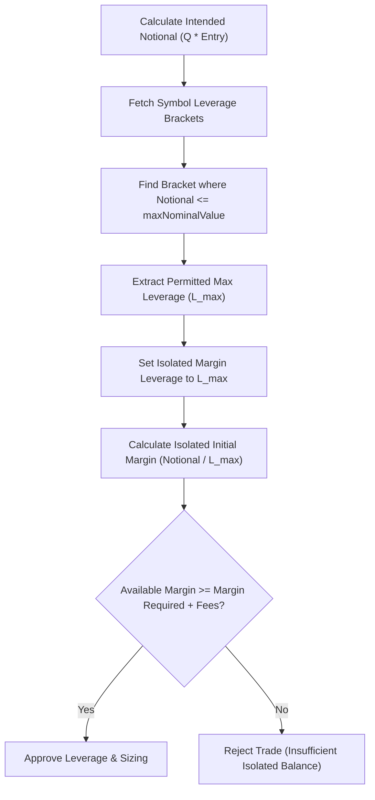

# Binance Futures HA Trading Bot — Risk Management & Position Sizing Model

**Document Version:** 1.0.0  
**Phase:** P01 — Master Project Brief, Architecture & Foundation  
**Status:** Approved Foundation  

---

## 1. Core Risk Philosophy & Nominal Target

The risk engine is designed to ensure mathematical capital preservation. Every trade must satisfy rigorous sizing, margin, and exchange-constraint checks before any order is submitted.

### 1.1 Nominal Risk Target
- **Nominal Risk Budget ($R_{budget}$):**
  $$R_{budget} = \text{Current Futures Account Equity} \times 0.10$$
- **Account Equity Definition:** Net wallet balance plus unrealized PnL (retrieved from `/fapi/v2/account` field `totalMarginBalance` or `totalCrossWalletBalance` in USDT).
- **Nominal vs Realized Risk Disclosure:** The 10% figure represents the **nominal mathematical risk target** based on initial stop distance. It is not an absolute guarantee of maximum realized loss. Realized losses can exceed 10% in extreme conditions due to:
  1. Execution slippage on stop market orders during illiquid dumps/pumps.
  2. Exchange downtime, maintenance, or API latency.
  3. Market gaps over weekend breaks or liquidation cascades.
  4. Exchange fee tiers and funding rates.

---

## 2. Mathematical Position Sizing Formulation

### 2.1 Basic Stop Distance
Given Entry Price ($P_{entry}$) and Stop Loss ($P_{sl}$):
- **For LONG:** $\Delta P_{sl} = P_{entry} - P_{sl} > 0$
- **For SHORT:** $\Delta P_{sl} = P_{sl} - P_{entry} > 0$

If $\Delta P_{sl} \le 0$, the trade is mathematically invalid and immediately rejected.

### 2.2 Trading Costs & Friction Adjustments
To prevent transaction costs from secretly inflating realized risk beyond 10%, position sizing explicitly accounts for taker fees and slippage:

Let:
- $r_{fee} = 0.0005$ (0.05% estimated VIP 0 taker fee)
- $r_{slip} = 0.0005$ (0.05% estimated slippage buffer)

The expected loss at stop execution is:
$$\text{Loss}(Q) = Q \times \Delta P_{sl} + \text{Cost}_{entry}(Q) + \text{Cost}_{exit}(Q) + \text{Slippage}(Q)$$
Where:
- $\text{Cost}_{entry}(Q) = Q \times P_{entry} \times r_{fee}$
- $\text{Cost}_{exit}(Q) = Q \times P_{sl} \times r_{fee}$
- $\text{Slippage}(Q) = Q \times P_{entry} \times r_{slip}$

Setting $\text{Loss}(Q) = R_{budget}$, we solve for cost-adjusted quantity $Q_{adj}$:
$$Q_{adj} = \frac{R_{budget}}{\Delta P_{sl} + P_{entry} \cdot (r_{fee} + r_{slip}) + P_{sl} \cdot r_{fee}}$$

---

## 3. Exchange Precision & Constraint Filtering

Binance enforces strict trading rules via `/fapi/v1/exchangeInfo` filters:

### 3.1 Step Size & Quantity Truncation (`LOT_SIZE`)
- Quantities must be an exact integer multiple of `stepSize`.
- **Mandatory Rule:** Always round **DOWN** to exchange step precision:
  $$Q_{step} = \left\lfloor \frac{Q_{adj}}{\text{stepSize}} \right\rfloor \times \text{stepSize}$$
- Rounding up is strictly prohibited as it would exceed the risk budget.

### 3.2 Minimum Quantity Filter
- If $Q_{step} < \text{minQty}$, the trade is **rejected**.
- Never artificially increase quantity to satisfy `minQty`.

### 3.3 Minimum Notional Filter (`MIN_NOTIONAL`)
- Notional value: $\text{Notional} = Q_{step} \times P_{entry}$.
- If $\text{Notional} < \text{notionalFilter.minNotional}$ (typically 5 or 20 USDT on Binance), the trade is **rejected**.
- Never increase quantity to satisfy `minNotional` if doing so increases risk beyond $R_{budget}$.

### 3.4 Maximum Quantity & Market Lot Size
- Ensure $Q_{step} \le \text{marketLotSize.maxQty}$.

---

## 4. Leverage Selection & Bracket Matching

Binance Futures imposes dynamic maximum leverage tiers based on position notional (`/fapi/v1/leverageBracket`).

### 4.1 Liquidation Price Safeguard
With high leverage (e.g. 20x to 125x), the estimated liquidation price could be tighter than the confirmed swing stop-loss price.

Let $MMR$ be the Maintenance Margin Ratio for the applicable bracket.
- **For LONG:**
  Estimated liquidation price $P_{liq} \approx P_{entry} \times (1 - \frac{1}{\text{Leverage}} + MMR)$.
  If $P_{sl} \le P_{liq}$, the position would liquidate before hitting the stop loss.
  **Enforced Rule:** If $P_{sl} \le P_{liq}$ (LONG) or $P_{sl} \ge P_{liq}$ (SHORT), the trade is **rejected**.

---

## 5. Hand-Calculated Verification Example

To ensure deterministic unit-testable validation, the following test case is established:

- **Futures Account Equity:** 1,000.00 USDT
- **Risk Target:** 10% $\rightarrow R_{budget} = 100.00\text{ USDT}$
- **Symbol:** `BTCUSDT`
- **Direction:** LONG
- **Entry Price:** 100.00 USDT
- **Stop-Loss Price:** 98.00 USDT
- **Basic Stop Distance:** $100.00 - 98.00 = 2.00\text{ USDT}$
- **Gross 3R Target:** $100.00 + (3 \times 2.00) = 106.00\text{ USDT}$
- **Expected Reward:** $50 \times 6.00 = 300.00\text{ USDT}$
- **Unadjusted Quantity:** $\frac{100.00}{2.00} = 50.0\text{ units}$
- **With 0.05% Fees & 0.05% Slippage:**
  $$\text{Friction} = 100 \times (0.0005 + 0.0005) + 98 \times 0.0005 = 0.10 + 0.049 = 0.149\text{ USDT/unit}$$
  $$Q_{adj} = \frac{100.00}{2.00 + 0.149} = \frac{100.00}{2.149} \approx 46.53327\text{ units}$$
- **With Step Size 0.001:** Truncated to 46.533 units.
- **Max Realized Risk at Stop:** $\le 100.00\text{ USDT}$.

---

## 6. Global Position Lock & Concurrency Control

1. **Max Allowed Positions:** Exactly **1** globally.
2. **Account Mutex:** An atomic lock (`threading.Lock` or SQLite row-level lock) must be acquired before calculating risk or submitting any entry order.
3. **No Pyramid / Scale-In:** The bot does not scale into existing trades or open concurrent positions on secondary symbols.
4. **Order Reconciliation Prerequisite:** Lock cannot be released until:
   - Position quantity is verified zero on exchange.
   - Both SL and TP orders are verified cancelled / expired.
   - SQLite state transitions to `CLOSED`.
