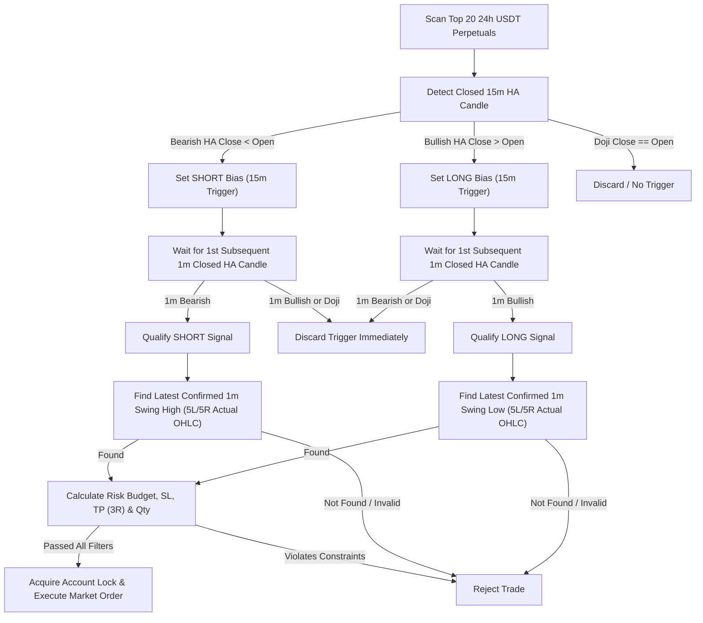

# Binance Futures HA Trading Bot — Strategy Rules & Execution Mechanics

**Document Version:** 1.0.0  
**Phase:** P01 — Master Project Brief, Architecture & Foundation  
**Status:** Approved Foundation  

---

## 1. Strategy Overview

The strategy combines multi-timeframe directional trend identification using synthetic Heikin-Ashi candles with market-structure stop-loss placement derived from actual price swing pivots. It trades high-momentum instruments selected dynamically from the top 24-hour gainers on Binance USDⓈ-M Futures.

---

## 2. Market Universe Selection

1. **Exchange Segment:** Binance USDⓈ-M Futures (`/fapi/v1/exchangeInfo`).
2. **Contract Eligibility Criteria:**
   - `contractType == "PERPETUAL"`
   - `quoteAsset == "USDT"`
   - `status == "TRADING"`
3. **Ranking Metric:**
   - 24-hour percentage price change (`priceChangePercent`) from `/fapi/v1/ticker/24hr`.
   - Sorted in descending order (highest percentage gainer first).
4. **Universe Size:** Top 20 eligible symbols.
5. **Deterministic Tie-Breaking:**
   - In case two symbols share identical `priceChangePercent`:
     1. Primary tie-breaker: 24-hour quote volume (`quoteVolume` descending).
     2. Secondary tie-breaker: Lexicographical symbol name ascending (`BTCUSDT` before `ETHUSDT`).
6. **Liquidity Filters:**
   - Exclude symbols with 24h quote volume $< 1,000,000\text{ USDT}$ (configurable via `SCANNER_MIN_QUOTE_VOLUME_24H`).
7. **Refresh Interval:**
   - Executed automatically every 60 seconds.
8. **In-Flight Symbol Protection:**
   - A symbol that qualified at the 15m trigger remains eligible for its 1m confirmation window even if it drops out of the top 20 during a scanner refresh within that window.
   - However, no *new* 15m triggers may be established for symbols outside the active top 20.

---

## 3. Heikin-Ashi Calculation Specification

All directional decisions rely strictly on completed candles (`is_closed == True`).

### 3.1 Formulas
Let actual candle $k_t$ have prices $(Open_t, High_t, Low_t, Close_t)$. The synthetic Heikin-Ashi candle $HA_t = (HA\_Open_t, HA\_High_t, HA\_Low_t, HA\_Close_t)$ is computed as follows:

1. **HA Close:**
   $$HA\_Close_t = \frac{Open_t + High_t + Low_t + Close_t}{4}$$

2. **HA Open:**
   - For initial bar ($t=0$ or first available history):
     $$HA\_Open_0 = \frac{Open_0 + Close_0}{2}$$
   - For all subsequent bars ($t > 0$):
     $$HA\_Open_t = \frac{HA\_Open_{t-1} + HA\_Close_{t-1}}{2}$$

3. **HA High:**
   $$HA\_High_t = \max(High_t, HA\_Open_t, HA\_Close_t)$$

4. **HA Low:**
   $$HA\_Low_t = \min(Low_t, HA\_Open_t, HA\_Close_t)$$

### 3.2 Directional Classification
With floating-point epsilon $\epsilon = 10^{-8}$:
- **Bullish:** $HA\_Close_t - HA\_Open_t > \epsilon$
- **Bearish:** $HA\_Open_t - HA\_Close_t > \epsilon$
- **Doji / Neutral:** $|HA\_Close_t - HA\_Open_t| \le \epsilon$

---

## 4. Multi-Timeframe Trigger & Confirmation Workflow

### 4.1 15-Minute Directional Trigger
- Evaluated when a 15m candle closes (e.g. 10:15:00, 10:30:00, 10:45:00 UTC).
- **Bullish 15m HA:** Generates a `LONG` bias trigger for the symbol.
- **Bearish 15m HA:** Generates a `SHORT` bias trigger for the symbol.
- **Doji 15m HA:** Generates no trigger. Any existing trigger for the symbol is cleared.
- **Validity Window:** The trigger remains active until the end of that 15m period (i.e. strictly up to the close of the next 15m candle).

### 4.2 1-Minute Single-Shot Confirmation
- Once a 15m trigger is established at $T_{15}$, the strategy waits for the **first subsequent newly closed 1m candle** $T_{1m\_first}$ (e.g., if 15m candle closes at 10:15:00, the first 1m candle closes at 10:16:00).
- **Long Confirmation:**
  - If $HA\_Close_{1m} > HA\_Open_{1m}$: The signal **qualifies**.
  - If $HA\_Close_{1m} \le HA\_Open_{1m}$ (Bearish or Doji): The trigger is **discarded immediately**.
- **Short Confirmation:**
  - If $HA\_Close_{1m} < HA\_Open_{1m}$: The signal **qualifies**.
  - If $HA\_Close_{1m} \ge HA\_Open_{1m}$ (Bullish or Doji): The trigger is **discarded immediately**.
- **Strict Single-Shot Rule:** The engine **never** waits for candle 2, 3, etc. If the first 1m candle does not confirm, the trigger is dead.

---

## 5. Swing Detection Specification (Stop-Loss Reference)

### 5.1 Price Source
Swing detection uses **actual market OHLC data**, never synthetic Heikin-Ashi values.

### 5.2 5-Left / 5-Right Pivot Rules
A candle at index $i$ is a confirmed pivot if and only if:
- **Swing Low (Pivot Low):**
  $$Low_i < Low_j \quad \forall j \in \{i-5, i-4, i-3, i-2, i-1\} \quad \text{AND} \quad Low_i < Low_k \quad \forall k \in \{i+1, i+2, i+3, i+4, i+5\}$$
- **Swing High (Pivot High):**
  $$High_i > High_j \quad \forall j \in \{i-5, i-4, i-3, i-2, i-1\} \quad \text{AND} \quad High_i > High_k \quad \forall k \in \{i+1, i+2, i+3, i+4, i+5\}$$

### 5.3 Confirmation & Timing (No Look-Ahead)
- The pivot at index $i$ is confirmed **only after candle $i+5$ has closed**.
- Earlier unconfirmed pivots cannot be used.
- Equal highs or lows do not satisfy the strict inequality and are rejected.

### 5.4 Stop-Loss Distance & Buffer
Let $SwingPrice$ be the price of the latest eligible confirmed 1m swing pivot within a lookback window of 100 bars:
- **LONG Trade:**
  $$SL = SwingLow \times (1 - \text{buffer})$$
  *(where buffer is configurable, default: 0.1% / 0.001)*
  - Requirement: $SL < EntryPrice$. If $SL \ge EntryPrice$, reject the trade.
- **SHORT Trade:**
  $$SL = SwingHigh \times (1 + \text{buffer})$$
  - Requirement: $SL > EntryPrice$. If $SL \le EntryPrice$, reject the trade.
- If no valid confirmed pivot exists in the lookback window, the trade is **rejected**.

---

## 6. Reward-to-Risk Ratio & Take-Profit Calculation

The strategy enforces a fixed **3:1 gross reward-to-risk ratio (3R)**:

1. **Stop Distance ($\Delta_{stop}$):**
   - For LONG: $\Delta_{stop} = Entry - SL$
   - For SHORT: $\Delta_{stop} = SL - Entry$

2. **Take-Profit Level ($TP$):**
   - For LONG: $TP = Entry + (3 \times \Delta_{stop})$
   - For SHORT: $TP = Entry - (3 \times \Delta_{stop})$

3. **Validation:**
   - Both $SL$ and $TP$ prices must conform to exchange `PRICE_FILTER` tick size (`tickSize`).
   - Rounding of $SL$:
     - For LONG: round **DOWN** to nearest tick size (maintains $\ge$ intended distance).
     - For SHORT: round **UP** to nearest tick size.
   - Rounding of $TP$:
     - For LONG: round **UP** to nearest tick size.
     - For SHORT: round **DOWN** to nearest tick size.
